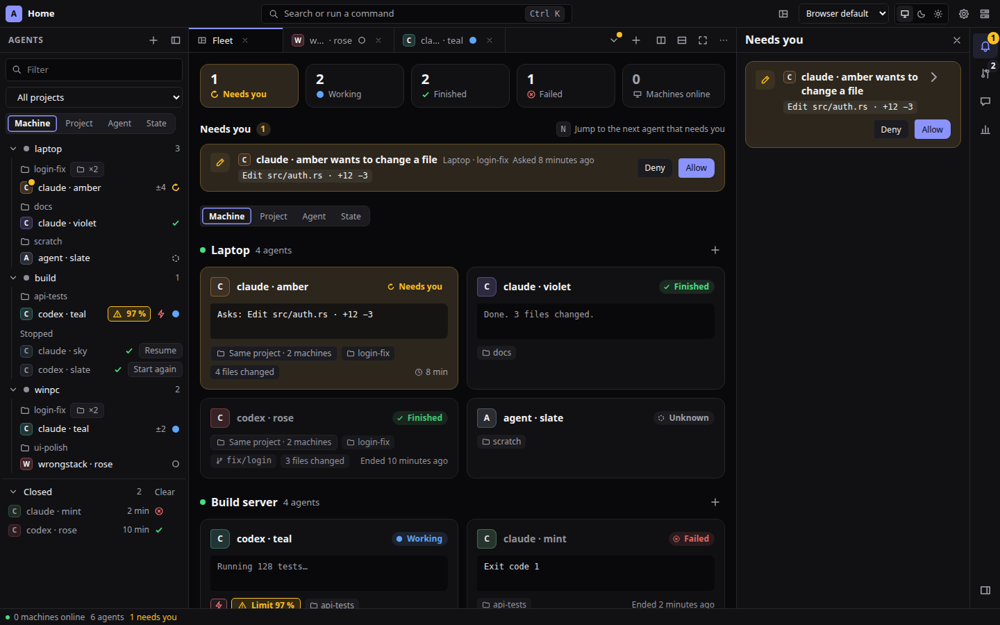

# Agora

**One console for your coding agents across Linux, macOS, and Windows.**

Run a **node** on each machine that runs agents, then connect the nodes to one **hub**. Open the hub in
a browser, terminal client, or desktop app to see which agents are working, answer approvals, and review
workspace changes. Nodes keep agents running and buffer events when the hub is unreachable.

Pre-alpha. See the [changelog](CHANGELOG.md) for released changes and the [capability matrix](docs/capabilities.md)
for what's implemented and where it has been tested.

[](docs/screenshots/README.md)

## Get started

1. Install the newest release. The script checks its checksum and release signature, puts `agora` on your PATH
   (no root or administrator rights) and pins the release key for `agora update`:
   ```sh
   curl -fsSL https://raw.githubusercontent.com/ersinkoc/Agora/main/install.sh | sh     # Linux, macOS
   ```
   ```powershell
   irm https://raw.githubusercontent.com/ersinkoc/Agora/main/install.ps1 | iex           # Windows PowerShell
   ```
   Or download the binary from [GitHub Releases](https://github.com/ersinkoc/Agora/releases) and
   [verify it yourself](#install-a-release).
2. Run `agora` from a project folder and choose **Start Agora here**. For a new Git repository, make the first
   commit before running setup in that folder. The first run starts a local hub and node in the background
   and signs you in. It opens the browser on a desktop and the terminal client over SSH or on Linux without
   a display. Use `agora --ui web` or `agora --ui tui` to choose.
3. Choose **Start an agent** and select a folder. Pick **Shell** to try a live terminal with no coding agent
   installed, or pick an agent already installed and signed in on that machine.

You can also start a session from another terminal on the same machine.

```sh
agora agent start shell --cwd .
agora agent start codex --cwd . --worktree  # Requires Codex and a Git checkout
```

Multiple agents can share a folder, including one outside Git. Use `--worktree` for a separate Git working
copy. To group checkouts and their board across machines, run `agora project init --cwd .` and share the
resulting `.agent-project.json` with the other checkouts. Files still move through your usual Git workflow.
See the [getting started guide](docs/getting-started.md).

### Add another machine

Allow network connections when setting up the hub. On the hub machine, run `agora pair open`. On the new
machine, run `agora join` and verify the discovered hub's fingerprint against the hub's screen. If discovery
is unavailable, give the address with `agora join HUB-ADDRESS`. Compare the six-digit number on both
machines before approving on the hub. Then run `agora` on the new machine to start its node.
See the [pairing walkthrough](docs/getting-started.md#add-a-second-machine).

For an SSH-only machine, the hub can maintain a reverse tunnel and install and enroll the node with
`agora hub ssh install NAME`. For a hub on a VPS or a browser on another network, see the
[SSH installation decision](docs/adr/0034-install-a-node-over-ssh.md) and the [remote hub guide](docs/guides/remote-hub.md).

## What works today

- **Supervise agents.** View live terminals side by side, see agent state and pending approvals, and browse
  workspace files, Git diffs, and commit history. The Usage panel shows tokens and context where available,
  including subscription plan limits for Codex. [Screenshots](docs/screenshots/README.md)
- **Start agents on any connected machine.** Choose a folder and, where the agent kind supports them, set
  model, effort, and launch options in the web app. **Settings → Agents** shows which tools each machine
  reports. Run `agora doctor` on the machine for local diagnostics. [Agent manifests](manifests/agents/README.md)
- **Coordinate across machines.** Agents use MCP to exchange messages, claim shared tasks and file leases,
  and hand off work. From a Backlog card on the web board, give a task to a running agent in that project
  or start a new agent for it. In the TUI, `b` opens the board and gives a Backlog task to a running agent.
  Agents can request a helper on their own node with signed approval.
  [Task board](docs/ux/task-board.md) · [Mesh tools](docs/specs/mesh-tools.md) ·
  [Board and dispatch decision](docs/adr/0095-a-project-has-a-kanban-board-and-a-task-can-be-dispatched-to-an-agent.md)
- **Reconnect to live agents.** Closing a client or losing the hub link leaves agent processes running.
  On Linux and macOS, unconfined terminal and structured agents launched through the background holder
  can also survive a node restart. Windows and confined agents rely on session resume when available.
  [Restart and resume behavior](docs/getting-started.md)
- **Script it.** `agora agent prompt ID TEXT --wait` waits for the turn and exits with a code for idle, blocked
  (it needs you), exited or timeout; `agora agent wait ID --until blocked` and `agora events --json` follow agents
  from a shell. [Script agents from a shell](docs/getting-started.md#script-agents-from-a-shell)
- **Choose a client.** The embedded web app works on desktop and phone-sized screens and ships in English
  and Turkish. The TUI covers terminals, chat, and approvals. The Tauri desktop app wraps the web app and
  pins the hub CA. [Desktop setup](apps/desktop/README.md)
- **Make it yours.** Layouts, twenty built-in and starter themes in both clients (and colour files imported
  from iTerm2, Alacritty, Ghostty, Windows Terminal and VS Code), themes synced through the hub between your
  windows, keybindings as data with a full command palette, and sandboxed plugin panels with an author kit
  (`agora plugin new | check | pack`). [Themes](docs/ux/themes.md) · [Layouts](docs/ux/layout.md) ·
  [Keybindings](docs/ux/keybindings.md) · [Plugins](docs/ux/plugins.md)
- **Run it in the background.** `agora service install` starts the hub and node roles configured on a machine
  at login. The hub supports passkeys, audit export, and backup and restore. [Getting started](docs/getting-started.md)

### Agent integrations

| Integration | Built-in kinds | Recorded validation |
| --- | --- | --- |
| Shell | `shell` | Live terminal without an agent account |
| Native terminal with state detection | `claude-code`, `codex`, `wrongstack` | Real terminal captures for all three, plus a live mesh task with WrongStack |
| Structured chat via ACP | `wrongstack-acp`, `opencode-acp`, `antigravity-acp` | A real WrongStack turn through the node. OpenCode and Antigravity still await an end-to-end run with the real program |
| External adapter | Install or provide a compatible adapter process | Adapter host and conformance tests |

Claude Code and Codex use their native terminal integrations. Structured agents can supply chat, plans,
tool calls, diffs, and approvals. See the [integration guide](docs/architecture.md#integration-levels) and
[real-agent test record](docs/backlog/phase-4.md).

## Project direction

- **Agent setup.** Use `agora agent install NAME --list FILE --root-key KEY` to install a
  single executable from a signed package list, with confirmation at the local terminal. Terminal agent kinds
  can use the installed executable. Installation and updates from the web app are planned.
  [Agent package decision](docs/adr/0087-install-and-update-coding-agents-from-the-window.md)
- **Session tools.** A structured agent's transcript is kept on the node (30 days), and an agent taken up from
  the holder or resumed shows its earlier turns. An agent's local web server opens in a Preview pane through
  the hub, on an origin of its own per forward. Paging through that history in the window is planned.
  [Chat history decision](docs/adr/0089-the-chat-history-survives-the-node-and-is-read-in-pages.md) ·
  [Web preview decision](docs/adr/0088-preview-an-agents-local-web-server-in-the-window.md)
- **Remote operations.** Signed binary updates and automatic certificate renewal are implemented. Live node
  upgrades and standby hub takeover are still on the roadmap. Terminal streams currently relay through one
  authoritative hub. [Capabilities](docs/capabilities.md) · [Roadmap](docs/roadmap.md)

The [three-machine LAN test](docs/backlog/lan-test-findings.md) records cross-node messaging and shared
tasks with Linux, macOS, and Windows 11 nodes, including real Claude Code and Codex on Windows. The
[SSH validation](docs/reviews/2026-11-09-real-ssh-run.md) used a local SSH server.

## Security and isolation

The node verifies approvals signed by devices it trusts. For routed actions that use grants, the node's
`signed_commands` policy determines when to require one. Under the default single-owner policy, legacy
routed commands rely on hub authorization. Selected-folder inspection and launch use request-specific
signatures. Browser and desktop signing keys depend on the integrity of the web app served by the hub.
[Threat model](docs/security/threat-model.md)

Git worktrees separate working copies. Use node sandbox policy for process confinement where supported.
Confinement is opt-in and its limits vary by platform. File leases coordinate cooperating agents and
node-mediated writes. [Sandbox recipes](docs/security/sandbox-recipes.md)

## Install a release

`install.sh` (Linux, macOS) and `install.ps1` (Windows) do everything below for you: they download the binary for this machine
with its `.sha256` and `.sig`, check both against the [release verification key](docs/security/release-key.pub) (they need
`ssh-keygen`, OpenSSH 8.1 or newer; Windows has it as the OpenSSH Client optional feature), install it for your user
(`~/.local/bin`, or `%LOCALAPPDATA%\Programs\agora`; over your `agora` already on PATH when it is yours), add that folder to PATH
and save the key as `~/.agora/release-key`. On a machine already set up they offer to start Agora at login
(`agora service install`); on a new one `agora` asks that on its first run. They never stop or restart a running Agora. Options:
`--version X.Y.Z`, `--dir DIR`, `--no-modify-path`, `--service`, `--no-service` (`-Version`, `-Dir`, ... in PowerShell). To pass
them through a pipe: `curl -fsSL .../install.sh | sh -s -- --version 0.3.43`.

By hand: releases include the web app. Choose the binary for Linux (x64 or ARM64), macOS (Intel or Apple Silicon),
or Windows (x64), and download its `.sha256` and `.sig` files. Save the repository's
[release verification key](docs/security/release-key.pub) as `release-key.pub` in the same directory.

Use the downloaded filename in place of the Linux x64 example. This works in a POSIX shell with OpenSSH.

```sh
f=agora-x86_64-unknown-linux-gnu
if command -v sha256sum >/dev/null; then
  sha256sum -c "$f.sha256"
else
  shasum -a 256 -c "$f.sha256"
fi &&
  ssh-keygen -Y verify -f release-key.pub -I agora-release -n file -s "$f.sig" < "$f"
```

After verification, make the binary executable on Linux or macOS (`chmod +x "$f"`), put it on your PATH,
and run `agora doctor`. On Windows, PowerShell's `Get-FileHash -Algorithm SHA256` can compute the hash to
compare with the checksum file. macOS releases use ad hoc signing. If Gatekeeper blocks a browser download
after you've verified it, remove the quarantine flag with `xattr -d com.apple.quarantine "$f"`. Save the
trusted release key as `~/.agora/release-key` (or `$AGORA_HOME/release-key`) to use `agora update`.

## Try it (from source)

Use the Rust toolchain pinned in this repository and Node.js 22 as in CI. Build the web app first so the
binary embeds it. See the [platform setup guides](docs/fordevs/) for prerequisites.

```sh
(cd apps/web && npm ci && npm run gen && npm run build)
cargo build --locked --release -p agora
target/release/agora
```

On Windows, use the [Windows development guide](docs/fordevs/for_windows_dev.md) and run
`target\release\agora.exe`. For a terminal-only build, you can build the Rust binary directly. A hub with
no embedded web app can serve a separate build via `agora hub run --web DIR`.

<details>
<summary>Start the hub and node manually</summary>

The hub and node each run in their own terminal. Start the hub, then use another terminal to get an enrollment
code from it and enroll the local node.

```sh
target/release/agora hub run --listen 127.0.0.1:7443

target/release/agora hub code
target/release/agora node enroll --hub wss://localhost:7443 --ca ~/.agora/hub/ca.pem --code XXXX-XXXX --id laptop
target/release/agora node run --project /path/to/myproject
```

Open `https://localhost:7443/` and sign in with the separate one-time sign-in code printed by the hub.
Run `agora hub login` to issue another code. The browser needs to trust the local hub's certificate.

</details>

## Contributing

Run `just check` for the Rust, localization, and documentation checks. See
[CONTRIBUTING.md](CONTRIBUTING.md), the [architecture map](docs/map.md), and the [backlog](docs/backlog/).
Coding agents should read [AGENTS.md](AGENTS.md).

## License

[Apache-2.0](LICENSE). Contributions use the Developer Certificate of Origin.
