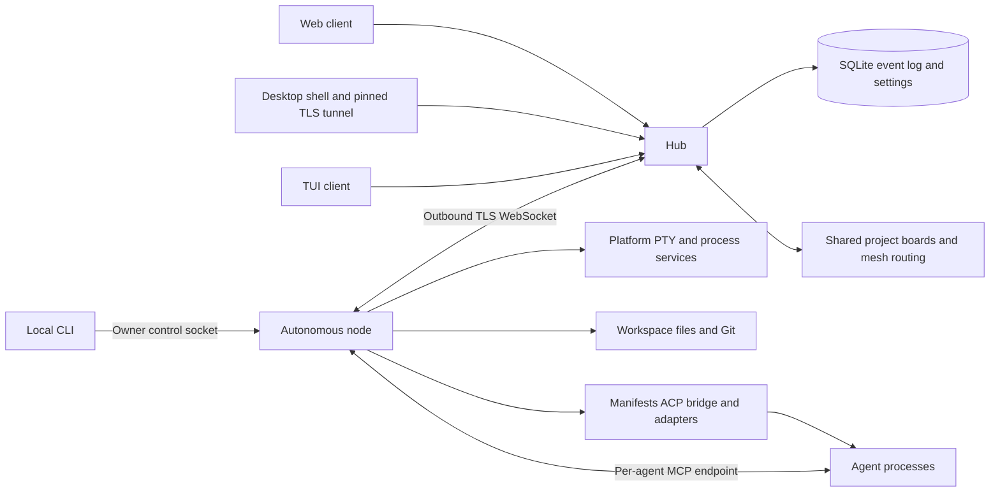

# Architecture analysis

Date: 2026-11-13

Baseline: `main` at `4016aa550275cc7a6525abde9e14cdd76271895c`

Scope: repository architecture, implementation boundaries, operational risks and improvement priorities.

The existing architecture fits the product: one hub coordinates autonomous nodes, while manifests and adapter processes integrate coding agents. The strongest next investment is durability, bounded resource use, explicit security policy and evidence of behavior under failure and load. These improvements can retain the current topology and most crate boundaries.

This assessment distinguishes code observations, repository-recorded validation and proposed improvements. It is a static architecture review, not a newly executed security audit or performance certification. Other worktrees, unmerged changes and the version of the connected mesh service are outside the baseline.

## Current architecture

Terminal output travels on separate dynamic streams through the hub relay. It is not appended to the event store. The optional direct client-to-node data path is accepted in ADR-0023, but the inspected web transport uses the hub relay. A node retains local execution when the hub is unavailable; access to central coordination has separate availability rules. [S1, S4, S5, S7]

### Components and ownership

| Component | Existing responsibility | Architectural value |
| --- | --- | --- |
| `agora-core` | Agent state, identities, projects, worktrees, tasks, leases and event bookkeeping | Plain domain data with no package dependencies; time can be supplied explicitly |
| `agora-protocol` and `schema/` | Protobuf messages, generated codecs, handshakes, capabilities and frames | Shared wire contract and compatibility checks |
| `agora-platform` | PTY/ConPTY, local IPC, process information, confinement and platform helpers | OS behavior has a dedicated boundary |
| `agora-vt` | Terminal abstraction and Alacritty backend | Detection and terminal interpretation stay independent of client layout |
| `agora-adapters` | TOML manifests, detection, MCP injection, ACP, adapter hosting and signed packages | New agent kinds can be integrated without embedding each agent in the domain model |
| `agora-node` | Supervision, local commands, files/Git, approvals, grants, mesh endpoints and event buffering | Execution and policy remain on the machine |
| `agora-mesh` | Broker state and MCP tool contracts | Coordination logic is separable from sockets and clocks |
| `agora-hub` | Enrollment, authentication, routing, projections, event storage, boards, audit, notifications and web serving | One ordering authority for shared coordination |
| `agora-i18n` and `locales/` | Fluent catalogs and localization validation | Human text stays separate from protocol errors |
| `agora-tui` | Secondary client, terminal/chat interaction and signed decisions | A client usable without a graphical desktop |
| `agora` | Single executable and command composition | Compact distribution and one entry point |
| `apps/web` | React, TypeScript, Vite, local event projection and xterm.js | Navigation can read local state while terminal streams update separately |
| `apps/desktop` and `agora-desktop-tunnel` | Tauri shell and a loopback tunnel pinned to the hub CA | Reuses the primary UI and centralizes desktop trust handling |
| `agora-fake-agent`, `bench/` and `tools/schema-check` | Integration fixtures, benchmark harness and compatibility tooling | Repeatable evidence without production accounts |

The main Cargo workspace contains 15 packages, including test and tooling packages. The desktop shell has its own workspace. Six agent manifests and English/Turkish locale directories are present. Cargo metadata distinguishes normal dependencies from test dependencies: for example, the desktop tunnel's hub dependency and the TUI's node dependency are test-only, not production coupling. [S2]

### Authority and data flow

| Data or decision | Authority | Failure behavior to preserve |
| --- | --- | --- |
| Process, terminal, file and Git facts | Node | Hub failure must not terminate running agents |
| Shared task claims and leases | Hub board | Shared-board operations fail closed when the hub is unreachable; local execution continues |
| Permission to execute sensitive actions | Node policy and trusted device signatures | Hub routing cannot manufacture a device signature |
| User visibility and roles | Hub, with node device limits for signed actions | Snapshot, live stream and command access must agree |
| Project identity | Explicit portable ID or documented Git/folder derivation | Identity groups sessions; it grants no access and transfers no files |
| Browser display | Client projection of snapshot plus positioned events | Reconnect resumes or replaces state without creating runtime facts |

The shared-board broker is not merely a projection of the event log. It also persists board snapshots in settings, while events feed client views. Keeping those representations consistent is an important durability boundary. [S3, S6]

## What is implemented and what remains conditional

| Area | Evidence in this baseline | Boundary |
| --- | --- | --- |
| Autonomous execution | Supervisor does not depend on a hub; node has a capped disk event buffer | A node daemon restart differs from a network reconnect and may end its processes |
| Replay after event loss | Resync support exists in uplink, hub sessions/storage and node announcements | Lost history remains lost; resync reconstructs present facts |
| Running agents during resync | ADR-0055 logic and shared-board regression tests exist | Test sources were inspected, not executed for this assessment |
| L1 integration | Claude Code, Codex and WrongStack manifests and terminal fixtures exist | Detection remains an inference when no structured report exists |
| L2 and L3 | ACP client/bridge and external adapter host exist | Real integrations have different validation coverage; OpenCode's manifest explicitly says a real bridge run is pending |
| Shared coordination | Project boards, handover, tasks, leases and cross-node routing exist | Leases cannot intercept an agent's direct shell writes |
| Signed authority | Approvals, grants and exact-request directory signatures exist | Coverage depends on the operation and node policy; see priority R1 |
| Team mode | Roles, project filtering, device limits and audit storage exist | Device ownership and member access to shared boards remain incomplete in the backlog |
| Windows | ConPTY, named pipes and process support exist | Confinement is disabled by default and has documented compatibility limits |
| Panel command | `hubcli::panel` derives and prints the hub URL and CA location | It does not create an offline panel, automatically log in or provide a reverse forwarder |
| Agent-created helpers | ADR-0057 is accepted | MCP tools do not include `agent_start`, `agent_wait` or `agent_output`; `AgentStarted` has no parent field in this baseline |
| Optional direct data path | ADR-0023 is accepted | The inspected client uses relay; ticket and path-switch behavior must be specified before implementation |

Sources: [S3, S4, S7, S8, S9, S10, S11]. Acceptance of an ADR establishes an approved direction; it does not establish implementation or production validation.

## Strengths to preserve

The hub/node division is well chosen. It separates central visibility from machine execution, works with outbound connections and makes hub outages survivable. ADR-0056's single-hub direction also avoids introducing competing authorities for approvals, tasks and leases.

The domain/runtime separation is substantive: `agora-core` has no dependencies, and the mesh broker takes caller-supplied time. This makes lifecycle and coordination behavior amenable to deterministic tests rather than requiring a live distributed environment for every check. [S2, S3]

The protocol has meaningful safeguards: schema sources, golden fixtures, a breaking-change check and capability negotiation. The node's signed approvals and grants provide a foundation for containing hub compromise. Neither should be weakened to simplify UI flows. [S4, S8, S12]

Terminal bytes bypass event persistence, and several output paths already use bounded queues with recovery for lagging subscribers. The renderer is abstracted. The recorded xterm comparison supports keeping the current DOM renderer for the measured scenarios; a renderer change should follow measurements on the target hardware. [S5, S7, S13]

The repository records real LAN findings as well as synthetic tests. That distinction matters: certificate behavior, small terminal screens, confinement and reconnect behavior have exposed issues that unit tests alone did not. [S10]

## Improvement priorities

Priorities below express recommended order. Code paths are identified precisely, but failure rates and capacity limits are not inferred from source inspection.

| ID | Priority | Improvement | Expected result |
| --- | --- | --- | --- |
| R1 | P0 before broader shared deployment | Make effective node security policy explicit during setup and diagnostics | Users can identify which actions remain authorized through hub trust alone |
| R2 | P1 | Make successful board mutations durably consistent | An acknowledged claim or handoff survives restart according to a documented contract |
| R3 | P1 | Bound subscription replay and shorten hub critical sections | A stale reconnect has a bounded effect on other nodes and clients |
| R4 | P1 | Add a measured restart and history strategy | Hub startup remains predictable as the event log grows |
| R5 | P1 | Complete resource admission and priority accounting | Aggregate load has explicit limits and overload behavior |
| R6 | P1 | Measure and implement large-list rendering | The 500-agent and 10,000-line diff budgets become enforceable |
| R7 | P1 | Reconcile documentation and implementation status | Product decisions use one accurate capability and evidence inventory |
| R8 | P2 | Add operational telemetry and recovery drills | Slowdowns and recovery failures can be localized to a component |
| R9 | P2 | Reduce internal responsibility concentration | Changes to lifecycle, transport and persistence can be reviewed independently |
| R10 | P2 | Implement accepted extensions in bounded slices | Helper agents and direct streams retain their approval and compatibility boundaries |

### R1 Make security policy explicit

`Policy::default` uses an empty signed-command list. The threat model explicitly records that legacy routed commands can then be driven by a compromised hub. With limited devices configured, the node supplies `SignedCommands::team_default` when the list is empty. Exact-request directory inspection and launch use a stronger signature path independently. It would therefore be inaccurate to call every remote start unsigned or to call every installation protected from hub compromise. [S8]

Setup and `doctor` should expose the effective policy: which operations require grants, whether any trusted devices are unrestricted, the active sandbox, and any unsupported controls. Offer clear local-development and shared-use profiles. Changing defaults or authority semantics requires the repository's ADR review before implementation.

Confinement should have an explicit capability matrix by OS and integration level. The threat model already names Linux Git/socket gaps, writable `.git` in selected checkouts, Windows limitations and the fact that localhost services can provide an escape from an offline network policy. Worktrees and advisory leases must not be presented as equivalent to OS confinement. [S8, S10]

Acceptance: fake agents exercise a policy matrix across routed legacy commands, directory launch, grants, approvals and limited devices; no signature from another node, expired grant or mismatched path succeeds. Setup and diagnostics describe the same effective rules.

### R2 Make board mutation durability explicit

`Hub::board_call` mutates the in-memory board, saves its snapshot with a discarded storage result, and emits client events with discarded results. The code calls persistence best effort after success. A failed write can therefore leave memory, stored board state and the client projection with different information. This is a source-level failure path; no disk-failure reproduction was run here. [S6]

Define a successful board operation as a durable commit of the board transition and the facts required to reconstruct it. Preserve the hub as the single authority. Stage the mutation or provide rollback, commit the durable representation, then publish and acknowledge. Extend the review to joins and handoff compensation, where the same consistency contract matters. If this changes the accepted persistence model, propose an ADR first.

Acceptance: inject a failed snapshot write, failed event append and process termination at each commit boundary. A restart must yield either the prior state with a failure response, or the committed new state with consistent task, lease and handoff ownership.

### R3 Bound subscription replay and hub critical sections

`Hub::ingest` holds the common inner lock while `session.event` performs storage work. `Hub::subscribe` holds that same lock while paging through all events after the supplied position and collecting them in a `Vec`. A client far behind can consequently make the amount of work and allocated replay memory depend on its entire backlog. `Hub::view` also clones the whole view. These are scaling risks, not a measured failure at the documented target load. [S5]

First add maximum replay events, bytes and age, then select the existing fresh-snapshot path beyond that budget. Measure lock hold time and storage latency. A dedicated ordered writer may later isolate synchronous storage from async connection tasks, but must preserve atomic ordering between persistence, projection and subscriber registration.

Acceptance: one client reconnects from a very old position during sustained ingestion. Its replay memory is bounded, other clients retain their latency target, and the snapshot/live boundary has no duplicate or missing position.

### R4 Keep restart cost predictable

`View::rebuild` starts at position zero and replays the full hub event log. Client snapshots are not durable projection checkpoints. Startup cost therefore grows with retained history; the 500 ms hub cold-start target needs a history-size dimension. [S5, S13]

Measure startup with representative event counts before selecting an optimization. A versioned, validated projection checkpoint plus replay of its tail is a natural option. Define migration, corruption fallback and backup behavior. Treat event archival as a separate retention decision: removing runtime history must not silently erase audit or cost evidence. Keep SQLite until measurements justify a backend change, as ADR-0049 already directs. [S11]

Acceptance: checkpoint plus tail produces the same projection as full replay; a corrupt checkpoint falls back safely; restore tests verify both board state and runtime reconstruction. Publish cold-start time and database size for each history size.

### R5 Bound aggregate load and protect input

The implementation already has client in-flight and node mesh-post limits, bounded terminal relay queues and lagging-client recovery. Some command, response and ordered-work queues remain unbounded, including the hub router and node uplink. Existing per-connection caps reduce risk, but do not by themselves define a global memory budget across all connections. [S7]

Inventory each queue's producer count, payload size, drain rate, admission limit and shutdown behavior. Add per-node and hub-wide limits where needed. An overload response or disconnect must have documented retry semantics; blindly retrying a command that may already have executed can duplicate effects. Measure input and approval latency during output floods and slow storage before choosing additional scheduling machinery.

Acceptance: bursty clients and a slow node cannot grow queue memory indefinitely; admission failure is explicit; another node's input and approvals continue within budget. Distinguish durable state events from terminal output that can recover through a snapshot.

### R6 Implement large-list rendering from measured cases

`Explorer` maps all expanded machine/folder/agent rows into DOM nodes. `DiffDialog` maps every file and every diff line. The design document requires virtualization for a 500-agent tree and a 10,000-line diff, but these components do not implement windowed rendering. The console's four-pane display cap is a useful existing bound. [S9, S13]

Benchmark those exact screens, then flatten visible tree rows and render only the viewport with overscan. Window large diffs while retaining search, selection and keyboard accessibility. Consider batching state notifications and more selective subscriptions if profiling shows event-driven derivation dominates. Do not coalesce away events needed for state correctness.

Acceptance: retain the existing 50 ms navigation, 300 ms diff first-paint and 60 fps scrolling targets under the named datasets. Check both themes, reduced motion, RTL and keyboard behavior. Revisit GPU or worker parsing only if real hardware measurements identify the terminal renderer/parser as the bottleneck.

### R7 Reconcile documentation with code and evidence

The README still says no manifest has been verified with real agents and that Windows has never run a real agent. The phase-4 backlog records real Claude Code, Codex and WrongStack captures, and the LAN findings record real Windows runs. `performance.md` calls ADR-0023 proposed although the ADR is accepted. It also promises a nightly suite, while the inspected benchmark workflow has only push and pull-request triggers. [S10, S12, S13]

Maintain one capability table with separate fields for decision status, implementation, automated evidence and real-machine evidence. Link the README and roadmap to it. Add small consistency checks where statuses can be checked mechanically; keep human evidence claims traceable to dated run notes. Preserve the distinction between L1 terminal support and L2/L3 structured support.

Acceptance: a reader can determine what this exact commit supports without reconciling conflicting README, ADR and backlog wording. An accepted but unimplemented feature cannot be marked available solely because its ADR merged.

### R8 Make failures observable and rehearsed

The observability design describes structured tracing, redaction, Prometheus metrics and trace IDs. The inspected runtime still uses direct error printing in important paths, and the hub/node manifests do not include `tracing`. A request ID is useful correlation but is not the full described cross-hop timing system. [S14]

Begin with ingest/storage latency, lock hold time, queue depth, oldest unacknowledged event, resync count, relay resets and approval latency. Keep terminal bytes and message bodies out of diagnostic bundles by default. Define an operational recovery target and an acceptable history-loss window separately: resync restores present state after buffer eviction, not the missing history. [S3, S15]

Automate a multi-node backup/restore drill, long disconnect with buffer overflow, client reload during commands and certificate revocation during open connections. The backup design explicitly lists the multi-node drill and built-in scheduling as unfinished.

Acceptance: each failed drill identifies the failing hop and recovery outcome without exposing credentials; restoration reports lost history ranges and preserves live-agent board ownership where the current protocol guarantees it.

### R9 Reduce concentration within existing crates

The node supervisor/daemon/control/Git modules and hub server/board modules combine broad responsibilities. The useful next boundary is internal: separate command authorization, lifecycle orchestration, routing, persistence and projection without adding services or exposing implementation detail to clients.

Use focused internal modules and small types that make ownership and commit points explicit. Retain test-only dependencies where they provide cross-component evidence. Introduce a new crate only when there is a reusable boundary that justifies the dependency and ADR cost. File length alone is not evidence of a defect.

Acceptance: a change to policy checks can be reviewed and tested without changing transport framing, and a persistence change has one clearly defined commit path. Existing protocol fixtures and behavioral tests remain valid.

### R10 Deliver accepted extensions in safe slices

ADR-0057 needs schema additions, parent identity, signed launch approval, helper limits, audit and client presentation. Begin with one local helper after one exact approval; test denial, expiry, parent exit and orphan behavior. Scoped grants and cross-node starts should follow only with the inherited confinement and scope limits preserved. The current source still explicitly tells agents they cannot start helpers. [S11]

ADR-0023 can reduce latency when a distant hub creates a hairpin between a nearby client and node. Its next prerequisite is the ticket/encryption/path-switch specification and representative network measurements. Keep the hub authoritative for control and the relay available as fallback. These are approved directions with remaining implementation work, not reasons to replace the topology.

## Recommended delivery sequence

| Package | Scope | Completion evidence |
| --- | --- | --- |
| A | Capability inventory, effective policy diagnostics and a reproducible load baseline | Accurate status table; policy matrix; recorded baseline on the chosen commit |
| B | Board transaction contract and bounded subscription replay | Fault injection and restart tests; bounded old-client replay under concurrent ingest |
| C | Projection checkpoint strategy, queue admission and operational metrics | History-size startup results; overload recovery; observable queue and storage behavior |
| D | Explorer/diff virtualization and browser performance gates | Large datasets meet existing budgets; both-theme and accessibility checks |
| E | Multi-node disaster drill and OS-specific integration matrix | Recorded Linux/macOS/Windows outcomes with supported and refused paths explicit |
| F | Helper-agent implementation, followed by measured direct-path work | Signed helper lifecycle tests; approved wire fixtures; path-switch ordering and fallback proof |

These packages should become separate issues scoped to the named crates. Any change to authority, published messages, crate boundaries or dependency policy follows the repository's ADR process. This report does not change a decision or implement any package.

## Validation boundary

The assessment inspected the component sources referenced below, all numbered ADR status headers, selected accepted decisions, schemas, manifests, architecture/design/backlog documents and CI definitions. `cargo metadata --offline --no-deps --format-version 1` succeeded and supplied the package inventory and dependency kinds.

All 60 local Markdown source links resolve in the isolated worktree. `scripts/check-docs.sh` passed under Git Bash. Whitespace validation passed with `git diff --no-index --check` against the new file so that the untracked report is included.

Builds, Rust/web tests, benchmarks, browser screenshots, live SSH flows, real-agent interactions and hosted CI results were not executed or certified for this report. Historical measurements and real-machine results above are explicitly attributed to repository documents. The deliverable changes only this review file in an isolated worktree.

## Source references

- **S1**: [Architecture](../architecture.md), [vision](../vision.md), [glossary](../glossary.md).
- **S2**: [Workspace](../../Cargo.toml), [core dependencies](../../crates/agora-core/Cargo.toml), [web dependencies](../../apps/web/package.json), [desktop tunnel dependencies](../../crates/agora-desktop-tunnel/Cargo.toml), [TUI dependencies](../../crates/agora-tui/Cargo.toml).
- **S3**: [Supervisor](../../crates/agora-node/src/supervisor.rs), [disk event buffer](../../crates/agora-node/src/event_buffer.rs), [node resync announcements](../../crates/agora-node/src/daemon.rs), [resync regression sources](../../crates/agora/tests/hub_link.rs), [mesh broker](../../crates/agora-mesh/src/broker.rs).
- **S4**: [Protocol specification](../specs/protocol.md), [event schema](../../schema/agora/v1/events.proto), [protocol fixtures](../../crates/agora-protocol/tests/golden.rs).
- **S5**: [Hub](../../crates/agora-hub/src/hub.rs), especially `view`, `ingest`, `subscribe` and `publish`; [projection rebuild](../../crates/agora-hub/src/projection.rs); [SQLite store](../../crates/agora-hub/src/store.rs).
- **S6**: [Hub board mutation and persistence](../../crates/agora-hub/src/hub.rs), `board_call`, `board_joined` and `board_revert`; [board state](../../crates/agora-hub/src/board.rs); [shared board ADR](../adr/0039-shared-project-board.md).
- **S7**: [Hub router](../../crates/agora-hub/src/router.rs), [connection server](../../crates/agora-hub/src/server.rs), [node uplink](../../crates/agora-node/src/uplink_client.rs), [terminal actor](../../crates/agora-node/src/terminal.rs), [web connection](../../apps/web/src/net/live.ts).
- **S8**: [Threat model](../security/threat-model.md), [grants](../../crates/agora-node/src/grants.rs), [device limits](../../crates/agora-node/src/limits.rs), [policy defaults and team fallback](../../crates/agora-node/src/daemon.rs), [directory authorization](../../crates/agora-node/src/directory.rs).
- **S9**: [Explorer](../../apps/web/src/components/Explorer.tsx), [diff dialog](../../apps/web/src/components/DiffDialog.tsx), [console](../../apps/web/src/components/Console.tsx), [renderer](../../apps/web/src/terminal/renderer.ts), [client projection](../../apps/web/src/net/view.ts).
- **S10**: [README](../../README.md), [phase 4](../backlog/phase-4.md), [phase 6](../backlog/phase-6.md), [phase 7](../backlog/phase-7.md), [LAN findings](../backlog/lan-test-findings.md), [OpenCode manifest](../../manifests/agents/opencode-acp.toml).
- **S11**: [Direct data path](../adr/0023-direct-data-path.md), [team mode](../adr/0049-team-mode-users-roles-and-audit-first.md), [resync](../adr/0054-node-resync-after-lost-events.md), [board preservation](../adr/0055-resync-keeps-running-agents-board-work.md), [single hub and panel](../adr/0056-one-hub-every-node-reaches-the-panel.md), [helper agents](../adr/0057-agents-start-agents.md), [MCP tool list](../../crates/agora-mesh/src/mcp.rs), [panel command](../../crates/agora/src/hubcli.rs).
- **S12**: [CI](../../.github/workflows/ci.yml), [benchmark workflow](../../.github/workflows/bench.yml), [release workflow](../../.github/workflows/release.yml), [schema checker](../../tools/schema-check/Cargo.toml).
- **S13**: [Performance budgets and recorded measurements](../design/performance.md).
- **S14**: [Observability design](../design/observability.md), [hub dependencies](../../crates/agora-hub/Cargo.toml), [node dependencies](../../crates/agora-node/Cargo.toml).
- **S15**: [Backup and restore](../design/backup-restore.md).
