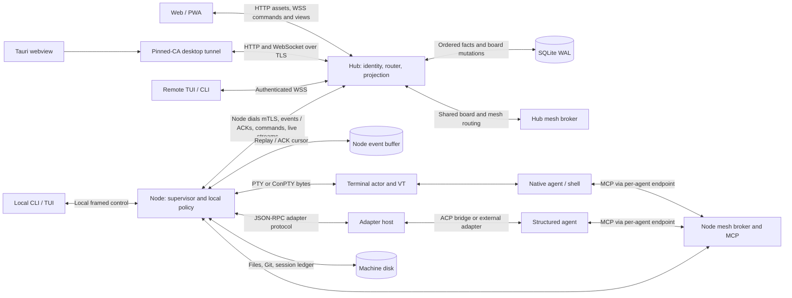

# Agora architecture report

## Contents

1. [Purpose and scope](#1-purpose-and-scope)
2. [Component map and dependencies](#2-component-map-and-dependencies)
3. [Protocol, event store and data paths](#3-protocol-event-store-and-data-paths)
4. [Node runtime and platform boundary](#4-node-runtime-and-platform-boundary)
5. [Hub, identity and outage behavior](#5-hub-identity-and-outage-behavior)
6. [Mesh, shared board and helpers](#6-mesh-shared-board-and-helpers)
7. [Clients and state-derived views](#7-clients-and-state-derived-views)
8. [Agent integration and extension](#8-agent-integration-and-extension)
9. [Invariants and enforcement](#9-invariants-and-enforcement)
10. [Security and approval authority](#10-security-and-approval-authority)
11. [Performance budgets and evidence](#11-performance-budgets-and-evidence)
12. [Decision record, open questions and roadmap](#12-decision-record-open-questions-and-roadmap)
13. [Risks, gaps and backlog](#13-risks-gaps-and-backlog)

This report reviews the 2026-11-22 repository checkout at HEAD `3cc91373` (workspace version `0.3.32`), including local edits present during review. “Built” means an implementation is present in this checkout. Test and field evidence cited below come from the repository. This report adds no runtime or benchmark measurements. [Cargo.toml](../../Cargo.toml), [docs/capabilities.md](../capabilities.md).

## 1. Purpose and scope

- Agora is a project-centric control plane for existing coding agents. One window shows activity, terminals, changes, files, coordination and approvals across the owner's machines. The target includes Linux, macOS, Windows, remote hosts and SSH-only hosts. [docs/vision.md](../vision.md), [docs/map.md](../map.md), [docs/architecture.md](../architecture.md).
- A **node** supervises one machine. The **hub** orders and distributes facts and routes requests. A **client** renders a view and sends intent. A **project** groups related checkouts or workspaces. A **workspace** is a canonical directory on one node, and a **worktree** is an optional managed Git working copy. An agent kind describes the integration and a session ID refers to the tool's own conversation. [docs/glossary.md](../glossary.md), [crates/agora-core/src/project.rs](../../crates/agora-core/src/project.rs), [crates/agora-core/src/agent.rs](../../crates/agora-core/src/agent.rs), [crates/agora-node/src/ledger.rs](../../crates/agora-node/src/ledger.rs).
- The preferred launch path uses the selected workspace, which can be shared, non-Git or a subdirectory. Git review is workspace-level. Two agents editing the same directory share its diff, and there is no reliable per-agent attribution. The older `agent.start` path has its worktree behavior preserved. [docs/adr/0052-agents-run-in-selected-directories.md](../adr/0052-agents-run-in-selected-directories.md), [crates/agora-node/src/control.rs](../../crates/agora-node/src/control.rs), [crates/agora-node/src/supervisor.rs](../../crates/agora-node/src/supervisor.rs).
- Nodes and their agents continue when the window closes or the hub is unreachable. A hub outage removes cross-machine visibility and can delay a required human decision. The node still owns the local process and disk. [docs/adr/0002-hub-and-spoke.md](../adr/0002-hub-and-spoke.md), [crates/agora-node/src/daemon.rs](../../crates/agora-node/src/daemon.rs), [crates/agora-node/src/uplink_client.rs](../../crates/agora-node/src/uplink_client.rs).
- The product hosts and connects coding tools. Building a coding-agent loop, replacing the IDE, hosting inference and proxying model API traffic are outside scope. The accepted design for a ready agent uses an existing agent kind through the same launch and policy paths. [docs/vision.md](../vision.md), [docs/adr/0096-agora-offers-a-ready-helper-agent-instead-of-a-coding-agent-loop-of-its-own.md](../adr/0096-agora-offers-a-ready-helper-agent-instead-of-a-coding-agent-loop-of-its-own.md).
- Deployment starts with a solo owner. Project-scoped users and audit are the team-mode foundation. Hosted multi-tenancy and the cloud privacy requirements are future scope. [docs/roadmap.md](../roadmap.md), [docs/adr/0049-team-mode-users-roles-and-audit-first.md](../adr/0049-team-mode-users-roles-and-audit-first.md), [crates/agora-hub/src/users.rs](../../crates/agora-hub/src/users.rs), [crates/agora-hub/src/scope.rs](../../crates/agora-hub/src/scope.rs).

## 2. Component map and dependencies

The dependency column shows direct production edges from the crate in the first column. Names in that column's dependency list omit the `agora-` prefix. Each manifest is the source for its edges. [Cargo.toml](../../Cargo.toml).

| Crate | Owns | Direct workspace dependencies and implementation |
| --- | --- | --- |
| `agora` | Executable composition, CLI, first run, enrollment, services, daemon supervision, updates, holder and bridge entry points. | core, hub, adapters, node, tui, desktop-tunnel, i18n, protocol, platform. [crates/agora/Cargo.toml](../../crates/agora/Cargo.toml), [crates/agora/src/main.rs](../../crates/agora/src/main.rs), [crates/agora/src/frontdoor.rs](../../crates/agora/src/frontdoor.rs), [crates/agora/src/supervise.rs](../../crates/agora/src/supervise.rs). |
| `agora-core` | Pure domain structs and rules for projects, agents, worktrees, restart, events, tasks, leases, secret names and text. | None. [crates/agora-core/Cargo.toml](../../crates/agora-core/Cargo.toml), [crates/agora-core/src/lib.rs](../../crates/agora-core/src/lib.rs). |
| `agora-protocol` | Generated v1 Rust types, framing, handshake, typed errors, WebSocket codec, dialing and JSON-RPC helpers. | None. [crates/agora-protocol/Cargo.toml](../../crates/agora-protocol/Cargo.toml), [crates/agora-protocol/build.rs](../../crates/agora-protocol/build.rs), [crates/agora-protocol/src/lib.rs](../../crates/agora-protocol/src/lib.rs). |
| `agora-platform` | OS operations, including PTY/ConPTY, local IPC, process inspection, service primitives, contained file access and sandbox enforcement. | None. [crates/agora-platform/Cargo.toml](../../crates/agora-platform/Cargo.toml), [crates/agora-platform/src/lib.rs](../../crates/agora-platform/src/lib.rs), [crates/agora-platform/src/confined.rs](../../crates/agora-platform/src/confined.rs). |
| `agora-vt` | Terminal trait and Alacritty-backed emulator, live cells, scrollback, cursor, modes and conformance. | None. [crates/agora-vt/Cargo.toml](../../crates/agora-vt/Cargo.toml), [crates/agora-vt/src/lib.rs](../../crates/agora-vt/src/lib.rs), [crates/agora-vt/src/alacritty.rs](../../crates/agora-vt/src/alacritty.rs), [crates/agora-vt/src/conformance.rs](../../crates/agora-vt/src/conformance.rs). |
| `agora-node` | Machine runtime, local command dispatch, supervision, PTYs, files, Git, approvals, ledger, events, uplink and per-agent MCP server. | core, protocol, platform, vt, adapters, mesh, i18n. [crates/agora-node/Cargo.toml](../../crates/agora-node/Cargo.toml), [crates/agora-node/src/daemon.rs](../../crates/agora-node/src/daemon.rs), [crates/agora-node/src/control.rs](../../crates/agora-node/src/control.rs), [crates/agora-node/src/supervisor.rs](../../crates/agora-node/src/supervisor.rs). |
| `agora-adapters` | Manifest parser, detection and pacing, MCP injection, ACP bridge, external adapter host, package verification/install and usage parsing. | core, protocol, vt, platform. [crates/agora-adapters/Cargo.toml](../../crates/agora-adapters/Cargo.toml), [crates/agora-adapters/src/lib.rs](../../crates/agora-adapters/src/lib.rs). |
| `agora-mesh` | Broker rules, tasks and leases, message handling, MCP and awareness payloads, dispatch prompt construction. | core, protocol. [crates/agora-mesh/Cargo.toml](../../crates/agora-mesh/Cargo.toml), [crates/agora-mesh/src/broker.rs](../../crates/agora-mesh/src/broker.rs), [crates/agora-mesh/src/mcp.rs](../../crates/agora-mesh/src/mcp.rs), [crates/agora-mesh/src/dispatch.rs](../../crates/agora-mesh/src/dispatch.rs). |
| `agora-hub` | Authenticated sessions, SQLite and projection, client subscriptions, routing, shared boards, enrollment, audit, observability and web serving. | core, protocol, mesh, i18n. [crates/agora-hub/Cargo.toml](../../crates/agora-hub/Cargo.toml), [crates/agora-hub/src/lib.rs](../../crates/agora-hub/src/lib.rs). |
| `agora-i18n` | Shared Fluent loading, locale selection, rendering and translation lint. | None. [crates/agora-i18n/Cargo.toml](../../crates/agora-i18n/Cargo.toml), [crates/agora-i18n/src/catalog.rs](../../crates/agora-i18n/src/catalog.rs), [crates/agora-i18n/src/lint.rs](../../crates/agora-i18n/src/lint.rs). |
| `agora-tui` | Hub and local terminal client state, interaction, terminal panes, review views and Ratatui rendering. | core, protocol, vt, i18n. [crates/agora-tui/Cargo.toml](../../crates/agora-tui/Cargo.toml), [crates/agora-tui/src/app.rs](../../crates/agora-tui/src/app.rs), [crates/agora-tui/src/client.rs](../../crates/agora-tui/src/client.rs), [crates/agora-tui/src/render.rs](../../crates/agora-tui/src/render.rs). |
| `agora-desktop-tunnel` | Pinned-CA TLS tunnel to a hub behind a local HTTP/WS endpoint and CA fingerprint handling. | None in production. [crates/agora-desktop-tunnel/Cargo.toml](../../crates/agora-desktop-tunnel/Cargo.toml), [crates/agora-desktop-tunnel/src/lib.rs](../../crates/agora-desktop-tunnel/src/lib.rs). |
| `agora-fake-agent` | Reproducible terminal scenes and fake ACP/L3 peers for fixture, integration and performance work. | None. [crates/agora-fake-agent/Cargo.toml](../../crates/agora-fake-agent/Cargo.toml), [crates/agora-fake-agent/src/main.rs](../../crates/agora-fake-agent/src/main.rs), [crates/agora-fake-agent/src/acp.rs](../../crates/agora-fake-agent/src/acp.rs), [crates/agora-fake-agent/src/adapter.rs](../../crates/agora-fake-agent/src/adapter.rs). |

- The hub and node share library dependencies and speak the wire protocol to each other. The hub has no production crate edge to the node or platform. The executable composes both. Test edges include adapters → fake agent, TUI → node, desktop tunnel → hub, and the executable → mesh. [crates/agora-hub/Cargo.toml](../../crates/agora-hub/Cargo.toml), [crates/agora-node/Cargo.toml](../../crates/agora-node/Cargo.toml), [crates/agora-adapters/Cargo.toml](../../crates/agora-adapters/Cargo.toml), [crates/agora-tui/Cargo.toml](../../crates/agora-tui/Cargo.toml), [crates/agora-desktop-tunnel/Cargo.toml](../../crates/agora-desktop-tunnel/Cargo.toml), [crates/agora/Cargo.toml](../../crates/agora/Cargo.toml).
- The React app builds from [apps/web](../../apps/web). The Tauri application uses its own Cargo workspace and depends on desktop-tunnel, platform and i18n. The main workspace also builds the schema checker and benchmark harness. The fake agent is a separate test executable. [apps/web/package.json](../../apps/web/package.json), [apps/desktop/src-tauri/Cargo.toml](../../apps/desktop/src-tauri/Cargo.toml), [Cargo.toml](../../Cargo.toml), [tools/schema-check/Cargo.toml](../../tools/schema-check/Cargo.toml), [bench/Cargo.toml](../../bench/Cargo.toml).

The diagram shows the implemented network and local paths. The crate table above gives compile-time direction. [crates/agora-hub/src/server.rs](../../crates/agora-hub/src/server.rs), [crates/agora-hub/src/router.rs](../../crates/agora-hub/src/router.rs), [crates/agora-node/src/control.rs](../../crates/agora-node/src/control.rs), [crates/agora-node/src/uplink_client.rs](../../crates/agora-node/src/uplink_client.rs), [crates/agora-node/src/mesh_server.rs](../../crates/agora-node/src/mesh_server.rs).

## 3. Protocol, event store and data paths

### Schema and encoding

- Protocol Buffers proto3 is the IDL. `handshake.proto` defines peer negotiation, `commands.proto` the RPC vocabulary, `events.proto` producer facts, `client.proto` client snapshots and positioned events, and `common.proto` typed errors. Enrollment, pairing, devices, preview and adapters have their own v1 files. [schema/README.md](../../schema/README.md), [schema/agora/v1/handshake.proto](../../schema/agora/v1/handshake.proto), [schema/agora/v1/commands.proto](../../schema/agora/v1/commands.proto), [schema/agora/v1/events.proto](../../schema/agora/v1/events.proto), [schema/agora/v1/client.proto](../../schema/agora/v1/client.proto), [schema/agora/v1/common.proto](../../schema/agora/v1/common.proto), [schema/agora/v1/enroll.proto](../../schema/agora/v1/enroll.proto), [schema/agora/v1/pairing.proto](../../schema/agora/v1/pairing.proto), [schema/agora/v1/devices.proto](../../schema/agora/v1/devices.proto), [schema/agora/v1/preview.proto](../../schema/agora/v1/preview.proto), [schema/agora/v1/adapter.proto](../../schema/agora/v1/adapter.proto).
- Rust builds use protox and prost. The web build generates its TypeScript-facing bindings using protobufjs. Binary and proto3 JSON golden fixtures check the message contracts. CI compares the schema against a base revision with `agora-schema-check`. Protocol evolution uses additive messages, fields and capabilities. Field numbers and published semantics are stable. [crates/agora-protocol/build.rs](../../crates/agora-protocol/build.rs), [scripts/gen-ts.sh](../../scripts/gen-ts.sh), [schema/fixtures/v1](../../schema/fixtures/v1), [crates/agora-protocol/tests/golden.rs](../../crates/agora-protocol/tests/golden.rs), [tools/schema-check/src/main.rs](../../tools/schema-check/src/main.rs), [.github/workflows/ci.yml](../../.github/workflows/ci.yml).
- A frame contains varint stream ID, one-byte kind, flags, optional varint sequence, varint payload length and payload. The ordinary cap is 1 MiB. Each WebSocket binary message contains exactly one frame. Rust and TypeScript implement the same envelope. [crates/agora-protocol/src/frame.rs](../../crates/agora-protocol/src/frame.rs), [crates/agora-protocol/src/ws.rs](../../crates/agora-protocol/src/ws.rs), [apps/web/src/net/frame.ts](../../apps/web/src/net/frame.ts).
- Stream 0 carries handshake, heartbeats and control. Stream 1 carries correlated command requests and results. Stream 2 carries events and acknowledgements. Dynamic streams carry terminal/chat data and stream closure. File reads, watches and Git are principally typed RPC/events in this checkout. The schema and spec reserve wider paths than the implemented relay. [docs/specs/protocol.md](../specs/protocol.md), [crates/agora-protocol/src/frame.rs](../../crates/agora-protocol/src/frame.rs), [schema/agora/v1/commands.proto](../../schema/agora/v1/commands.proto), [crates/agora-node/src/control.rs](../../crates/agora-node/src/control.rs), [crates/agora-hub/src/router.rs](../../crates/agora-hub/src/router.rs).
- Routed calls are correlated by request ID, remapped for the node link. The local handler uses a supplied idempotency key for ordinary commands, sharing an in-flight claim and caching the response. Subscriptions have a separate stream path. The command-level mechanism is independent of durable event deduplication. [schema/agora/v1/commands.proto](../../schema/agora/v1/commands.proto), [crates/agora-hub/src/router.rs](../../crates/agora-hub/src/router.rs), [crates/agora-node/src/control.rs](../../crates/agora-node/src/control.rs).
- Node and remote client WSS carry protobuf commands/events and specialized live stream payloads. The local node control client also uses framed protobuf. L3 uses newline-delimited JSON-RPC 2.0 with the adapter schema's JSON mapping. ACP and MCP have independent JSON-RPC conversations. Some HTTP endpoints use JSON. [crates/agora-node/src/control.rs](../../crates/agora-node/src/control.rs), [crates/agora-protocol/src/ws.rs](../../crates/agora-protocol/src/ws.rs), [crates/agora-adapters/src/host.rs](../../crates/agora-adapters/src/host.rs), [crates/agora-adapters/src/acp.rs](../../crates/agora-adapters/src/acp.rs), [crates/agora-mesh/src/mcp.rs](../../crates/agora-mesh/src/mcp.rs), [crates/agora-hub/src/web.rs](../../crates/agora-hub/src/web.rs).
- `Hello` identifies the role, offered generations and capabilities. `Welcome` chooses the highest common generation and intersects, sorts and deduplicates capability names. Required capabilities can fail the handshake. The current production schema and links use generation 1. Command support also depends on the destination node's capabilities. [schema/agora/v1/handshake.proto](../../schema/agora/v1/handshake.proto), [crates/agora-protocol/src/handshake.rs](../../crates/agora-protocol/src/handshake.rs), [crates/agora-node/src/uplink_client.rs](../../crates/agora-node/src/uplink_client.rs), [crates/agora-hub/src/session.rs](../../crates/agora-hub/src/session.rs), [crates/agora-hub/src/router.rs](../../crates/agora-hub/src/router.rs), [crates/agora/src/hubcli.rs](../../crates/agora/src/hubcli.rs).
- Errors carry stable dotted codes and typed parameters. Examples are `protocol.capability_missing`, `protocol.producer_mismatch`, `node.offline` and `approval.grant_required`. Clients map the code to Fluent, and may present a more specific message using structured parameters. Transport refusals and local CLI errors have separate presentation paths. [docs/specs/error-codes.md](../specs/error-codes.md), [schema/agora/v1/common.proto](../../schema/agora/v1/common.proto), [crates/agora-protocol/src/error.rs](../../crates/agora-protocol/src/error.rs), [apps/web/src/i18n.ts](../../apps/web/src/i18n.ts), [locales/en/errors.ftl](../../locales/en/errors.ftl), [crates/agora/src/main.rs](../../crates/agora/src/main.rs).

### Durable control state and reconnect

1. The node assigns sequences per producer and appends checksummed records to a disk log capped at 64 MiB by default. Its ack cursor is persisted separately. A torn tail is recoverable and a log with a different producer identity is set aside. [crates/agora-node/src/event_buffer.rs](../../crates/agora-node/src/event_buffer.rs), [crates/agora-node/src/daemon.rs](../../crates/agora-node/src/daemon.rs).
2. A node opens WSS, negotiates, and resumes from the hub's contiguous acknowledgement. The authenticated identity must match the producer and any machine identity carried in a node event. The hub rejects hub-owned event types from nodes. [crates/agora-node/src/uplink.rs](../../crates/agora-node/src/uplink.rs), [crates/agora-node/src/uplink_client.rs](../../crates/agora-node/src/uplink_client.rs), [crates/agora-hub/src/session.rs](../../crates/agora-hub/src/session.rs).
3. SQLite in WAL mode stores payloads under producer and sequence and assigns a global position. The append transaction classifies applied, duplicate and gap cases. A gap needs replay unless the node deliberately announces a resync. Projection update and subscriber publication follow durable append in hub order. [crates/agora-hub/src/store.rs](../../crates/agora-hub/src/store.rs), [crates/agora-hub/src/hub.rs](../../crates/agora-hub/src/hub.rs), [crates/agora-hub/src/projection.rs](../../crates/agora-hub/src/projection.rs).
4. If the requested prefix is gone, the node sends `SnapshotRequired` and supplies retained events plus a runtime announcement. The hub records the skipped range when accepting the new base. The announcement re-states workspaces, live agents, relevant exits, terminals and approvals. It repeats `NodeOnline` only when the start boundary was lost, so a reconnect within the same process can preserve running agents' board claims. Lost history and omitted facts remain a recovery limitation. [docs/specs/protocol.md](../specs/protocol.md), [crates/agora-node/src/daemon.rs](../../crates/agora-node/src/daemon.rs), [crates/agora-node/src/uplink.rs](../../crates/agora-node/src/uplink.rs), [crates/agora-hub/src/store.rs](../../crates/agora-hub/src/store.rs), [crates/agora-hub/src/hub.rs](../../crates/agora-hub/src/hub.rs).
5. A client gets a snapshot at a global position and then positioned events. A retained client view can reconnect from its cursor, with a fresh snapshot when replay cannot be served. The hub drops a stalled subscriber rather than block every client. Scope filtering can hide events while the stream still advances. [schema/agora/v1/client.proto](../../schema/agora/v1/client.proto), [crates/agora-hub/src/hub.rs](../../crates/agora-hub/src/hub.rs), [crates/agora-hub/src/server.rs](../../crates/agora-hub/src/server.rs), [crates/agora-hub/src/scope.rs](../../crates/agora-hub/src/scope.rs), [apps/web/src/net/live.ts](../../apps/web/src/net/live.ts), [crates/agora-tui/src/client.rs](../../crates/agora-tui/src/client.rs).

### Live data

- A terminal sends an initial styled ANSI repaint followed by raw VT bytes and resize/exit signals. Relays map stream IDs between the client and the node. PTY bytes bypass SQLite and the node event log. Slow-stream recovery uses a fresh subscribe or repaint rather than replaying an unbounded byte queue. [crates/agora-node/src/terminal.rs](../../crates/agora-node/src/terminal.rs), [crates/agora-node/src/control.rs](../../crates/agora-node/src/control.rs), [crates/agora-hub/src/router.rs](../../crates/agora-hub/src/router.rs), [apps/web/src/terminal/frames.ts](../../apps/web/src/terminal/frames.ts).
- Structured chat has a bounded node-local transcript with a snapshot and entry updates on the live relay. Tool and plan entries can update in place. Agent status, availability, approvals and accounting facts use the event path. [crates/agora-node/src/chat.rs](../../crates/agora-node/src/chat.rs), [crates/agora-node/src/control.rs](../../crates/agora-node/src/control.rs), [schema/agora/v1/events.proto](../../schema/agora/v1/events.proto), [apps/web/src/net/transcript.ts](../../apps/web/src/net/transcript.ts).
- The current network route is hub-relayed. ADR-0023 accepts an optional direct terminal and file path, while ADR-0011 defers QUIC. Neither replacement is wired into the production client/node path. [docs/adr/0023-direct-data-path.md](../adr/0023-direct-data-path.md), [docs/adr/0011-transport.md](../adr/0011-transport.md), [crates/agora-protocol/src/ws.rs](../../crates/agora-protocol/src/ws.rs), [crates/agora-hub/src/router.rs](../../crates/agora-hub/src/router.rs), [crates/agora-node/src/uplink_client.rs](../../crates/agora-node/src/uplink_client.rs).

## 4. Node runtime and platform boundary

### Ownership and supervision

- The daemon opens its machine state, command socket, supervisor, mesh runtime and event sink. Supervision ticks, I/O workers, file/Git observation and an optional uplink perform different jobs. The executable's detached front door and service/supervisor tooling manage daemon processes. [crates/agora-node/src/daemon.rs](../../crates/agora-node/src/daemon.rs), [crates/agora-node/src/control.rs](../../crates/agora-node/src/control.rs), [crates/agora/src/frontdoor.rs](../../crates/agora/src/frontdoor.rs), [crates/agora/src/supervise.rs](../../crates/agora/src/supervise.rs), [crates/agora/src/servicecmd.rs](../../crates/agora/src/servicecmd.rs).
- A launch resolves the kind and program, authorizes the selected directory and requested settings, prepares MCP and the execution environment, creates a worktree when requested, and records the running agent. Failure unwinds the managed worktree and its still-safe new branch where possible. User-selected directories are never managed-worktree cleanup targets. [crates/agora-node/src/manifests.rs](../../crates/agora-node/src/manifests.rs), [crates/agora-node/src/directory.rs](../../crates/agora-node/src/directory.rs), [crates/agora-node/src/launch_options.rs](../../crates/agora-node/src/launch_options.rs), [crates/agora-node/src/supervisor.rs](../../crates/agora-node/src/supervisor.rs), [crates/agora-node/src/git.rs](../../crates/agora-node/src/git.rs).
- L0/L1 agents run in terminals. L2/L3 agents run through an adapter host. The supervisor watches exits, enforces launch limits, handles stop/restart and arbitrates reported state against fallback screen detection. Session IDs can come from hooks, tool files or the adapter. [crates/agora-node/src/supervisor.rs](../../crates/agora-node/src/supervisor.rs), [crates/agora-core/src/restart.rs](../../crates/agora-core/src/restart.rs), [crates/agora-core/src/agent.rs](../../crates/agora-core/src/agent.rs), [crates/agora-node/src/session_files.rs](../../crates/agora-node/src/session_files.rs), [crates/agora-adapters/src/host.rs](../../crates/agora-adapters/src/host.rs).
- The versioned local session ledger records agent identity, selected workspace, tool session ID and recovery metadata. It supports Resume offers, policy-controlled auto-resume, bounded batches and safeguards against resume loops. It is separate from transcript and terminal display history. [crates/agora-node/src/ledger.rs](../../crates/agora-node/src/ledger.rs), [crates/agora-node/src/daemon.rs](../../crates/agora-node/src/daemon.rs), [docs/adr/0060-agent-session-ledger-and-resume.md](../adr/0060-agent-session-ledger-and-resume.md).
- The separate holder can own a PTY beyond the daemon lifetime. A new node reclaims matching live sessions through the private holder link, with process identity and ledger checks. Link v2 adds pipe I/O for eligible structured agents. The implemented adoption path covers eligible Unix sessions. Windows has holder primitives and still lacks the end-to-end adoption path. Processes started directly by the node still use the ordinary interruption/resume path on node loss. [crates/agora/src/hold.rs](../../crates/agora/src/hold.rs), [crates/agora-node/src/holder.rs](../../crates/agora-node/src/holder.rs), [crates/agora-node/src/holder_link.rs](../../crates/agora-node/src/holder_link.rs), [crates/agora-node/src/supervisor.rs](../../crates/agora-node/src/supervisor.rs), [crates/agora-platform/src/winhold.rs](../../crates/agora-platform/src/winhold.rs), [docs/specs/holder-link.md](../specs/holder-link.md), [docs/capabilities.md](../capabilities.md).

### Terminals and OS isolation

- The terminal actor reads output and feeds the node VT before fanout. Input, resize and process control use `PtyControl` so they can proceed while the output reader blocks. The emulator gives styled cells, modes, live bottom lines and repaint data. A node-only live bottom is the detector's input. [crates/agora-node/src/terminal.rs](../../crates/agora-node/src/terminal.rs), [crates/agora-platform/src/lib.rs](../../crates/agora-platform/src/lib.rs), [crates/agora-vt/src/lib.rs](../../crates/agora-vt/src/lib.rs), [crates/agora-vt/src/alacritty.rs](../../crates/agora-vt/src/alacritty.rs), [crates/agora-adapters/src/rules.rs](../../crates/agora-adapters/src/rules.rs).
- Unix uses PTYs, process groups and owner-local sockets. Linux uses procfs and macOS native process APIs. Windows uses ConPTY, job objects, named pipes and supported process inspection. Another Windows process's cwd is unsupported. Runtime uses platform interfaces and capability constants to handle differences. [crates/agora-platform/src/unix.rs](../../crates/agora-platform/src/unix.rs), [crates/agora-platform/src/linux.rs](../../crates/agora-platform/src/linux.rs), [crates/agora-platform/src/macos.rs](../../crates/agora-platform/src/macos.rs), [crates/agora-platform/src/conpty.rs](../../crates/agora-platform/src/conpty.rs), [crates/agora-platform/src/windows.rs](../../crates/agora-platform/src/windows.rs), [crates/agora-platform/src/winproc.rs](../../crates/agora-platform/src/winproc.rs).
- A shared terminal takes the minimum live subscriber rows and columns. The hub's resize/close bookkeeping drives that size and browser clients fit their displays to it. [docs/adr/0072-a-shared-terminal-takes-the-smallest-windows-size.md](../adr/0072-a-shared-terminal-takes-the-smallest-windows-size.md), [crates/agora-hub/src/router.rs](../../crates/agora-hub/src/router.rs), [apps/web/src/terminal/sizing.ts](../../apps/web/src/terminal/sizing.ts).

### Workspaces, files, Git and confinement

- Project identity is a portable UUID in `.agent-project.json` when explicitly bound, otherwise normalized Git remote plus root commit (root alone without a remote). Standalone folders can be node-local. Confirmed identity changes are checked and running agents retain their original project membership. Identity aggregates views and boards and is independent of directory authorization. [crates/agora-core/src/project.rs](../../crates/agora-core/src/project.rs), [crates/agora-node/src/directory.rs](../../crates/agora-node/src/directory.rs), [crates/agora-hub/src/projection.rs](../../crates/agora-hub/src/projection.rs), [crates/agora-hub/src/scope.rs](../../crates/agora-hub/src/scope.rs).
- The node performs lazy directory listing, bounded reads, watched change discovery and mediated writes. Writes check leases, secret path policy, size and confinement before a checked-handle replacement. Workspace review handles tracked and untracked changes and excludes sensitive paths by default. [crates/agora-node/src/files.rs](../../crates/agora-node/src/files.rs), [crates/agora-node/src/control.rs](../../crates/agora-node/src/control.rs), [crates/agora-platform/src/confined.rs](../../crates/agora-platform/src/confined.rs), [crates/agora-core/src/secrets.rs](../../crates/agora-core/src/secrets.rs), [crates/agora-node/src/git.rs](../../crates/agora-node/src/git.rs).
- Git runs locally for discovery, status, diff, log and managed worktree operations. Hardened Git invocations disable executable extension points on the node's review path. A confined agent gets node-authored Git config where policy permits it. Changes are derived from the selected workspace, with the repository context resolved by the node. [crates/agora-node/src/git.rs](../../crates/agora-node/src/git.rs), [crates/agora-node/src/gitconfig.rs](../../crates/agora-node/src/gitconfig.rs), [crates/agora-node/src/sandbox.rs](../../crates/agora-node/src/sandbox.rs), [crates/agora-node/src/supervisor.rs](../../crates/agora-node/src/supervisor.rs).
- Process confinement is opt-in through node policy. `off`, `worktree` and `worktree-offline` describe the policy intent. The node builds allowed paths and environment, with extra manifest access allowed only for kinds the owner trusts. Enforcement uses Linux Landlock and available socket restrictions, macOS sandbox profiles, and Windows restricted tokens with per-agent SIDs and ACLs. The offline variant is supported on macOS with Seatbelt and refused on Linux and Windows. [crates/agora-platform/src/lib.rs](../../crates/agora-platform/src/lib.rs), [crates/agora-node/src/sandbox.rs](../../crates/agora-node/src/sandbox.rs), [crates/agora-platform/src/linux.rs](../../crates/agora-platform/src/linux.rs), [crates/agora-platform/src/macos.rs](../../crates/agora-platform/src/macos.rs), [crates/agora-platform/src/winconfine.rs](../../crates/agora-platform/src/winconfine.rs), [docs/adr/0047-agent-sandboxing-with-os-profiles.md](../adr/0047-agent-sandboxing-with-os-profiles.md), [docs/adr/0050-windows-agent-confinement.md](../adr/0050-windows-agent-confinement.md).
- Confinement also addresses the local control socket, socket-bearing environment variables, designated mesh IPC and manifest-declared credentials. Network/socket guarantees vary with OS support. Resource controls include agent-count admission, process limits and filesystem/watch budgets, with broader workspace cleanup and quotas tracked separately. [crates/agora-node/src/control_token.rs](../../crates/agora-node/src/control_token.rs), [crates/agora-node/src/credentials.rs](../../crates/agora-node/src/credentials.rs), [crates/agora-node/src/sandbox.rs](../../crates/agora-node/src/sandbox.rs), [crates/agora-node/src/supervisor.rs](../../crates/agora-node/src/supervisor.rs), [docs/security/threat-model.md](../security/threat-model.md), [docs/design/resource-limits.md](../design/resource-limits.md), [docs/adr/0064-workspace-hygiene.md](../adr/0064-workspace-hygiene.md).

## 5. Hub, identity and outage behavior

- One authoritative hub maintains connection identity, node presence, routing, shared coordination, and the positioned view served to clients. Runtime facts are sourced from nodes. Node connection state is sourced from the authenticated link and emitted by the hub. [crates/agora-hub/src/hub.rs](../../crates/agora-hub/src/hub.rs), [crates/agora-hub/src/session.rs](../../crates/agora-hub/src/session.rs), [crates/agora-hub/src/projection.rs](../../crates/agora-hub/src/projection.rs), [docs/adr/0070-the-hub-owns-whether-a-machine-is-online.md](../adr/0070-the-hub-owns-whether-a-machine-is-online.md).
- A node generates its key and enrolls with an expiring one-time code or the pairing flow. The hub issues a node certificate and checks revocation. Re-enrolling a named node replaces its credential. The node pins the hub CA. Renewal uses the authenticated link for machine certificates and local hub tooling for the server leaf. [crates/agora-hub/src/ca.rs](../../crates/agora-hub/src/ca.rs), [crates/agora-hub/src/enroll.rs](../../crates/agora-hub/src/enroll.rs), [crates/agora-hub/src/pairing.rs](../../crates/agora-hub/src/pairing.rs), [crates/agora-hub/src/tls.rs](../../crates/agora-hub/src/tls.rs), [crates/agora-hub/src/leaf.rs](../../crates/agora-hub/src/leaf.rs), [crates/agora-node/src/cert_renew.rs](../../crates/agora-node/src/cert_renew.rs), [crates/agora-node/src/link_renewal.rs](../../crates/agora-node/src/link_renewal.rs).
- Client sign-in uses short-lived codes, sessions and passkeys, with an optional screen password for remote sign-in and an owner-local bootstrap path. Team roles and project grants constrain commands and snapshots. Client session authentication is separate from signatures on a node action. [crates/agora-hub/src/signin.rs](../../crates/agora-hub/src/signin.rs), [crates/agora-hub/src/passkey.rs](../../crates/agora-hub/src/passkey.rs), [crates/agora-hub/src/password.rs](../../crates/agora-hub/src/password.rs), [crates/agora-hub/src/users.rs](../../crates/agora-hub/src/users.rs), [crates/agora-hub/src/scope.rs](../../crates/agora-hub/src/scope.rs), [crates/agora-hub/src/dispatch.rs](../../crates/agora-hub/src/dispatch.rs).
- The dispatch gate handles hub-owned requests or forwards a typed request to an identified node. The router tracks its origin, slot and stream mapping and returns offline, timeout or capability errors. Only the node executes machine commands. [crates/agora-hub/src/dispatch.rs](../../crates/agora-hub/src/dispatch.rs), [crates/agora-hub/src/router.rs](../../crates/agora-hub/src/router.rs), [crates/agora-hub/src/server.rs](../../crates/agora-hub/src/server.rs), [crates/agora-node/src/control.rs](../../crates/agora-node/src/control.rs).
- Approval requests and outcomes are projected into the hub view. The hub routes a client decision, maintains the queue view and can notify the user. Node policy, trusted keys and pending approval state determine whether the action proceeds. [crates/agora-hub/src/projection.rs](../../crates/agora-hub/src/projection.rs), [crates/agora-hub/src/notifier.rs](../../crates/agora-hub/src/notifier.rs), [crates/agora-node/src/approvals.rs](../../crates/agora-node/src/approvals.rs), [crates/agora-node/src/control.rs](../../crates/agora-node/src/control.rs).
- The hub persists event history, board state, enrollment and user/device records, settings and audit data. Local backup/verify/restore functions operate on SQLite. The CLI can embed the built web assets, and the HTTP layer can serve them alongside WebSocket upgrades. [crates/agora-hub/src/store.rs](../../crates/agora-hub/src/store.rs), [crates/agora-hub/src/board.rs](../../crates/agora-hub/src/board.rs), [crates/agora-hub/src/audit.rs](../../crates/agora-hub/src/audit.rs), [crates/agora-hub/src/web.rs](../../crates/agora-hub/src/web.rs), [crates/agora/build.rs](../../crates/agora/build.rs), [crates/agora/src/hubcli.rs](../../crates/agora/src/hubcli.rs).
- Restore replays node-produced facts still retained by enrolled machines. Hub-only state since the backup, including board mutations, audit and enrollment, cannot be reconstructed from that replay. The repository has a multi-process restore drill. Hub-managed backup scheduling and encryption are still design work. [docs/design/backup-restore.md](../design/backup-restore.md), [crates/agora/tests/restore_drill.rs](../../crates/agora/tests/restore_drill.rs), [crates/agora-hub/src/store.rs](../../crates/agora-hub/src/store.rs).
- Machines normally dial the hub outbound. An SSH-only machine can dial a loopback reverse-tunnel endpoint held by the hub host. Installing/enrolling over SSH is a separate operation. A direct WSS link remains the ordinary path, including loopback. [crates/agora-hub/src/ssh.rs](../../crates/agora-hub/src/ssh.rs), [crates/agora-hub/src/ssh_install.rs](../../crates/agora-hub/src/ssh_install.rs), [crates/agora-node/src/uplink_client.rs](../../crates/agora-node/src/uplink_client.rs), [docs/guides/remote-hub.md](../guides/remote-hub.md).
- The machine can also open the remote hub panel using its enrolled trust through a local tunnel. Tailscale publication and trusted reverse-proxy settings are separate access paths for the window. [crates/agora/src/panelcmd.rs](../../crates/agora/src/panelcmd.rs), [crates/agora/src/tailscale.rs](../../crates/agora/src/tailscale.rs), [crates/agora/src/remotecmd.rs](../../crates/agora/src/remotecmd.rs), [crates/agora-hub/src/proxy.rs](../../crates/agora-hub/src/proxy.rs), [docs/guides/remote-hub.md](../guides/remote-hub.md).
- During an outage a machine cannot reach the hub. The uplink retries the configured endpoint with jittered backoff. The node keeps its processes, policy and local IPC, and buffers events. Remote routing and hub-backed coordination are unavailable until the same authority returns. The reconnect path replays or resynchronizes. A takeover design is accepted and remains unimplemented. [crates/agora-node/src/uplink_client.rs](../../crates/agora-node/src/uplink_client.rs), [crates/agora-node/src/link_state.rs](../../crates/agora-node/src/link_state.rs), [crates/agora-node/src/daemon.rs](../../crates/agora-node/src/daemon.rs), [crates/agora-node/src/mesh_server.rs](../../crates/agora-node/src/mesh_server.rs), [docs/adr/0086-any-machine-can-be-the-hub-one-authoritative-hub-with-takeover.md](../adr/0086-any-machine-can-be-the-hub-one-authoritative-hub-with-takeover.md).
- Uplink heartbeats run every 10 seconds with a 25-second silence budget. Early retry waits start at 0.5 seconds and grow to a 1.5-second cap for the first five minutes. They can reach 30 seconds after a longer outage. Browser probes run every 15 seconds. These detection and retry budgets are separate from the measured resume latency once the link returns. [crates/agora-node/src/uplink_client.rs](../../crates/agora-node/src/uplink_client.rs), [crates/agora-hub/src/server.rs](../../crates/agora-hub/src/server.rs), [apps/web/src/net/live.ts](../../apps/web/src/net/live.ts).

## 6. Mesh, shared board and helpers

- Each registered agent can receive its own local MCP endpoint, exposed to its MCP client by a stdio bridge. Socket admission binds the caller identity. Structured agents receive the server descriptor during session start. The bridge can reconnect and reinitialize after a node-side link drops. [crates/agora-node/src/mesh_server.rs](../../crates/agora-node/src/mesh_server.rs), [crates/agora/src/meshbridge.rs](../../crates/agora/src/meshbridge.rs), [crates/agora-adapters/src/inject.rs](../../crates/agora-adapters/src/inject.rs), [crates/agora-adapters/src/acp.rs](../../crates/agora-adapters/src/acp.rs), [docs/specs/mesh-tools.md](../specs/mesh-tools.md).
- MCP tools cover discovery, workspace status, messages, local ask/reply, inbox, tasks, leases, handoff and helpers. The server handles initialize and JSON-RPC errors and binds outstanding waits/asks to their connection. The broker enforces content and rate caps. Awareness returns bounded facts and identifies partial results when the hub is unavailable. [crates/agora-mesh/src/mcp.rs](../../crates/agora-mesh/src/mcp.rs), [crates/agora-mesh/src/awareness.rs](../../crates/agora-mesh/src/awareness.rs), [crates/agora-mesh/src/broker.rs](../../crates/agora-mesh/src/broker.rs), [crates/agora-node/src/mesh_server.rs](../../crates/agora-node/src/mesh_server.rs).
- By default the broker allows 16 KiB per body, 20 refs, 30 messages per agent per minute, five open asks and 1,000 retained inbox entries. These limits protect node-local resources and differ from approval and spawn limits. [crates/agora-mesh/src/broker.rs](../../crates/agora-mesh/src/broker.rs), [crates/agora-node/src/spawn.rs](../../crates/agora-node/src/spawn.rs).
- A local message enters the in-memory broker. A qualified remote destination uses a `MeshPost` over the uplink. The hub stamps authenticated origin and the receiving node attaches provenance and qualifies references. Delivery is at most once, with a failure notice where reported. Ordinary cross-node messages work; synchronous `ask` remains node-local and full cross-node reply linkage is pending. [schema/agora/v1/commands.proto](../../schema/agora/v1/commands.proto), [crates/agora-mesh/src/broker.rs](../../crates/agora-mesh/src/broker.rs), [crates/agora-node/src/mesh_server.rs](../../crates/agora-node/src/mesh_server.rs), [crates/agora-hub/src/deliver.rs](../../crates/agora-hub/src/deliver.rs), [crates/agora-hub/src/server.rs](../../crates/agora-hub/src/server.rs), [docs/adr/0074-a-reply-keeps-its-link-across-machines.md](../adr/0074-a-reply-keeps-its-link-across-machines.md).
- A local project has a node broker. A project spanning two online enrolled nodes, or with unfinished shared work, has a hub-owned board. Membership comes from checkouts, registered workspaces and running agent bindings. The hub verifies caller membership, qualifies the agent ID and serializes the board mutation. Existing shared work prevents a silent fallback to an independent local writer. [crates/agora-hub/src/board.rs](../../crates/agora-hub/src/board.rs), [crates/agora-hub/src/hub.rs](../../crates/agora-hub/src/hub.rs), [crates/agora-node/src/mesh_server.rs](../../crates/agora-node/src/mesh_server.rs), [docs/specs/mesh-tools.md](../specs/mesh-tools.md).
- Board join reconciles node-local unfinished tasks/leases into the shared board. Claims honor dependencies and have one winner. Leases are TTL-bound and atomically acquired for all requested paths or refused. Ended agents release work and expired leases stop blocking. A shared-board result follows persistence, and board state is reconstructed for new client snapshots. [crates/agora-mesh/src/broker.rs](../../crates/agora-mesh/src/broker.rs), [crates/agora-hub/src/board.rs](../../crates/agora-hub/src/board.rs), [crates/agora-hub/src/hub.rs](../../crates/agora-hub/src/hub.rs), [schema/agora/v1/client.proto](../../schema/agora/v1/client.proto).
- Leases protect node-mediated writes. Shell edits through the agent process are outside that write interception. A task-bearing handoff checks project membership, transfers the claim with context, and accounts for failed remote delivery. A handoff without a task is a message. [crates/agora-core/src/lease.rs](../../crates/agora-core/src/lease.rs), [crates/agora-node/src/files.rs](../../crates/agora-node/src/files.rs), [crates/agora-mesh/src/broker.rs](../../crates/agora-mesh/src/broker.rs), [crates/agora-hub/src/board.rs](../../crates/agora-hub/src/board.rs), [docs/specs/mesh-tools.md](../specs/mesh-tools.md).
- `agent_start` creates a bounded node-owned helper request. The node checks caller, kind, folder, lineage, resource limits and launch options, then applies a signed decision or matching signed helper grant. Launch uses supervisor policy. Parent-bound `agent_wait` and `agent_output` expose a limited view of that helper. [crates/agora-node/src/spawn.rs](../../crates/agora-node/src/spawn.rs), [crates/agora-node/src/approvals.rs](../../crates/agora-node/src/approvals.rs), [crates/agora-node/src/mesh_server.rs](../../crates/agora-node/src/mesh_server.rs), [crates/agora-node/src/supervisor.rs](../../crates/agora-node/src/supervisor.rs), [docs/adr/0057-agents-start-agents.md](../adr/0057-agents-start-agents.md).
- Helper starts are same-node. A terminal helper's initial prompt uses fresh ready and typed checks before submit. A structured helper can receive its first prompt once idle. Routine cross-node mesh delivery does not automatically inject a message into any terminal. [crates/agora-node/src/spawn.rs](../../crates/agora-node/src/spawn.rs), [crates/agora-node/src/supervisor.rs](../../crates/agora-node/src/supervisor.rs), [crates/agora-adapters/src/rules.rs](../../crates/agora-adapters/src/rules.rs), [docs/specs/mesh-tools.md](../specs/mesh-tools.md).
- The accepted Kanban design has a read-only web view and a broker primitive that can claim a task for another eligible agent and construct a prompt from task data. Window-to-agent dispatch and the ready-agent preset are separate, outstanding vertical slices. [apps/web/src/components/BoardView.tsx](../../apps/web/src/components/BoardView.tsx), [apps/web/src/components/ProjectBoard.tsx](../../apps/web/src/components/ProjectBoard.tsx), [crates/agora-mesh/src/dispatch.rs](../../crates/agora-mesh/src/dispatch.rs), [crates/agora-mesh/src/broker.rs](../../crates/agora-mesh/src/broker.rs), [docs/adr/0095-a-project-has-a-kanban-board-and-a-task-can-be-dispatched-to-an-agent.md](../adr/0095-a-project-has-a-kanban-board-and-a-task-can-be-dispatched-to-an-agent.md), [docs/capabilities.md](../capabilities.md).

## 7. Clients and state-derived views

- The primary web window uses React, TypeScript, Vite, Tailwind, Radix primitives and Fluent. Local projections hydrate from snapshots and apply positioned events. Selectors derive agents, projects, machines, approvals, boards and recent messages. Navigation state and preferences stay client-local. Commands go back through the hub. [apps/web/package.json](../../apps/web/package.json), [apps/web/src/net/live.ts](../../apps/web/src/net/live.ts), [apps/web/src/net/view.ts](../../apps/web/src/net/view.ts), [apps/web/src/App.tsx](../../apps/web/src/App.tsx), [apps/web/src/layout/store.ts](../../apps/web/src/layout/store.ts), [apps/web/src/i18n.ts](../../apps/web/src/i18n.ts).
- The web UI renders agent state, terminal/chat, files, changes, boards, usage and approval views. Terminal rendering is behind an xterm.js adapter. Layout code opens streams when needed, and the design layer supplies themes and tokens. Phone navigation uses the same hub-backed state and approval mechanisms. PWA installation and ntfy links cover the mobile path. [apps/web/src/components/Console.tsx](../../apps/web/src/components/Console.tsx), [apps/web/src/terminal/renderer.ts](../../apps/web/src/terminal/renderer.ts), [apps/web/src/layout/streams.ts](../../apps/web/src/layout/streams.ts), [apps/web/src/design/tokens.css](../../apps/web/src/design/tokens.css), [apps/web/src/phone/Phone.tsx](../../apps/web/src/phone/Phone.tsx), [crates/agora-hub/src/web.rs](../../crates/agora-hub/src/web.rs), [crates/agora-hub/src/notifier.rs](../../crates/agora-hub/src/notifier.rs).
- The TUI uses Ratatui and crossterm. Its remote client consumes hub snapshots/updates with pinned TLS; its local entry point can drive the node's control socket. Application state and command/input handling feed the renderer. The terminal pane emulates raw VT locally. Approval signing uses its device key. [crates/agora/src/tuicmd.rs](../../crates/agora/src/tuicmd.rs), [crates/agora-tui/src/client.rs](../../crates/agora-tui/src/client.rs), [crates/agora-tui/src/app.rs](../../crates/agora-tui/src/app.rs), [crates/agora-tui/src/render.rs](../../crates/agora-tui/src/render.rs), [crates/agora-tui/src/pane.rs](../../crates/agora-tui/src/pane.rs), [crates/agora-tui/src/device.rs](../../crates/agora-tui/src/device.rs).
- The Tauri shell configures a hub address and CA, opens a local tunnel and displays the hub's web app. Its local setup UI persists connection settings. The remote hub page has no Tauri command capability grant. This shell has no separate domain projection or node runtime. [apps/desktop/README.md](../../apps/desktop/README.md), [apps/desktop/src-tauri/src/main.rs](../../apps/desktop/src-tauri/src/main.rs), [apps/desktop/src-tauri/capabilities/default.json](../../apps/desktop/src-tauri/capabilities/default.json), [crates/agora-desktop-tunnel/src/lib.rs](../../crates/agora-desktop-tunnel/src/lib.rs).
- The CLI shares the same command model for node and hub operations. Bootstrap, installation, key management, service and update commands also perform local orchestration directly. [crates/agora/src/main.rs](../../crates/agora/src/main.rs), [crates/agora/src/frontdoor.rs](../../crates/agora/src/frontdoor.rs), [crates/agora/src/agentcmd.rs](../../crates/agora/src/agentcmd.rs), [crates/agora/src/trustcli.rs](../../crates/agora/src/trustcli.rs), [crates/agora/src/servicecmd.rs](../../crates/agora/src/servicecmd.rs), [crates/agora/src/update.rs](../../crates/agora/src/update.rs).
- Runtime state changes arrive through command responses or events. Web/TUI rendering reads a view and ephemeral presentation state. Device keys, layout preferences, client caches and viewport state are client-owned; shared project facts and approvals are rebuilt from the protocol. Fluent catalogs provide human labels and error text, with English as source and Turkish available. [apps/web/src/net/view.ts](../../apps/web/src/net/view.ts), [apps/web/src/App.tsx](../../apps/web/src/App.tsx), [crates/agora-tui/src/app.rs](../../crates/agora-tui/src/app.rs), [crates/agora-tui/src/render.rs](../../crates/agora-tui/src/render.rs), [crates/agora-i18n/src/catalog.rs](../../crates/agora-i18n/src/catalog.rs), [locales/en/main.ftl](../../locales/en/main.ftl), [locales/tr/main.ftl](../../locales/tr/main.ftl).

## 8. Agent integration and extension

| Level | Runtime contract | Way to add an agent |
| --- | --- | --- |
| L0 generic | PTY plus local VT, no structured state contract. | Open a terminal for an ordinary installed CLI. [crates/agora-node/src/control.rs](../../crates/agora-node/src/control.rs), [crates/agora-node/src/terminal.rs](../../crates/agora-node/src/terminal.rs). |
| L1 manifest | Native PTY UI plus declarative launch, hooks/session observation, ready/state rules and MCP injection. | Add a validated TOML manifest with argv, process and detection rules, and captured live-screen fixtures. Optional entries describe resume, settings, usage, MCP and login names. [docs/specs/agent-manifest.md](../specs/agent-manifest.md), [crates/agora-adapters/src/manifest.rs](../../crates/agora-adapters/src/manifest.rs), [manifests/agents/codex.toml](../../manifests/agents/codex.toml), [manifests/agents/fixtures](../../manifests/agents/fixtures). |
| L2 ACP | Node hosts its ACP bridge as an adapter. The bridge speaks ACP to the tool and translates session, prompts, updates, approvals and MCP configuration. | Set `[structured]` with `acp = { argv = [...] }` in a manifest for an ACP-capable executable. [manifests/agents/opencode-acp.toml](../../manifests/agents/opencode-acp.toml), [crates/agora-adapters/src/acp.rs](../../crates/agora-adapters/src/acp.rs), [docs/specs/adapter-protocol.md](../specs/adapter-protocol.md). |
| L3 external adapter | An independent process implements the declared adapter methods/capabilities over stdio JSON-RPC, adapting the vendor's native protocol. | Ship the executable and a manifest or signed package referencing it. Validate against the adapter transcript. [schema/agora/v1/adapter.proto](../../schema/agora/v1/adapter.proto), [crates/agora-adapters/src/host.rs](../../crates/agora-adapters/src/host.rs), [adapters/examples/minimal-python](../../adapters/examples/minimal-python), [schema/fixtures/adapter/minimal.transcript.json](../../schema/fixtures/adapter/minimal.transcript.json), [crates/agora-protocol/tests/adapter_conformance.rs](../../crates/agora-protocol/tests/adapter_conformance.rs). |

- Reported state from hooks or structured peers has priority. Screen rules read configured live regions and use paced fallback. A user can choose a native terminal kind even when a structured kind for the same tool exists. [crates/agora-core/src/agent.rs](../../crates/agora-core/src/agent.rs), [crates/agora-adapters/src/rules.rs](../../crates/agora-adapters/src/rules.rs), [crates/agora-adapters/src/pacer.rs](../../crates/agora-adapters/src/pacer.rs), [crates/agora-node/src/supervisor.rs](../../crates/agora-node/src/supervisor.rs), [manifests/agents/wrongstack.toml](../../manifests/agents/wrongstack.toml), [manifests/agents/wrongstack-acp.toml](../../manifests/agents/wrongstack-acp.toml).
- `agent.kinds` reports available kinds, launch options/settings and reasons for missing programs. Structured features are limited to advertised capabilities. The host turns notifications into node state, chat, approval and usage data, and carries cancel/configuration commands in the reverse direction. [crates/agora-node/src/control.rs](../../crates/agora-node/src/control.rs), [crates/agora-node/src/manifests.rs](../../crates/agora-node/src/manifests.rs), [crates/agora-adapters/src/host.rs](../../crates/agora-adapters/src/host.rs), [apps/web/src/net/agentKinds.ts](../../apps/web/src/net/agentKinds.ts), [apps/web/src/components/StartAgent.tsx](../../apps/web/src/components/StartAgent.tsx).
- The registry verifies a versioned, expiring signed index, publisher authorization, digests and package signatures. The adapter install CLI handles the explicit install workflow. ACP registry conversion and native binary installation are separate tools. The native installer slice handles signed lists and binary downloads locally; window-managed installation is outstanding. [crates/agora-adapters/src/registry.rs](../../crates/agora-adapters/src/registry.rs), [crates/agora-adapters/src/package.rs](../../crates/agora-adapters/src/package.rs), [crates/agora-adapters/src/registry_convert.rs](../../crates/agora-adapters/src/registry_convert.rs), [crates/agora-adapters/src/agent_install.rs](../../crates/agora-adapters/src/agent_install.rs), [crates/agora/src/adaptercmd.rs](../../crates/agora/src/adaptercmd.rs), [crates/agora/src/agentcmd.rs](../../crates/agora/src/agentcmd.rs), [docs/specs/agent-packages.md](../specs/agent-packages.md).
- The account boundary remains on the node. A tool can use its own login, and configured credential names may be provided for its terminal launch only as permitted by owner policy and manifest. Usage can come from reports or manifest-described local files. The hub prices known models with bundled models.dev data and overrides and projects observed quota windows separately. [crates/agora-node/src/credentials.rs](../../crates/agora-node/src/credentials.rs), [crates/agora-node/src/usage_files.rs](../../crates/agora-node/src/usage_files.rs), [crates/agora-node/src/usage_quota.rs](../../crates/agora-node/src/usage_quota.rs), [crates/agora-hub/src/usage.rs](../../crates/agora-hub/src/usage.rs), [docs/design/agent-accounts.md](../design/agent-accounts.md), [docs/design/usage-and-cost.md](../design/usage-and-cost.md).

The installed node can load a new kind from its manifest directory, where local files also override bundled kinds. Adding a manifest to the *bundled defaults* currently requires adding it to the explicit `BUILT_IN` list in the node crate. It still requires no agent-specific logic in `agora-core`. [crates/agora-node/src/manifests.rs](../../crates/agora-node/src/manifests.rs), [manifests/agents/README.md](../../manifests/agents/README.md).

## 9. Invariants and enforcement

| Invariant from the repository rules | Enforcement point or verification boundary |
| --- | --- |
| Nodes are autonomous. Running agents and local policy survive hub loss. | Daemon owns supervisor and control independently of uplink. Retry and durable buffering are separate. [crates/agora-node/src/daemon.rs](../../crates/agora-node/src/daemon.rs), [crates/agora-node/src/uplink_client.rs](../../crates/agora-node/src/uplink_client.rs), [crates/agora-node/src/event_buffer.rs](../../crates/agora-node/src/event_buffer.rs). |
| Domain state is separate from runtime handles. | Core has domain modules and no workspace crate dependencies. PTY, child and transport handles belong to platform, terminal, adapter and service modules. [crates/agora-core/Cargo.toml](../../crates/agora-core/Cargo.toml), [crates/agora-core/src/lib.rs](../../crates/agora-core/src/lib.rs), [crates/agora-node/src/terminal.rs](../../crates/agora-node/src/terminal.rs), [crates/agora-adapters/src/host.rs](../../crates/agora-adapters/src/host.rs). |
| Rendering derives from state. | Web reducers and wire effects sit outside presentation, and TUI drawing borrows application/screen state. Persistence of preferences is client-side. Terminal adapters maintain their own display buffers. [apps/web/src/net/view.ts](../../apps/web/src/net/view.ts), [apps/web/src/App.tsx](../../apps/web/src/App.tsx), [crates/agora-tui/src/app.rs](../../crates/agora-tui/src/app.rs), [crates/agora-tui/src/render.rs](../../crates/agora-tui/src/render.rs). |
| The protocol is schema-first and append-only, with ADR review for changes. | Generation-specific schemas, base-branch compatibility checker and golden tests enforce shape. Semantic compatibility and an ADR are review requirements. [AGENTS.md](../../AGENTS.md), [schema/README.md](../../schema/README.md), [tools/schema-check/src/main.rs](../../tools/schema-check/src/main.rs), [crates/agora-protocol/tests/golden.rs](../../crates/agora-protocol/tests/golden.rs), [.github/workflows/ci.yml](../../.github/workflows/ci.yml). |
| Human-facing product copy uses Fluent, and API errors carry stable codes and parameters. | Catalog, code dictionary and localization lint support the rule. Diagnostic strings and external-agent content are distinct surfaces. A literal HTTP asset 404 response remains in the web handler. [crates/agora-i18n/src/lint.rs](../../crates/agora-i18n/src/lint.rs), [crates/agora-protocol/src/error.rs](../../crates/agora-protocol/src/error.rs), [crates/agora-hub/src/web.rs](../../crates/agora-hub/src/web.rs), [crates/agora-node/src/chat.rs](../../crates/agora-node/src/chat.rs), [locales/en/errors.ftl](../../locales/en/errors.ftl), [locales/tr/errors.ftl](../../locales/tr/errors.ftl). |
| OS-dependent runtime implementation stays in the platform crate. | Platform entry points supply runtime capabilities and select OS backends. The Windows-specific modules are also behind those interfaces. A Linux-only holder integration test outside the platform crate uses a target-OS predicate. [crates/agora-platform/src/lib.rs](../../crates/agora-platform/src/lib.rs), [crates/agora-platform/src/linux.rs](../../crates/agora-platform/src/linux.rs), [crates/agora-platform/src/macos.rs](../../crates/agora-platform/src/macos.rs), [crates/agora-platform/src/windows.rs](../../crates/agora-platform/src/windows.rs), [crates/agora/tests/hold.rs](../../crates/agora/tests/hold.rs). |
| Integration is data-driven. | Manifest declarations pick native, ACP or external adapter paths. A core change is unnecessary for a locally installed kind. The explicit bundled list is the packaging exception. [crates/agora-adapters/src/manifest.rs](../../crates/agora-adapters/src/manifest.rs), [crates/agora-node/src/manifests.rs](../../crates/agora-node/src/manifests.rs), [crates/agora-node/src/supervisor.rs](../../crates/agora-node/src/supervisor.rs). |
| Agent credentials stay on the node. | The owner-local secret store and launch preparation expose configured values to the selected process. File/Git redaction is path-based defense. Arbitrary agent or terminal output can still contain sensitive content. [crates/agora-node/src/credentials.rs](../../crates/agora-node/src/credentials.rs), [crates/agora-node/src/supervisor.rs](../../crates/agora-node/src/supervisor.rs), [crates/agora-node/src/files.rs](../../crates/agora-node/src/files.rs), [crates/agora-core/src/secrets.rs](../../crates/agora-core/src/secrets.rs), [docs/security/threat-model.md](../security/threat-model.md). |
| The hub cannot widen node policy. Sensitive actions under that policy need node-verified authority. | The node reads owner policy, verifies trusted-device signatures, consumes approval IDs and checks routed grants or signed directory actions. Protections depend on the default and configured policy and on where signing keys are usable. [crates/agora-node/src/daemon.rs](../../crates/agora-node/src/daemon.rs), [crates/agora-node/src/approvals.rs](../../crates/agora-node/src/approvals.rs), [crates/agora-node/src/grants.rs](../../crates/agora-node/src/grants.rs), [crates/agora-node/src/control.rs](../../crates/agora-node/src/control.rs), [docs/security/threat-model.md](../security/threat-model.md). |
| Mesh content is untrusted data. | MCP binds caller identity and supplies standing instructions. Hub stamps remote origin. Broker quotas and node approval gates govern actions separately from content. [crates/agora-mesh/src/mcp.rs](../../crates/agora-mesh/src/mcp.rs), [crates/agora-mesh/src/broker.rs](../../crates/agora-mesh/src/broker.rs), [crates/agora-hub/src/server.rs](../../crates/agora-hub/src/server.rs), [crates/agora-node/src/spawn.rs](../../crates/agora-node/src/spawn.rs). |
| Performance is a release concern. PTY bytes bypass the event store and input outranks output. | Typed event sink and live relay are separate. PTY control bypasses the output read loop. Bench CI checks throughput and latency guardrails. Benchmark evidence for each hot-path change is also a review requirement. [crates/agora-node/src/terminal.rs](../../crates/agora-node/src/terminal.rs), [crates/agora-node/src/control.rs](../../crates/agora-node/src/control.rs), [crates/agora-hub/src/router.rs](../../crates/agora-hub/src/router.rs), [.github/workflows/bench.yml](../../.github/workflows/bench.yml), [AGENTS.md](../../AGENTS.md). |
| Simplicity, visual quality, design tokens and plain UI terms matter. | Web token/theme files and Fluent catalogs provide implementation mechanisms. Review supplies screenshots and checks the visual vocabulary. [apps/web/src/design/tokens.css](../../apps/web/src/design/tokens.css), [apps/web/src/themes/tokens.ts](../../apps/web/src/themes/tokens.ts), [locales/en/web.ftl](../../locales/en/web.ftl), [docs/ux/visual-language.md](../ux/visual-language.md), [docs/screenshots/README.md](../screenshots/README.md), [AGENTS.md](../../AGENTS.md). |
| Screen-based detection reads the live terminal bottom. | Rule regions call the VT's live-bottom interface. User scroll position lives in the client. Reported state remains authoritative over the fallback. [crates/agora-adapters/src/rules.rs](../../crates/agora-adapters/src/rules.rs), [crates/agora-vt/src/lib.rs](../../crates/agora-vt/src/lib.rs), [crates/agora-vt/src/alacritty.rs](../../crates/agora-vt/src/alacritty.rs), [crates/agora-core/src/agent.rs](../../crates/agora-core/src/agent.rs), [apps/web/src/terminal/renderer.ts](../../apps/web/src/terminal/renderer.ts). |
| Project identity never confers machine/file access. | Directory binding authorization and scope checks are independent of the portable identity used to group views and boards. [crates/agora-node/src/directory.rs](../../crates/agora-node/src/directory.rs), [crates/agora-node/src/limits.rs](../../crates/agora-node/src/limits.rs), [crates/agora-hub/src/scope.rs](../../crates/agora-hub/src/scope.rs), [docs/adr/0052-agents-run-in-selected-directories.md](../adr/0052-agents-run-in-selected-directories.md). |
| Machine presence is hub-owned and runtime state is node-owned. | Authenticated node sessions reject hub-owned presence records from node producers. Link changes update the hub projection. [crates/agora-hub/src/session.rs](../../crates/agora-hub/src/session.rs), [crates/agora-hub/src/server.rs](../../crates/agora-hub/src/server.rs), [crates/agora-hub/src/projection.rs](../../crates/agora-hub/src/projection.rs). |
| The working product name should be mechanically replaceable. | Repository convention. Existing external identifiers such as the WSS subprotocol and signing domain embed the current naming and have compatibility implications. [AGENTS.md](../../AGENTS.md), [docs/open-questions.md](../open-questions.md), [crates/agora-protocol/src/ws.rs](../../crates/agora-protocol/src/ws.rs), [crates/agora-node/src/grants.rs](../../crates/agora-node/src/grants.rs). |

## 10. Security and approval authority

### Trust boundaries

| Boundary and asset | Enforcement and residual risk |
| --- | --- |
| Client ↔ hub: session identity, project data, commands. | TLS or the local bootstrap path, short-lived sign-in material, WebAuthn, optional remote screen password, role/scope checks and audit. Trusted proxy settings constrain the accepted Host, Origin and source-address headers. A hub serving a window also controls the code the window runs. [crates/agora-hub/src/tls.rs](../../crates/agora-hub/src/tls.rs), [crates/agora-hub/src/web.rs](../../crates/agora-hub/src/web.rs), [crates/agora-hub/src/proxy.rs](../../crates/agora-hub/src/proxy.rs), [crates/agora-hub/src/signin.rs](../../crates/agora-hub/src/signin.rs), [crates/agora-hub/src/passkey.rs](../../crates/agora-hub/src/passkey.rs), [crates/agora-hub/src/scope.rs](../../crates/agora-hub/src/scope.rs), [docs/security/threat-model.md](../security/threat-model.md). |
| Hub ↔ node: machine identity, execution and replay. | TLS enrollment, pinned CA, revocation, certificate identity checks, session ownership and local node policy. A valid hub link can still request actions whose node policy does not require a grant. [crates/agora-hub/src/enroll.rs](../../crates/agora-hub/src/enroll.rs), [crates/agora-hub/src/session.rs](../../crates/agora-hub/src/session.rs), [crates/agora-node/src/uplink_client.rs](../../crates/agora-node/src/uplink_client.rs), [crates/agora-node/src/daemon.rs](../../crates/agora-node/src/daemon.rs), [crates/agora-node/src/grants.rs](../../crates/agora-node/src/grants.rs). |
| Node ↔ process: local files, credentials, process control and IPC. | OS process/runtime controls, optional workspace confinement, owner-local control channel and separate per-agent mesh endpoints. Policy decides extra paths, sockets and credentials. Windows and Linux do not offer identical guarantees to macOS. [crates/agora-node/src/sandbox.rs](../../crates/agora-node/src/sandbox.rs), [crates/agora-node/src/control_token.rs](../../crates/agora-node/src/control_token.rs), [crates/agora-node/src/credentials.rs](../../crates/agora-node/src/credentials.rs), [crates/agora-node/src/mesh_server.rs](../../crates/agora-node/src/mesh_server.rs), [crates/agora-platform/src/linux.rs](../../crates/agora-platform/src/linux.rs), [crates/agora-platform/src/macos.rs](../../crates/agora-platform/src/macos.rs), [crates/agora-platform/src/winconfine.rs](../../crates/agora-platform/src/winconfine.rs). |
| Agent ↔ agent and agent ↔ external content: prompt injection and data leakage. | Agent identity and origin are recorded, input is bounded and tool authority stays with node policy. Repository/web content and agent messages can still influence an agent's thinking. Secret-name suppression cannot sanitize arbitrary output. [docs/security/threat-model.md](../security/threat-model.md), [crates/agora-mesh/src/mcp.rs](../../crates/agora-mesh/src/mcp.rs), [crates/agora-mesh/src/broker.rs](../../crates/agora-mesh/src/broker.rs), [crates/agora-hub/src/deliver.rs](../../crates/agora-hub/src/deliver.rs), [crates/agora-node/src/chat.rs](../../crates/agora-node/src/chat.rs), [crates/agora-core/src/secrets.rs](../../crates/agora-core/src/secrets.rs). |
| Node ↔ registry/vendor and update channel: code supply chain. | Signed registry metadata and package verification, owner approval and release verification. A locally installed binary or external adapter is executable code, with the limits of its launch environment. [crates/agora-adapters/src/registry.rs](../../crates/agora-adapters/src/registry.rs), [crates/agora-adapters/src/agent_install.rs](../../crates/agora-adapters/src/agent_install.rs), [crates/agora/src/adaptercmd.rs](../../crates/agora/src/adaptercmd.rs), [crates/agora/src/update.rs](../../crates/agora/src/update.rs), [.github/workflows/release.yml](../../.github/workflows/release.yml), [docs/security/threat-model.md](../security/threat-model.md). |
| Desktop tunnel ↔ browser and hub: pinned remote trust, local origin. | Loopback listener checks the HTTP destination and tunnels only to the configured hub with the pinned CA. The hub page is rendered in a webview without native shell commands. [crates/agora-desktop-tunnel/src/lib.rs](../../crates/agora-desktop-tunnel/src/lib.rs), [apps/desktop/src-tauri/capabilities/default.json](../../apps/desktop/src-tauri/capabilities/default.json), [docs/adr/0048-desktop-app-is-a-thin-tauri-shell.md](../adr/0048-desktop-app-is-a-thin-tauri-shell.md). |

### Decision and execution authority

1. An adapter or node control flow asks the node to create a pending approval. The node assigns a random single-use ID, expiry and action context. The hub projects and routes this request. A device signs a canonical, domain-separated message, and the node checks its signature, scope, freshness and current request. A deny, expiry or consumed request cannot be used as a new grant. [docs/adr/0020-approval-authority.md](../adr/0020-approval-authority.md), [docs/adr/0028-approval-signature-scheme.md](../adr/0028-approval-signature-scheme.md), [crates/agora-node/src/approvals.rs](../../crates/agora-node/src/approvals.rs), [crates/agora-hub/src/projection.rs](../../crates/agora-hub/src/projection.rs), [apps/web/src/net/approval.ts](../../apps/web/src/net/approval.ts), [crates/agora-tui/src/device.rs](../../crates/agora-tui/src/device.rs).
2. Trust is machine-local. The owner manages trusted device keys, or an already trusted device can endorse another within bounded scope and expiry. The node tracks revocation and re-trust ordering. Hub device registration only provides candidate public keys. The TUI/CLI signing key and a local owner decision are outside browser page authority. [crates/agora-node/src/device_trust.rs](../../crates/agora-node/src/device_trust.rs), [crates/agora/src/trustcli.rs](../../crates/agora/src/trustcli.rs), [crates/agora-hub/src/devices.rs](../../crates/agora-hub/src/devices.rs), [crates/agora-tui/src/device.rs](../../crates/agora-tui/src/device.rs), [docs/adr/0081-a-replayed-revocation-does-not-undo-the-owners-re-trust.md](../adr/0081-a-replayed-revocation-does-not-undo-the-owners-re-trust.md).
3. Routed commands matched by `signed_commands` require a live device-signed grant scoped to the node, agent or project. Directory actions and permission-skipping flows have their own signed authorization and checks. Some team configurations supply a stricter default. The single-owner default does not automatically require grants on legacy start and terminal input. Local control has a separate owner-local trust boundary. [crates/agora-node/src/grants.rs](../../crates/agora-node/src/grants.rs), [crates/agora-node/src/directory.rs](../../crates/agora-node/src/directory.rs), [crates/agora-node/src/launch_options.rs](../../crates/agora-node/src/launch_options.rs), [crates/agora-node/src/control.rs](../../crates/agora-node/src/control.rs), [crates/agora-node/src/daemon.rs](../../crates/agora-node/src/daemon.rs), [docs/adr/0041-signed-routed-commands.md](../adr/0041-signed-routed-commands.md).
4. Browser sign-in passkeys and browser approval keys serve different purposes. The approval key is non-extractable WebCrypto material in origin storage. Code running on that origin can still invoke signing. A compromised asset-serving hub can therefore affect approvals, grants and endorsements in its window despite node-side signature validation. The threat model records this limit explicitly in T55. [apps/web/src/net/passkey.ts](../../apps/web/src/net/passkey.ts), [apps/web/src/net/approval.ts](../../apps/web/src/net/approval.ts), [apps/web/src/net/devices.ts](../../apps/web/src/net/devices.ts), [crates/agora-node/src/device_trust.rs](../../crates/agora-node/src/device_trust.rs), [docs/security/threat-model.md](../security/threat-model.md).

The hub audit and event log provide attribution for recorded operations. They are not a cryptographic trust anchor independent of the hub. Terminal and chat transport use TLS on each network hop, with the hub in the relay trust boundary. End-to-end terminal encryption remains future work. [crates/agora-hub/src/audit.rs](../../crates/agora-hub/src/audit.rs), [crates/agora-hub/src/store.rs](../../crates/agora-hub/src/store.rs), [crates/agora-hub/src/router.rs](../../crates/agora-hub/src/router.rs), [docs/security/privacy.md](../security/privacy.md), [docs/architecture.md](../architecture.md).

Permission skipping has a tracked startup gap. The node checks explicit launch choices and supported changes to an active structured session, but the backlog says an adapter whose own initial config already skips permissions is not refused on that basis. The certificate renewal clock-skew amendment also remains outstanding. [crates/agora-node/src/launch_options.rs](../../crates/agora-node/src/launch_options.rs), [crates/agora-node/src/supervisor.rs](../../crates/agora-node/src/supervisor.rs), [docs/backlog/phase-2.md](../backlog/phase-2.md), [docs/capabilities.md](../capabilities.md).

## 11. Performance budgets and evidence

### Requirements

The budget baseline is p95 unless a row specifies a frame rate, capacity or footprint. [docs/design/performance.md](../design/performance.md), [docs/adr/0022-performance-budgets.md](../adr/0022-performance-budgets.md).

| Surface | Budget |
| --- | --- |
| Local input → echo | ≤16 ms on the direct-path target. |
| Remote input → echo | Network RTT + ≤5 ms Agora overhead, perceived ≤16 ms with predictive echo. |
| View/agent/project switch and terminal snapshot | ≤50 ms to render local state, ≤150 ms for terminal snapshot. |
| State changes | Reported ≤100 ms + network, screen-detected ≤300 ms + network. |
| Approval click and reconnect | ≤200 ms to unblock in the same region, ≤2 s to resume after a flap without reload or event loss. |
| Web/desktop terminal stress | Steady 60 fps, no main-thread task >50 ms, one terminal at 10 MB/s with 20 other active terminals. |
| Large views | 500 agents across 50 projects at 60 fps scrolling, 10,000 diff lines first paint ≤300 ms, 100,000-file tree first level ≤100 ms. |
| Node capacity | 50 terminals, idle CPU ≤1%, ≤50 MB base plus ≤10 MB per terminal. |
| Hub capacity | 100 nodes, 50 clients and 5,000 events/s sustained on 2 vCPU / 2 GB, ≤300 MB RSS. |
| Cold start and package | Node ≤200 ms, hub ≤500 ms, client first useful paint ≤1.5 s or ≤500 ms cached, binary with web assets ≤40 MB per platform. |

### Hot paths and guardrails

- PTY reading, VT parse, live-bottom detection and relay fanout scale with terminals and viewers. Blocking I/O is separated from command control. Detection pacing avoids a fixed full-screen scan and a terminal without subscribers avoids relay traffic. Snapshot code gathers repaint data at the stream boundary and performs ANSI synthesis outside the lock. [crates/agora-node/src/terminal.rs](../../crates/agora-node/src/terminal.rs), [crates/agora-node/src/supervisor.rs](../../crates/agora-node/src/supervisor.rs), [crates/agora-adapters/src/pacer.rs](../../crates/agora-adapters/src/pacer.rs), [crates/agora-adapters/src/rules.rs](../../crates/agora-adapters/src/rules.rs).
- Node/client terminal queues are bounded. Output is chunked, slow relays close or recover by snapshot, and client wire loops wake for command responses and live output. TCP_NODELAY reduces small-frame latency. The TUI limits drawing and applies local input pacing. [crates/agora-node/src/control.rs](../../crates/agora-node/src/control.rs), [crates/agora-node/src/uplink_client.rs](../../crates/agora-node/src/uplink_client.rs), [crates/agora-hub/src/router.rs](../../crates/agora-hub/src/router.rs), [crates/agora-hub/src/server.rs](../../crates/agora-hub/src/server.rs), [crates/agora-tui/src/termio.rs](../../crates/agora-tui/src/termio.rs), [crates/agora/src/tuicmd.rs](../../crates/agora/src/tuicmd.rs).
- The event path orders store, reducer and fanout under the hub lock. Network ingest admits one blocking-worker job per hub, and a connection groups immediately available events within a 16-event/64 KiB batch threshold. This bounds dispatch overhead and isolates blocking work from async I/O workers, while the ordered writer remains serialized. The node also combines usage reports in a five-second window. [crates/agora-hub/src/server.rs](../../crates/agora-hub/src/server.rs), [crates/agora-hub/src/hub.rs](../../crates/agora-hub/src/hub.rs), [crates/agora-hub/src/store.rs](../../crates/agora-hub/src/store.rs), [crates/agora-node/src/usage_merge.rs](../../crates/agora-node/src/usage_merge.rs).
- Clients cache a local projection. Large diffs window their rows and file browsing loads directory levels on demand. The ordinary Explorer tree still renders every row in the recorded scale scenario. A watcher traversal caps recorded entries. [apps/web/src/net/view.ts](../../apps/web/src/net/view.ts), [apps/web/src/components/ChangesView.tsx](../../apps/web/src/components/ChangesView.tsx), [apps/web/src/components/Explorer.tsx](../../apps/web/src/components/Explorer.tsx), [apps/web/src/components/FilesView.tsx](../../apps/web/src/components/FilesView.tsx), [crates/agora-node/src/files.rs](../../crates/agora-node/src/files.rs), [docs/design/performance.md](../design/performance.md).

### Measured and unverified

| Scenario | Repository evidence |
| --- | --- |
| Linux node, 50 terminals | 4 MB node base, 0.14 MB per idle terminal, 3.9 MB per loaded terminal, 0.2–0.4% idle CPU and 10 ms in-process startup. In-process echo p95 0.06–0.2 ms excludes the network and client. [bench/src/main.rs](../../bench/src/main.rs), [docs/design/performance.md](../design/performance.md). |
| Local browser via hub | 14 ms p95 text echo, 30 ms p95 next-frame echo and 50 ms p95 for the terminal switch sample. Four visible terminals sustained 18.6 MB/s aggregate without a recorded long task. This is a headless loopback scenario. [scripts/perf-browser.mjs](../../scripts/perf-browser.mjs), [docs/design/performance.md](../design/performance.md). |
| Local TUI via hub | macOS p95 echo 4.6 ms, palette under flood 6.2 ms, and 0.2% idle CPU in the reported run. [docs/design/performance.md](../design/performance.md), [docs/reviews/2026-11-14-macos-confinement-and-terminal-client.md](2026-11-14-macos-confinement-and-terminal-client.md). |
| Hub command under output flood | Loopback command p99 0.41–0.62 ms with flood after wake-on-answer. This isolates command handling and relay pressure rather than fleet ingest capacity. [crates/agora-hub/tests/flood_latency.rs](../../crates/agora-hub/tests/flood_latency.rs), [docs/design/performance.md](../design/performance.md). |
| Cold hub replay | Approximately 649 ms to open at 1.05 million events and 1.13 s at 2.10 million in the recorded workload. Whole-log replay remains in the code. [crates/agora-hub/tests/startup_measure.rs](../../crates/agora-hub/tests/startup_measure.rs), [crates/agora-hub/src/projection.rs](../../crates/agora-hub/src/projection.rs), [docs/design/performance.md](../design/performance.md). |
| Large static web tree | At 500 agents p95 scroll frame gap 24.4 ms, and at 2,000 it is 93.8 ms in the recorded software-rendered scenario. These figures do not establish sustained 60 fps. [scripts/perf-tree.mjs](../../scripts/perf-tree.mjs), [docs/reviews/0557-perf-phases.md](0557-perf-phases.md), [docs/design/performance.md](../design/performance.md). |
| CI and evidence gaps | The benchmark gate compares hot-path throughput to base with a 10% threshold and checks latency ceilings. Existing evidence does not establish the full 100-node/50-client/5,000-event/s fleet target, WAN echo or all 20 extra terminals visibly busy. [bench/src/main.rs](../../bench/src/main.rs), [.github/workflows/bench.yml](../../.github/workflows/bench.yml), [docs/design/performance.md](../design/performance.md). |

## 12. Decision record, open questions and roadmap

The digest includes each ADR marked **Accepted** by its source file in this checkout. It records the decisions, with delivery status covered in the implementation sections and §13. [docs/adr/README.md](../adr/README.md).

### Foundations, storage and policy

- Rust is the node, hub and terminal client's implementation language. [ADR-0001](../adr/0001-rust.md).
- A single hub coordinates autonomous nodes in a hub-and-spoke topology. [ADR-0002](../adr/0002-hub-and-spoke.md).
- Project is the top-level grouping and the original isolation default was a worktree per agent, later revised by ADR-0052. [ADR-0003](../adr/0003-project-entity-and-worktrees.md).
- L0–L3 express increasing integration depth, with reported state preferred where available. [ADR-0004](../adr/0004-integration-levels.md).
- Published protocol definitions evolve additively from a shared schema. [ADR-0006](../adr/0006-schema-first-protocol.md).
- Use Fluent for human text and stable codes with parameters for API errors. [ADR-0007](../adr/0007-i18n.md).
- Use proto3 as the protocol IDL and generate bindings and compatibility fixtures. [ADR-0009](../adr/0009-schema-format.md).
- Put Alacritty's VT backend behind a replaceable terminal trait. [ADR-0012](../adr/0012-vt-backend.md).
- Use Tokio for async networking and keep blocking PTY I/O on dedicated threads. [ADR-0013](../adr/0013-async-runtime.md).
- Use SQLite WAL for the first hub behind an event-store interface. [ADR-0014](../adr/0014-hub-storage.md).
- License the project under Apache-2.0 and use a Developer Certificate of Origin. [ADR-0016](../adr/0016-license.md).
- Ship signed updates and support a bounded protocol generation skew. [ADR-0019](../adr/0019-updates-and-version-skew.md).
- Use models.dev for model and price metadata, with local overrides and independent quota profiles. [ADR-0021](../adr/0021-model-catalog-models-dev.md).
- Require measured interaction, rendering and capacity budgets. [ADR-0022](../adr/0022-performance-budgets.md).
- Require progressive disclosure, consistent visual language and reviewable visual quality. [ADR-0024](../adr/0024-simplicity-and-visual-quality.md).
- Deliver team users, roles, project scopes and audit before choosing a SQLite replacement. [ADR-0049](../adr/0049-team-mode-users-roles-and-audit-first.md).
- Keep one hub and provide a way to reach its panel from each node machine. [ADR-0056](../adr/0056-one-hub-every-node-reaches-the-panel.md).
- Allow different machines to host one authoritative hub, with explicit takeover. [ADR-0086](../adr/0086-any-machine-can-be-the-hub-one-authoritative-hub-with-takeover.md).

### Wire, routing and recovery

- Use protobuf over the network and JSON-RPC with schema-derived data for adapters, with JSON local control in the original decision. [ADR-0010](../adr/0010-wire-encoding.md).
- Start with WebSocket over TLS, retaining SSH stdio and a possible later QUIC transport. [ADR-0011](../adr/0011-transport.md).
- Add an optional hub-brokered direct client/node data path for terminal and file traffic. [ADR-0023](../adr/0023-direct-data-path.md).
- Add node-local agent.list for supervised agent discovery. [ADR-0025](../adr/0025-agent-list-command.md).
- Define event acknowledgement and frame kinds for control and event streams. [ADR-0026](../adr/0026-event-ack-and-control-frames.md).
- Define client snapshots, positioned subscriptions and node enrollment messages. [ADR-0027](../adr/0027-hub-client-and-enrollment-messages.md).
- Route client commands and live terminal streams through the hub with per-link stream mapping. [ADR-0029](../adr/0029-command-routing-and-terminal-relay.md).
- Add agent.kinds so clients can discover launchable kinds on a node. [ADR-0030](../adr/0030-agent-kinds-command.md).
- Add usage.report for token counts and client cost estimates. [ADR-0033](../adr/0033-usage-report-command.md).
- Add git.log for recent commits in an agent's workspace. [ADR-0037](../adr/0037-git-log-command.md).
- Stream structured chat separately, with a transcript snapshot and live updates. [ADR-0038](../adr/0038-chat-transcript-stream.md).
- Resynchronize a node whose unacknowledged event prefix is no longer retained. [ADR-0054](../adr/0054-node-resync-after-lost-events.md).
- Preserve running agents' board work during a resync within the same node process. [ADR-0055](../adr/0055-resync-keeps-running-agents-board-work.md).
- Derive online state from the hub's authenticated link, with deadlines and heartbeats. [ADR-0070](../adr/0070-the-hub-owns-whether-a-machine-is-online.md).
- Size a shared terminal to the smallest subscribing window. [ADR-0072](../adr/0072-a-shared-terminal-takes-the-smallest-windows-size.md).
- Support forgetting a known offline machine and optionally refusing its return. [ADR-0073](../adr/0073-forget-a-machine.md).
- Broker opt-in preview of an agent's local web service under node-authorized bounds. [ADR-0088](../adr/0088-preview-an-agents-local-web-server-in-the-window.md).

### Identity, security and distribution

- Enroll machines under individual mTLS credentials and authenticate people with local user accounts. [ADR-0015](../adr/0015-identity.md).
- Distribute agents through versioned signed registry indexes and signed publisher packages. [ADR-0018](../adr/0018-registry-signing.md).
- Let nodes enforce owner policy and require user-signed approvals for actions that need consent. [ADR-0020](../adr/0020-approval-authority.md).
- Use ECDSA P-256 device signatures for approvals. [ADR-0028](../adr/0028-approval-signature-scheme.md).
- Use a supervised reverse SSH tunnel so a remote node can dial back to its hub. [ADR-0032](../adr/0032-ssh-machines-reverse-tunnel.md).
- Bootstrap and enroll a node over SSH using a verified release asset. [ADR-0034](../adr/0034-install-a-node-over-ssh.md).
- Require scoped device-signed grants for routed commands selected by node policy. [ADR-0041](../adr/0041-signed-routed-commands.md).
- Install and manage verified adapter packages and manifests from the registry. [ADR-0044](../adr/0044-installing-adapters-from-the-registry.md).
- Use OS confinement profiles for optional workspace sandboxing. [ADR-0047](../adr/0047-agent-sandboxing-with-os-profiles.md).
- Confine Windows agents with restricted tokens and per-agent SIDs. [ADR-0050](../adr/0050-windows-agent-confinement.md).
- Make permission-skipping launch choices explicit, manifest-declared and policy-checked. [ADR-0059](../adr/0059-launch-options-and-skipping-permissions.md).
- Support owner-local device trust and bounded endorsements from already trusted devices. [ADR-0061](../adr/0061-trusting-your-devices-on-a-machine-in-one-step.md).
- Pair by finding a hub and comparing a short number after opening a temporary pairing window. [ADR-0065](../adr/0065-pairing-find-a-hub-enter-a-number.md).
- Add a remote screen password, private/proxied access options and phone-sized UI. [ADR-0067](../adr/0067-remote-access-screen-password-and-mobile.md).
- Provide a revocable, read-only metrics token. [ADR-0076](../adr/0076-a-token-that-can-only-read-the-hubs-numbers.md).
- Sign the released Windows executable. [ADR-0077](../adr/0077-the-windows-binary-is-code-signed.md).
- Give confined agents a node-authored Git configuration of allowed settings. [ADR-0078](../adr/0078-a-confined-agent-gets-a-git-configuration-the-node-wrote.md).
- Hide secret-named files and sensitive diff content by default in file and review surfaces. [ADR-0080](../adr/0080-the-file-browser-does-not-show-secret-files.md).
- Retain enough revocation history for a replay to respect subsequent owner re-trust. [ADR-0081](../adr/0081-a-replayed-revocation-does-not-undo-the-owners-re-trust.md).
- Close the owner control socket to confined agents. [ADR-0082](../adr/0082-a-confined-agent-cannot-use-the-nodes-control-socket.md).
- Scope confined agents' Unix socket access and inherited socket environment to explicit grants. [ADR-0083](../adr/0083-a-confined-agent-reaches-only-the-unix-sockets-it-is-given.md).
- Supply declared credentials from the node under local owner policy. [ADR-0084](../adr/0084-a-confined-agent-gets-its-login-from-a-secret-the-node-holds.md).
- Renew machine and hub certificates before expiry, with a separate accepted clock-skew amendment. [ADR-0085](../adr/0085-machine-and-hub-certificates-renew-themselves.md).
- Install and update agent programs from a signed list with owner authorization, leading to a window-managed workflow. [ADR-0087](../adr/0087-install-and-update-coding-agents-from-the-window.md).

### Runtime, workspaces and agents

- Read structured usage data from files existing agent tools already write. [ADR-0042](../adr/0042-usage-from-agent-files.md).
- Support Windows with ConPTY, owner-only named pipes and native process inspection. [ADR-0045](../adr/0045-windows-node.md).
- Run in the selected workspace, use isolated worktrees on request and support portable project IDs. [ADR-0052](../adr/0052-agents-run-in-selected-directories.md).
- Browse machine folders and remove closed agents from the visible list. [ADR-0053](../adr/0053-browse-machine-folders-and-forget-closed-agents.md).
- Carry structured notices, mode/model choices, context and cost. [ADR-0058](../adr/0058-adapter-notices-modes-and-models.md).
- Keep a node-local tool session ledger and support Resume after interruption. [ADR-0060](../adr/0060-agent-session-ledger-and-resume.md).
- Make first run and restarting at login bring the machine and chosen interface back. [ADR-0062](../adr/0062-agora-up-brings-a-machine-back.md).
- Default to shared folders and bound managed worktree and disk lifecycle. [ADR-0064](../adr/0064-workspace-hygiene.md).
- Choose model, effort and mode at launch for users and helper requests. [ADR-0066](../adr/0066-start-an-agent-with-model-effort-and-mode.md).
- Report why a kind is missing and identify the binary in trust hints. [ADR-0069](../adr/0069-a-missing-agent-kind-says-why.md).
- List all changed paths even when diff text is cut. [ADR-0071](../adr/0071-the-diff-names-every-changed-file.md).
- Update a node in place while keeping agents running. [ADR-0075](../adr/0075-the-node-updates-in-place-without-stopping-agents.md).
- Delegate terminal ownership to a holder that can outlive the node daemon. [ADR-0079](../adr/0079-a-terminal-holder-keeps-agents-alive-when-the-node-stops.md).
- Persist structured chat on the node and let clients fetch pages. [ADR-0089](../adr/0089-the-chat-history-survives-the-node-and-is-read-in-pages.md).
- Represent complete structured conversations with thinking, tool lifecycle, plans, config, cancellation and usage. [ADR-0090](../adr/0090-a-structured-agents-conversation-is-complete.md).
- Display subscription plan windows observed in a tool's own output. [ADR-0091](../adr/0091-plan-limits-of-subscription-agents-are-shown-from-the-tools-own-output.md).
- Convert ACP registry data into available agent kinds and account for installation and sign-in. [ADR-0092](../adr/0092-the-acp-registry-is-a-source-of-agent-kinds.md).
- Extend holder ownership to structured agent pipes so supported sessions survive a daemon restart. [ADR-0093](../adr/0093-structured-agents-survive-a-node-restart.md).
- Identify the running agent program within a plain terminal. [ADR-0094](../adr/0094-a-plain-terminal-shows-the-agent-program-running-in-it.md).

### Mesh and clients

- Make the web window primary, wrap it in Tauri for desktop, and retain a secondary TUI. [ADR-0005](../adr/0005-web-first-client.md).
- Expose mesh coordination via MCP injected into supported agents. [ADR-0008](../adr/0008-mesh-via-mcp.md).
- Build the web app with React and TypeScript, an interchangeable terminal renderer and shared Fluent. [ADR-0017](../adr/0017-web-framework.md).
- Carry direct mesh messages across nodes with authenticated origin. [ADR-0031](../adr/0031-cross-node-mesh.md).
- Carry inert reference lists in cross-node mesh messages. [ADR-0035](../adr/0035-refs-on-cross-node-messages.md).
- Use Tailwind and Radix primitives, with app design tokens. [ADR-0036](../adr/0036-web-ui-stack.md).
- Use a single shared project board for cross-node tasks, channels and leases. [ADR-0039](../adr/0039-shared-project-board.md).
- Restore shared boards and leases and include board state in client snapshots. [ADR-0040](../adr/0040-board-in-snapshot.md).
- Define the terminal client's staged delivery and support surface. [ADR-0043](../adr/0043-tui-client.md).
- Use a responsive installable PWA for mobile and approvals. [ADR-0046](../adr/0046-mobile-is-the-web-client-as-a-pwa.md).
- Ship a thin Tauri shell and pinned hub tunnel with no native capability for the hub page. [ADR-0048](../adr/0048-desktop-app-is-a-thin-tauri-shell.md).
- Use ntfy and PWA links for remote push notifications. [ADR-0051](../adr/0051-no-web-push-ntfy-is-the-push-channel.md).
- Let agents ask the node to start helpers with user approval, then observe their own helpers. [ADR-0057](../adr/0057-agents-start-agents.md).
- Implement the TUI on Ratatui and crossterm. [ADR-0063](../adr/0063-the-terminal-client-on-ratatui.md).
- Provide configurable pane layouts, themes and replaceable panels across clients. [ADR-0068](../adr/0068-a-customizable-workspace-layouts-themes-panels.md).
- Preserve the message a reply answers when it crosses machines. [ADR-0074](../adr/0074-a-reply-keeps-its-link-across-machines.md).
- Give projects a Kanban board and support dispatching a task to a chosen agent. [ADR-0095](../adr/0095-a-project-has-a-kanban-board-and-a-task-can-be-dispatched-to-an-agent.md).
- Offer a ready-agent preset backed by existing coding tools and preserve the no-inference-loop boundary. [ADR-0096](../adr/0096-agora-offers-a-ready-helper-agent-instead-of-a-coding-agent-loop-of-its-own.md).

### Open decisions

- Q1 remains open for product name, logo, brand and trademark/domain work. Q15 remains open for the documentation site and translation workflow. Q2–Q14 point to accepted technical decisions covering schema, wire/transport, VT, async, web, storage, identity, license, signing, pricing, confinement and mobile. [docs/open-questions.md](../open-questions.md).
- Individual accepted ADRs still leave implementation details open. Examples are backup/takeover behavior, upgrade handoff, preview transport and the mobile verification gap. These are distinct from the two unresolved entries in the cross-project decision list. [docs/adr/0086-any-machine-can-be-the-hub-one-authoritative-hub-with-takeover.md](../adr/0086-any-machine-can-be-the-hub-one-authoritative-hub-with-takeover.md), [docs/adr/0075-the-node-updates-in-place-without-stopping-agents.md](../adr/0075-the-node-updates-in-place-without-stopping-agents.md), [docs/specs/preview.md](../specs/preview.md), [docs/capabilities.md](../capabilities.md).
- T55 references a proposed ADR-0097 for web key endorsements. There is no ADR-0097 file in this checkout. The published local decision set ends at ADR-0096. [docs/security/threat-model.md](../security/threat-model.md), [docs/adr/README.md](../adr/README.md), [docs/adr/0096-agora-offers-a-ready-helper-agent-instead-of-a-coding-agent-loop-of-its-own.md](../adr/0096-agora-offers-a-ready-helper-agent-instead-of-a-coding-agent-loop-of-its-own.md).

### Current phase

The furthest explicitly started phase is **Phase 7, Scale out**. Its backlog marks desktop, team mode and confinement in progress. The checkout contains substantial Phase 4 ACP, Phase 5 mesh and Phase 6 extensibility slices as well. The documents do not establish a clean sequential exit through Phase 6. There is a Phase 5 roadmap section and implemented cross-node mesh, but no dedicated Phase 5 backlog page or documented full exit there. [docs/roadmap.md](../roadmap.md), [docs/backlog/README.md](../backlog/README.md), [docs/backlog/phase-4.md](../backlog/phase-4.md), [docs/backlog/phase-6.md](../backlog/phase-6.md), [docs/backlog/phase-7.md](../backlog/phase-7.md), [docs/backlog/lan-test-findings.md](../backlog/lan-test-findings.md).

| Phase | Evidence and remaining exit work |
| --- | --- |
| 0–1 Bootstrap and protocol | Rust workspace, cross-OS checks, schema compatibility and golden tests. [docs/backlog/phase-0.md](../backlog/phase-0.md), [docs/backlog/phase-1.md](../backlog/phase-1.md), [.github/workflows/ci.yml](../../.github/workflows/ci.yml), [schema/fixtures/v1](../../schema/fixtures/v1). |
| 2 Node core | PTY, VT, supervisor, local control and filesystem operations implemented. Node-only footprint and echo measured. [docs/backlog/phase-2.md](../backlog/phase-2.md), [crates/agora-node/src/daemon.rs](../../crates/agora-node/src/daemon.rs), [docs/design/performance.md](../design/performance.md). |
| 3 Hub MVP and web | Core client/hub/node flow exists, along with SSH bootstrap tooling, notifications and backup. Direct data path remains open and the five-user first-glance trial was waived. [docs/backlog/phase-3.md](../backlog/phase-3.md), [crates/agora-hub/src/server.rs](../../crates/agora-hub/src/server.rs), [docs/capabilities.md](../capabilities.md). |
| 4 ACP and approvals | Bridge, chat and signed approvals are in place; roadmap's real-agent structured-mode coverage is not shown for every named agent. [docs/backlog/phase-4.md](../backlog/phase-4.md), [docs/roadmap.md](../roadmap.md), [crates/agora-adapters/src/acp.rs](../../crates/agora-adapters/src/acp.rs), [docs/capabilities.md](../capabilities.md). |
| 5 Mesh | Local and cross-node delivery and shared boards are built. LAN tests record cross-node messages; the full two-machine collaboration and handoff exit is separate evidence. [docs/roadmap.md](../roadmap.md), [docs/backlog/lan-test-findings.md](../backlog/lan-test-findings.md), [crates/agora-hub/src/board.rs](../../crates/agora-hub/src/board.rs), [docs/specs/mesh-tools.md](../specs/mesh-tools.md). |
| 6 Extensibility | TUI, signed adapter installation, Python adapter example and RTL foundations exist. Broader RTL and independently demonstrated third-party integration remain open. [docs/backlog/phase-6.md](../backlog/phase-6.md), [crates/agora/src/adaptercmd.rs](../../crates/agora/src/adaptercmd.rs), [adapters/examples/minimal-python](../../adapters/examples/minimal-python). |
| 7 Scale out | Windows runtime and PWA are built. Desktop, richer team mode, confinement variants, updates and live holder evolution are in progress. Hosted multi-tenancy and cloud privacy are future scope. [docs/backlog/phase-7.md](../backlog/phase-7.md), [docs/capabilities.md](../capabilities.md), [docs/roadmap.md](../roadmap.md). |

## 13. Risks, gaps and backlog

### Substantive gaps

| Area | Current state and effect |
| --- | --- |
| Hub recovery | One authority is a visibility/approval dependency. A node continues independently, but recovery is replay/resync against the same authority. Standby takeover is unimplemented. [docs/adr/0086-any-machine-can-be-the-hub-one-authoritative-hub-with-takeover.md](../adr/0086-any-machine-can-be-the-hub-one-authoritative-hub-with-takeover.md), [crates/agora-node/src/uplink_client.rs](../../crates/agora-node/src/uplink_client.rs). |
| Hub history and throughput | SQLite and the full-log projection are simple and recoverable with backups. Growth affects startup and storage. No projection checkpoint or configurable retention is wired. The writer is serialized even with async offload and batching, and no cited run establishes the sustained fleet ingest target. [crates/agora-hub/src/projection.rs](../../crates/agora-hub/src/projection.rs), [crates/agora-hub/src/store.rs](../../crates/agora-hub/src/store.rs), [crates/agora-hub/src/server.rs](../../crates/agora-hub/src/server.rs), [docs/security/privacy.md](../security/privacy.md), [docs/design/performance.md](../design/performance.md). |
| Rebuild scope after lost events | A resync restores the most important current runtime facts. It cannot reconstruct history, some managed-worktree creation facts, earlier usage totals or resource/Git detail until separately refreshed. [docs/specs/protocol.md](../specs/protocol.md), [crates/agora-node/src/daemon.rs](../../crates/agora-node/src/daemon.rs), [crates/agora-hub/src/store.rs](../../crates/agora-hub/src/store.rs). |
| Authority and policy defaults | T55's web-origin signing concern and permissive defaults for some routed commands are independent gaps. TLS, signing and revocation do not imply a compromised hub cannot cause actions. Confinement is opt-in and differs by OS. [docs/security/threat-model.md](../security/threat-model.md), [apps/web/src/net/approval.ts](../../apps/web/src/net/approval.ts), [crates/agora-node/src/daemon.rs](../../crates/agora-node/src/daemon.rs), [crates/agora-node/src/sandbox.rs](../../crates/agora-node/src/sandbox.rs). |
| Confinement coverage | Linux abstract sockets can be restricted on a supported Landlock ABI. Pathname socket restrictions still vary, with env scrubbing a fallback. Network-offline confinement outside macOS and a per-project or per-kind sandbox-level selector are pending. The threat model documents residual hard-link issues and exclusions. [crates/agora-platform/src/linux.rs](../../crates/agora-platform/src/linux.rs), [crates/agora-platform/src/macos.rs](../../crates/agora-platform/src/macos.rs), [crates/agora-platform/src/winconfine.rs](../../crates/agora-platform/src/winconfine.rs), [crates/agora-node/src/sandbox.rs](../../crates/agora-node/src/sandbox.rs), [docs/capabilities.md](../capabilities.md), [docs/security/threat-model.md](../security/threat-model.md). |
| Coordination and board | Cross-node reply links, routine lease refresh by the node, remote helper starts and window task dispatch remain outstanding. Local shell writes bypass lease enforcement. [docs/capabilities.md](../capabilities.md), [docs/specs/mesh-tools.md](../specs/mesh-tools.md), [crates/agora-mesh/src/broker.rs](../../crates/agora-mesh/src/broker.rs), [crates/agora-node/src/files.rs](../../crates/agora-node/src/files.rs), [crates/agora-node/src/spawn.rs](../../crates/agora-node/src/spawn.rs). |
| Live paths and chat | Direct file/terminal transport, QUIC, E2E terminal encryption, paged durable chat and the preview runtime remain open. Holder link v2 process recovery is distinct from a persistent chat archive. [docs/adr/0011-transport.md](../adr/0011-transport.md), [docs/adr/0023-direct-data-path.md](../adr/0023-direct-data-path.md), [docs/specs/preview.md](../specs/preview.md), [docs/specs/holder-link.md](../specs/holder-link.md), [docs/security/privacy.md](../security/privacy.md), [crates/agora-node/src/chat.rs](../../crates/agora-node/src/chat.rs). |
| Restart, update and disk hygiene | Unix holder support protects eligible live sessions. Full in-place handoff, broader platform adoption, managed-workspace cleanup and disk-limit lifecycle remain incomplete. A ledger with session IDs enables resume when process reattachment is unavailable. [crates/agora/src/hold.rs](../../crates/agora/src/hold.rs), [crates/agora/src/update.rs](../../crates/agora/src/update.rs), [crates/agora-node/src/ledger.rs](../../crates/agora-node/src/ledger.rs), [docs/backlog/phase-7.md](../backlog/phase-7.md), [docs/capabilities.md](../capabilities.md). |
| Agent ecosystem | Adapter conformance and signed installation ship; validated real-world L3 evidence is largely the example path. ACP conversion and signed native-binary CLI install are delivered slices. The window install flow, ready-agent preset, plain-terminal program identity and broader observed quotas remain open. [adapters/examples/minimal-python](../../adapters/examples/minimal-python), [crates/agora-adapters/src/registry_convert.rs](../../crates/agora-adapters/src/registry_convert.rs), [crates/agora-adapters/src/agent_install.rs](../../crates/agora-adapters/src/agent_install.rs), [docs/capabilities.md](../capabilities.md). |
| Client parity and rendering | Shared protocol types give compatibility, with hub, web and TUI state logic in separate implementations. The web layout/theme system has more surface than the TUI. Large-list performance and field coverage remain uneven. [crates/agora-hub/src/projection.rs](../../crates/agora-hub/src/projection.rs), [apps/web/src/net/view.ts](../../apps/web/src/net/view.ts), [crates/agora-tui/src/app.rs](../../crates/agora-tui/src/app.rs), [apps/web/src/layout/store.ts](../../apps/web/src/layout/store.ts), [docs/design/performance.md](../design/performance.md), [docs/capabilities.md](../capabilities.md). |
| Operations and evidence | Metrics, audit, link health reporting and backups exist. The observability design also calls for structured per-hop tracing and diagnostic facilities beyond the implemented counters. CI has two browser slices, while other scenarios and real machine checks are recorded separately. [crates/agora-hub/src/metrics.rs](../../crates/agora-hub/src/metrics.rs), [crates/agora-hub/src/audit.rs](../../crates/agora-hub/src/audit.rs), [crates/agora-hub/src/web.rs](../../crates/agora-hub/src/web.rs), [docs/design/observability.md](../design/observability.md), [.github/workflows/ci.yml](../../.github/workflows/ci.yml), [docs/backlog/lan-test-findings.md](../backlog/lan-test-findings.md). |

### Confirmed documentation and implementation differences

| Documentation | Checkout evidence |
| --- | --- |
| The architecture overview promises SDK generation for Rust, TypeScript, Go and Python. | Build and CI generation are present for Rust and TypeScript. The Python adapter example speaks JSON-RPC and is not a generated Python SDK. [docs/architecture.md](../architecture.md), [schema/README.md](../../schema/README.md), [crates/agora-protocol/build.rs](../../crates/agora-protocol/build.rs), [scripts/gen-ts.sh](../../scripts/gen-ts.sh), [adapters/examples/minimal-python](../../adapters/examples/minimal-python), [.github/workflows/ci.yml](../../.github/workflows/ci.yml). |
| ADR-0010 specifies JSON for the node-local CLI/socket and a network JSON debug capability. | The local command socket and web WSS client use the binary frame and protobuf model. The shipped capability tables do not advertise `debug.json`. [docs/adr/0010-wire-encoding.md](../adr/0010-wire-encoding.md), [crates/agora-node/src/control.rs](../../crates/agora-node/src/control.rs), [crates/agora-node/src/uplink_client.rs](../../crates/agora-node/src/uplink_client.rs), [crates/agora/src/hubcli.rs](../../crates/agora/src/hubcli.rs), [apps/web/src/net/live.ts](../../apps/web/src/net/live.ts). |
| The architecture overview calls rendered cell deltas the TUI default and describes predictive echo. | The node subscription accepts raw format, and the TUI reads raw VT plus snapshot repaint and renders locally. The current web and TUI pipelines rely on real echo. [docs/architecture.md](../architecture.md), [crates/agora-node/src/control.rs](../../crates/agora-node/src/control.rs), [crates/agora-tui/src/client.rs](../../crates/agora-tui/src/client.rs), [crates/agora-tui/src/pane.rs](../../crates/agora-tui/src/pane.rs), [apps/web/src/terminal/TerminalView.tsx](../../apps/web/src/terminal/TerminalView.tsx). |
| The architecture overview describes automatic mesh fallback into ACP or PTY for agents that do not poll. | Routine delivery uses inbox/broker semantics. The bounded approved helper first-prompt mechanism is a separate path. [docs/architecture.md](../architecture.md), [docs/specs/mesh-tools.md](../specs/mesh-tools.md), [crates/agora-node/src/mesh_server.rs](../../crates/agora-node/src/mesh_server.rs), [crates/agora-node/src/spawn.rs](../../crates/agora-node/src/spawn.rs). |
| The architecture overview says every CLI action maps one-to-one to a protocol command and the client owns no state. | Node RPC commands share protocol types. The executable also performs local bootstrap, service and update workflows. Clients own preferences, local keys and display state. [docs/architecture.md](../architecture.md), [docs/map.md](../map.md), [crates/agora/src/frontdoor.rs](../../crates/agora/src/frontdoor.rs), [crates/agora/src/servicecmd.rs](../../crates/agora/src/servicecmd.rs), [crates/agora/src/update.rs](../../crates/agora/src/update.rs), [apps/web/src/layout/store.ts](../../apps/web/src/layout/store.ts), [apps/web/src/net/approval.ts](../../apps/web/src/net/approval.ts). |
| The older ADR-0003 title implies a worktree per agent. | ADR-0052 and the newer `agent.launch` path make selected directories and optional isolation explicit. Legacy `agent.start` retains its contract. [docs/adr/0003-project-entity-and-worktrees.md](../adr/0003-project-entity-and-worktrees.md), [docs/adr/0052-agents-run-in-selected-directories.md](../adr/0052-agents-run-in-selected-directories.md), [crates/agora-node/src/control.rs](../../crates/agora-node/src/control.rs), [crates/agora-node/src/supervisor.rs](../../crates/agora-node/src/supervisor.rs). |
| The map labels pairing and the join rung as upcoming, and a Phase 7 row treats join as unbuilt. | The implemented join command pairs by address or IPv4 discovery with number confirmation. Hub pairing endpoints and web/TUI controls are present. Full onboarding readiness is still tracked by the capabilities page. [docs/map.md](../map.md), [docs/backlog/phase-7.md](../backlog/phase-7.md), [docs/capabilities.md](../capabilities.md), [crates/agora/src/joincmd.rs](../../crates/agora/src/joincmd.rs), [crates/agora/src/paircmd.rs](../../crates/agora/src/paircmd.rs), [crates/agora-hub/src/pairing_net.rs](../../crates/agora-hub/src/pairing_net.rs), [apps/web/src/components/Pairing.tsx](../../apps/web/src/components/Pairing.tsx), [crates/agora-tui/src/pair.rs](../../crates/agora-tui/src/pair.rs). |
| The backlog index calls ADR-0087 Proposed and says rungs 0082–0084 are unbuilt. | ADR-0087 is Accepted and native binary CLI installation is present. The control token, socket environment policies and credential store are present; ADR-0083 still has platform gaps. [docs/backlog/README.md](../backlog/README.md), [docs/capabilities.md](../capabilities.md), [docs/adr/0087-install-and-update-coding-agents-from-the-window.md](../adr/0087-install-and-update-coding-agents-from-the-window.md), [crates/agora-adapters/src/agent_install.rs](../../crates/agora-adapters/src/agent_install.rs), [crates/agora-node/src/control_token.rs](../../crates/agora-node/src/control_token.rs), [crates/agora-node/src/sandbox.rs](../../crates/agora-node/src/sandbox.rs), [crates/agora-node/src/credentials.rs](../../crates/agora-node/src/credentials.rs). |
| The older Phase 3 backlog marks SSH install open and assumes additional work on snapshot schema and acknowledgements. | There are SSH install code, client snapshot types, and integrated resume/ack handling. Windows SSH installation remains a separate platform limitation. [docs/backlog/phase-3.md](../backlog/phase-3.md), [docs/backlog/phase-7.md](../backlog/phase-7.md), [crates/agora-hub/src/ssh_install.rs](../../crates/agora-hub/src/ssh_install.rs), [schema/agora/v1/client.proto](../../schema/agora/v1/client.proto), [schema/agora/v1/handshake.proto](../../schema/agora/v1/handshake.proto), [crates/agora-node/src/uplink.rs](../../crates/agora-node/src/uplink.rs). |
| The performance design calls for universal list virtualization, worker/WASM terminal parsing and shared GPU drawing. | Explorer still mounts each recorded row. The web renderer uses xterm.js with a DOM default and an optional WebGL addon. The diff view windows rows. [docs/design/performance.md](../design/performance.md), [apps/web/src/components/Explorer.tsx](../../apps/web/src/components/Explorer.tsx), [apps/web/src/components/ChangesView.tsx](../../apps/web/src/components/ChangesView.tsx), [apps/web/src/terminal/renderer.ts](../../apps/web/src/terminal/renderer.ts), [apps/web/src/terminal/prefs.ts](../../apps/web/src/terminal/prefs.ts). |
| The November 20 review reports SQLite writes on async workers and no browser E2E in CI. | The present server uses a bounded blocking worker for event persistence. One CI job runs two browser E2E scripts, covering terminal/signed approval and hub-restart reconnect. Serialized ingest and broader multi-machine browser coverage remain concerns. [docs/reviews/2026-11-20-architecture-analysis.md](2026-11-20-architecture-analysis.md), [crates/agora-hub/src/server.rs](../../crates/agora-hub/src/server.rs), [.github/workflows/ci.yml](../../.github/workflows/ci.yml). |
| The threat model's general approval and kill-switch language implies universal coverage. | T55 explicitly qualifies the signing boundary, and grant policy is opt-in for legacy single-owner routed commands. Stop is exposed as an agent-addressed command, with recursive helper handling. The per-node, project and global kill-switch surface described in the threat model is not established by that RPC alone. [docs/security/threat-model.md](../security/threat-model.md), [schema/agora/v1/commands.proto](../../schema/agora/v1/commands.proto), [crates/agora-node/src/control.rs](../../crates/agora-node/src/control.rs), [crates/agora-node/src/daemon.rs](../../crates/agora-node/src/daemon.rs), [apps/web/src/net/approval.ts](../../apps/web/src/net/approval.ts). |

### Tracked follow-up

- Phase 4 tracks real tool runs and remaining launch/resume coverage. Phase 6 tracks broader RTL and ecosystem verification. Phase 7 tracks desktop, team mode, sandboxing, signed Windows releases, in-place update and holder lifecycle. The LAN findings provide the dated cross-machine evidence and open discrepancies. [docs/backlog/phase-4.md](../backlog/phase-4.md), [docs/backlog/phase-6.md](../backlog/phase-6.md), [docs/backlog/phase-7.md](../backlog/phase-7.md), [docs/backlog/lan-test-findings.md](../backlog/lan-test-findings.md).
- The research backlog tracks per-tool usage sources, provenance for quota profiles, external model ID mappings and recurring evidence rechecks. The backlog index records dependency migrations and desktop dependency constraints that require deliberate verification. [docs/backlog/research.md](../backlog/research.md), [docs/backlog/README.md](../backlog/README.md), [docs/design/usage-and-cost.md](../design/usage-and-cost.md).
- Phase 2 lists managed agent login and account workflows, which remain pending separately from owner-provided credentials. The notification design lists user preferences, digests and more delivery channels beyond the current ntfy/generic webhook and browser notification paths. [docs/backlog/phase-2.md](../backlog/phase-2.md), [docs/design/agent-accounts.md](../design/agent-accounts.md), [docs/design/notifications.md](../design/notifications.md), [crates/agora-hub/src/notifier.rs](../../crates/agora-hub/src/notifier.rs), [apps/web/src/net/alert.ts](../../apps/web/src/net/alert.ts).
- Desktop packaging, release signing and portability are separately tracked from feature code. Current tests and workflow definitions establish intended build coverage, while the capability matrix records which real-device or deployment results have been observed. [apps/desktop/README.md](../../apps/desktop/README.md), [.github/workflows/desktop.yml](../../.github/workflows/desktop.yml), [.github/workflows/release.yml](../../.github/workflows/release.yml), [docs/capabilities.md](../capabilities.md).
