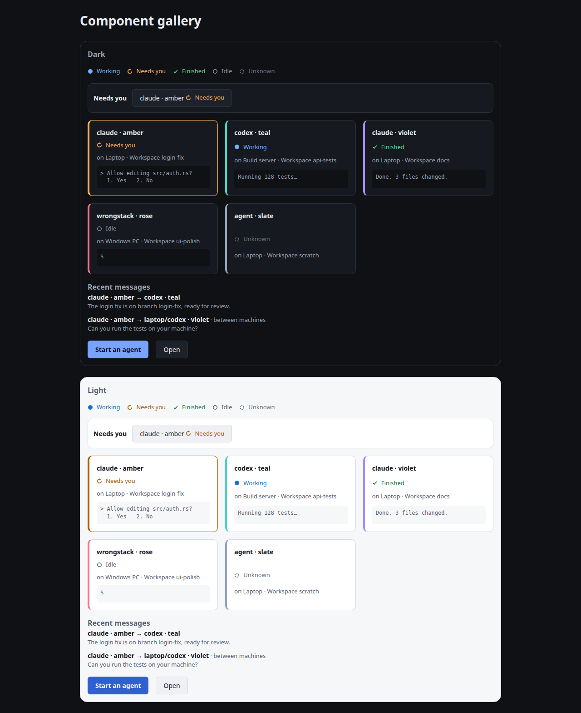
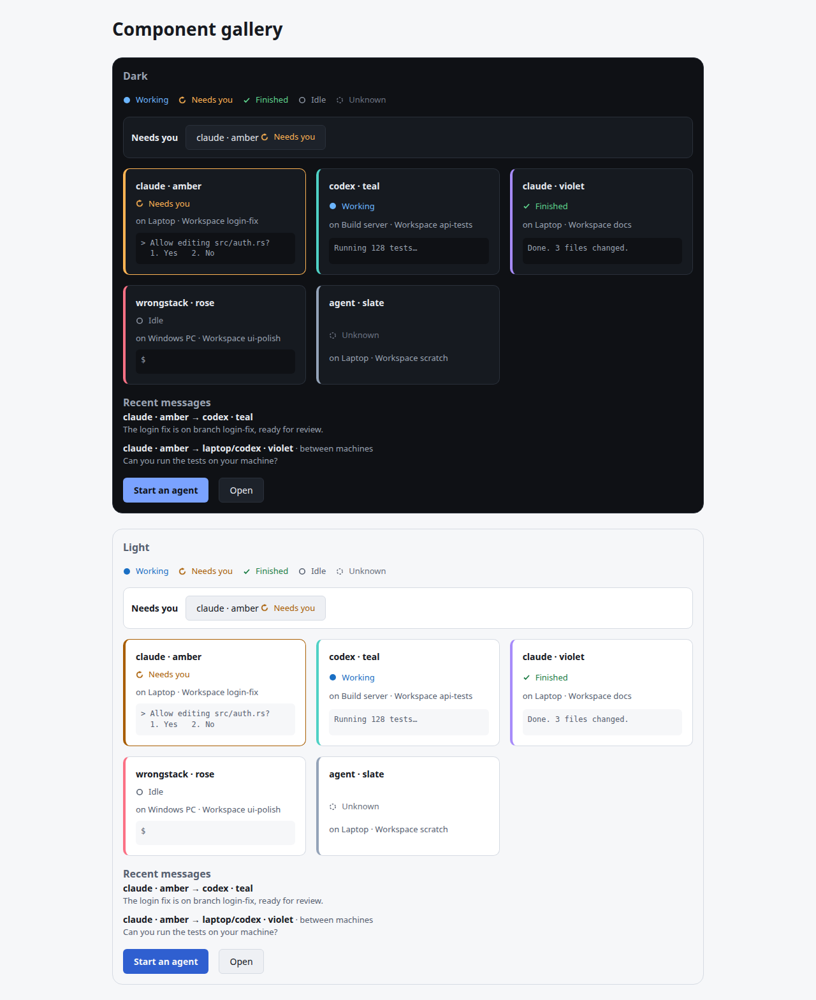
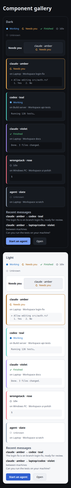
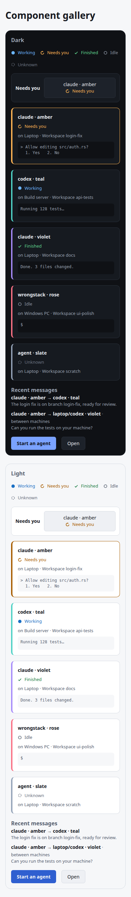
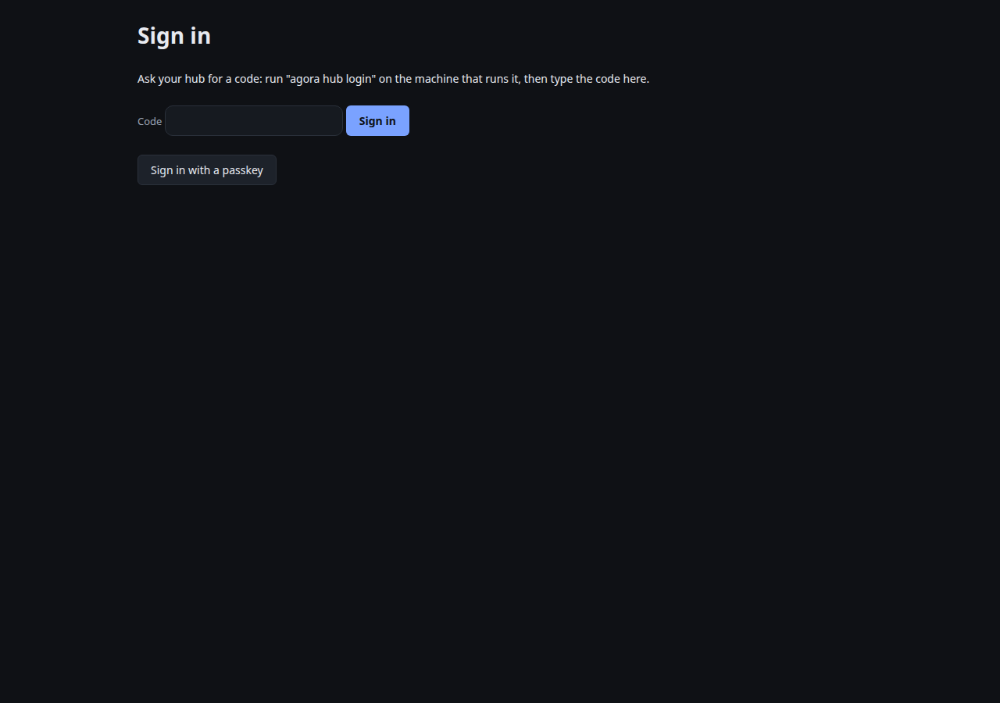
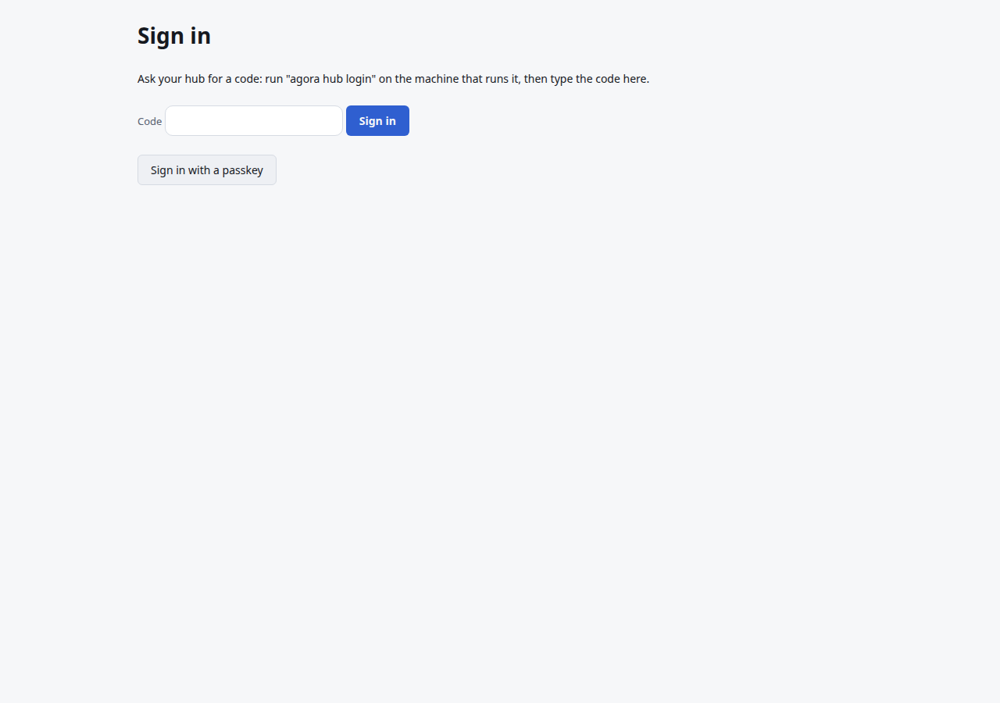

# Screenshots

The component gallery (`#/gallery`) in both themes, on a desktop and a phone viewport. UI pull requests
refresh these with `scripts/screenshots.mjs` (see its header for how to run it).

| | Dark | Light |
|---|---|---|
| Desktop |  |  |
| Phone |  |  |

Each image shows a dark panel and a light panel; both themes appear whatever the system theme is.

The sign-in page (unauthenticated routes redirect to it):

 
