# Screenshots

The component gallery (`#/gallery`) in both themes, on a desktop and a phone viewport. UI pull requests
refresh these with `scripts/screenshots.mjs` (see its header for how to run it).

| | Dark | Light |
|---|---|---|
| Desktop |  |  |
| Phone |  |  |

Each image shows a dark panel and a light panel; both themes appear whatever the system theme is.

The sign-in page (unauthenticated routes redirect to it):

 

From another machine, once the owner set a screen password (ADR-0067), it asks for the password too; the title bar has **Lock**
and This device sets the password and the idle lock (`screen-password/`):

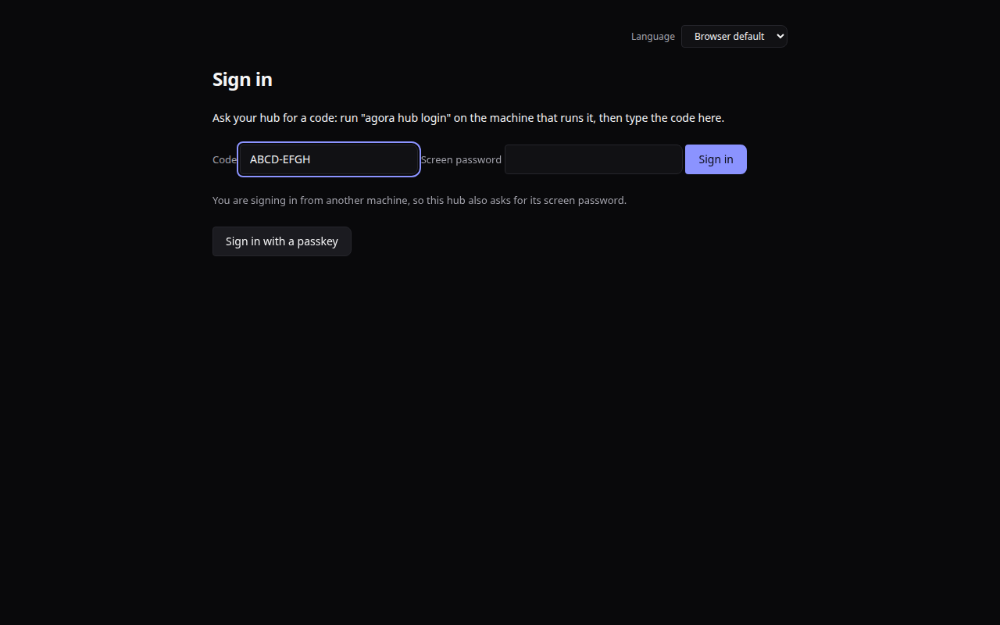 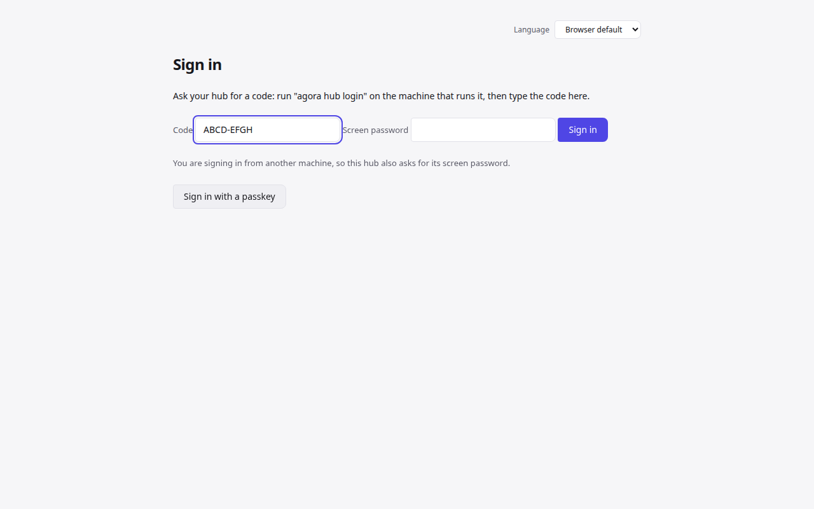
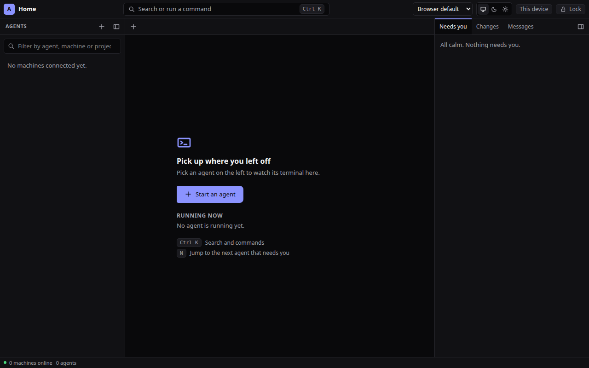 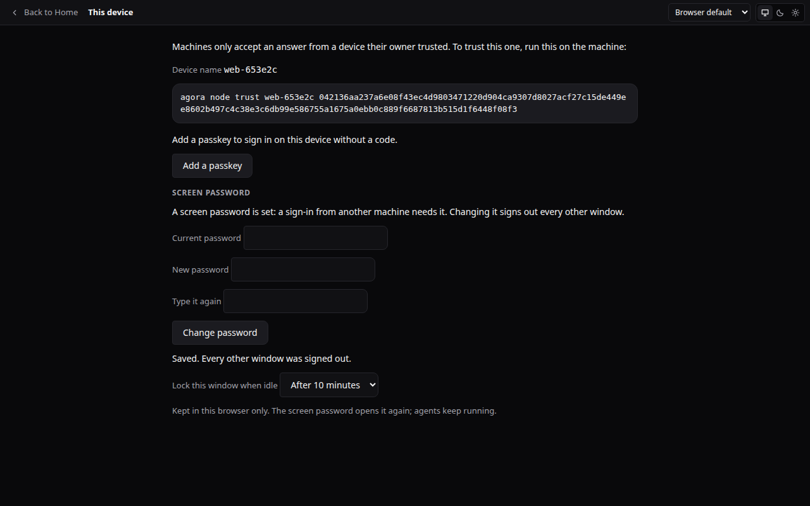

## The console (Home)
One window: machines and agents on the left, the terminals of the agents being watched in the middle (several at once), and
what needs you, uncommitted changes, agent messages and spend on the right.

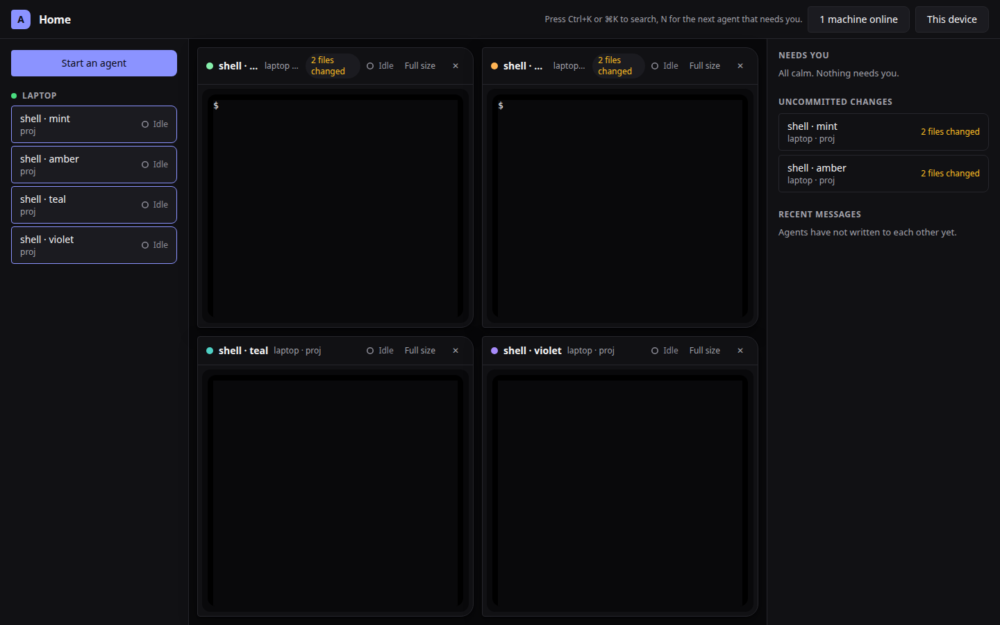
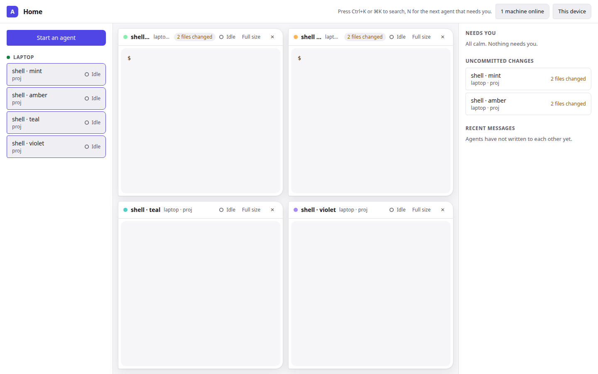
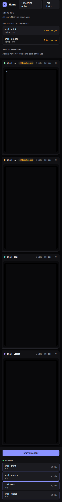

Command palette (Ctrl+K), on Radix Dialog:

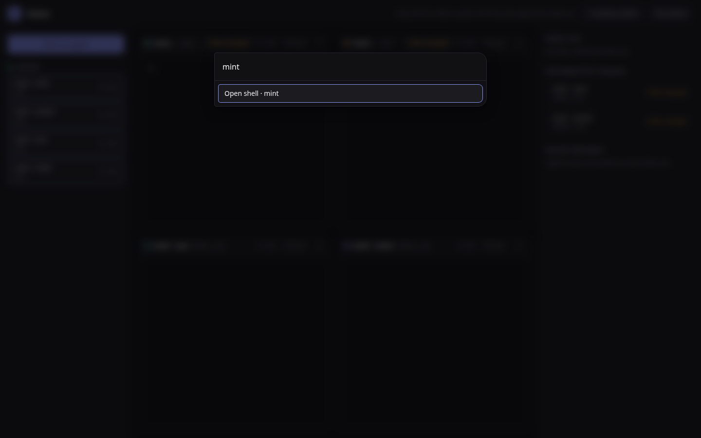

What an agent changed (click "N files changed"):

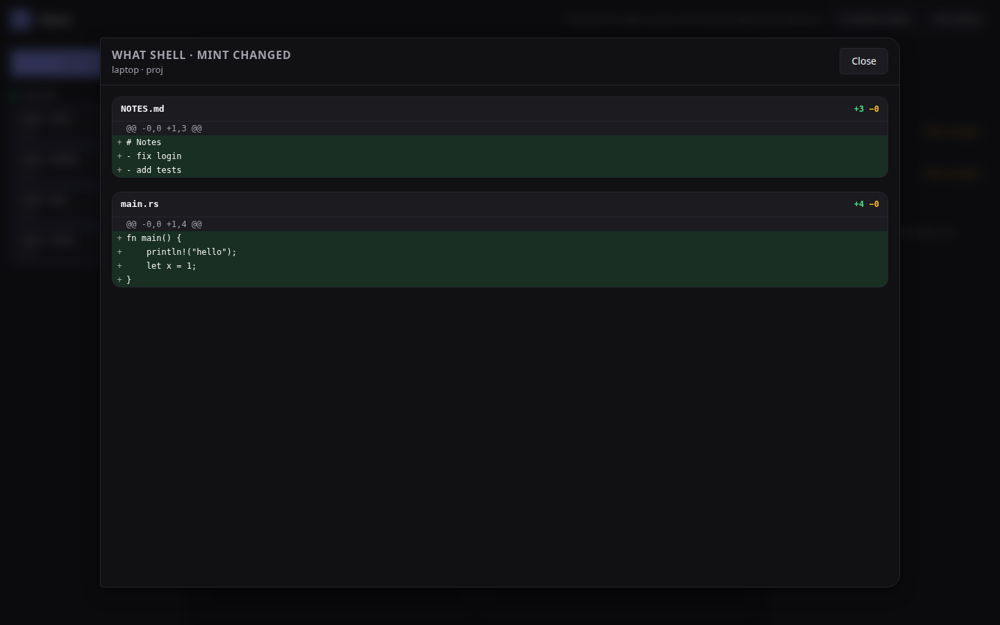

Files of a workspace (the Files button on a terminal):

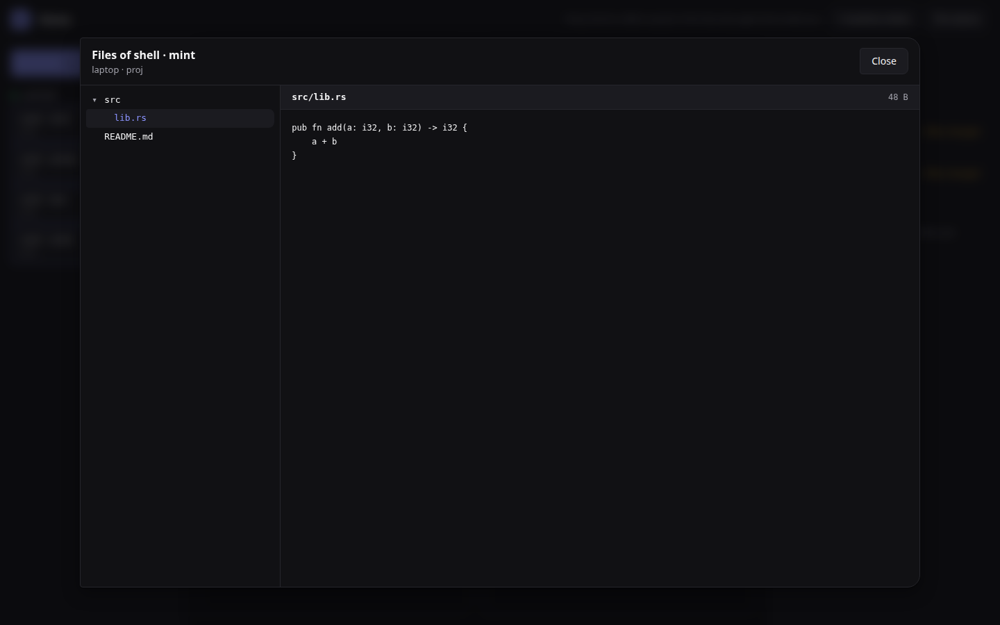

A chat agent (no terminal): send it a request; its permission request appears on the right and is answered with this browser's device key:

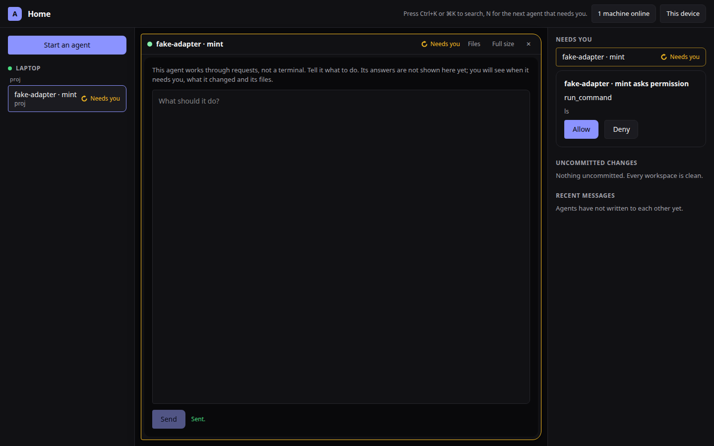

Commit history of a workspace (the History button on a terminal):

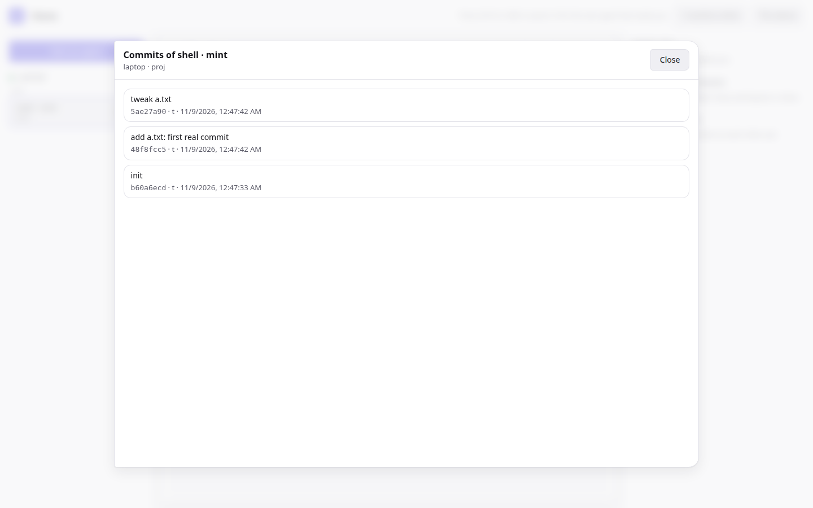

A chat agent's conversation (ADR-0038): your requests and its answers, streamed from the node:

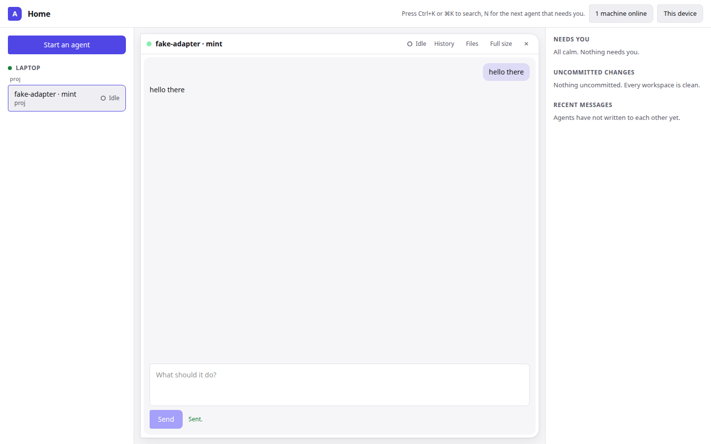

`demo-ltr-dark.png` and `demo-rtl-dark.png` show the same console left to right and with the page forced right to left (no RTL translation ships yet, so the text is English): the layout mirrors, the terminals stay left to right.

## On a phone (ADR-0067 rung 2)
`phone/`, from `scripts/e2e-phone.mjs` with `AGORA_SCREENSHOTS`: the list with a request waiting and one agent with the key bar, at
360 × 740, 390 × 844 and held sideways (844 × 390); a tablet (768 × 1024) keeping the full window with the key bar; This device on a
phone. Both themes.

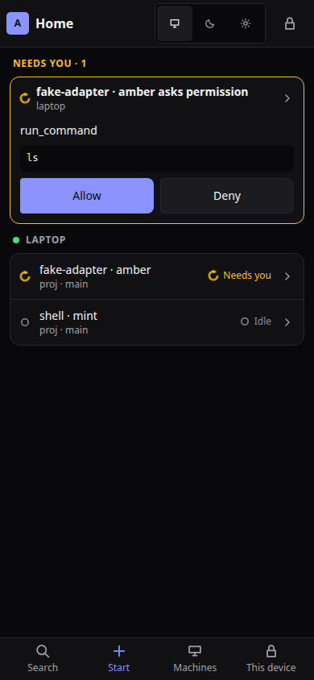 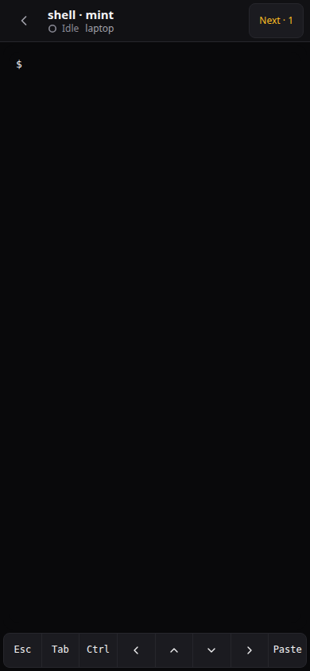 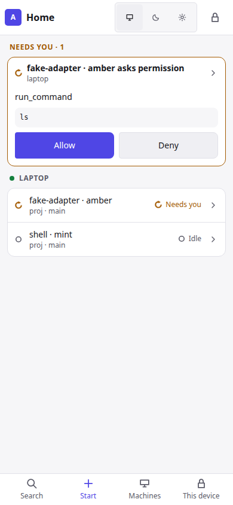 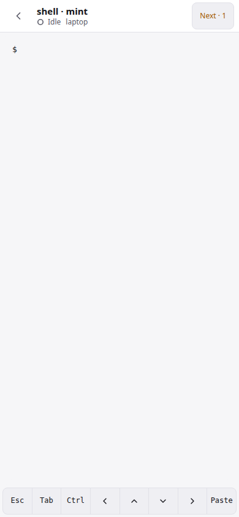
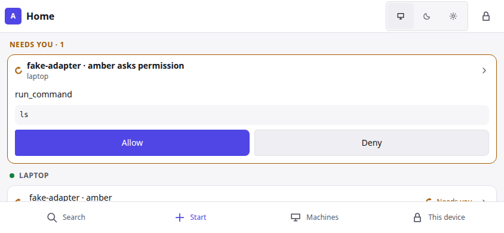 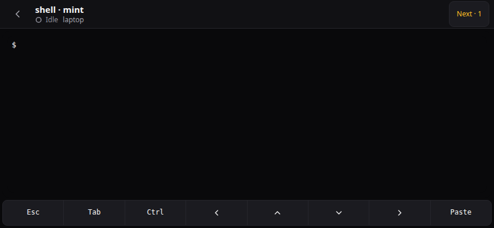

## Visual regression baselines
`apps/web/visual/` holds the reference images that `scripts/visual-regression.mjs` compares against (gallery and sign-in, both
themes, desktop and phone). They are the contract for how the shared components look: a pull request that changes them updates the
images with `--update`, and the diff shows in review.

`grant-dark.png` and `grant-light.png` show the permission window a machine's `signed_commands` policy triggers (ADR-0041).
- `adr59-start-dont-ask-confirm-{dark,light}.png`, `adr59-start-dont-ask-chosen-{dark,light}.png`: ADR-0059 start window, "Don't ask" asked about (Keep asking is the main button) and chosen; `adr59-no-ask-badge-tiles-{dark,light}.png`: the "Does not ask" badge on an agent's tile (gallery).
