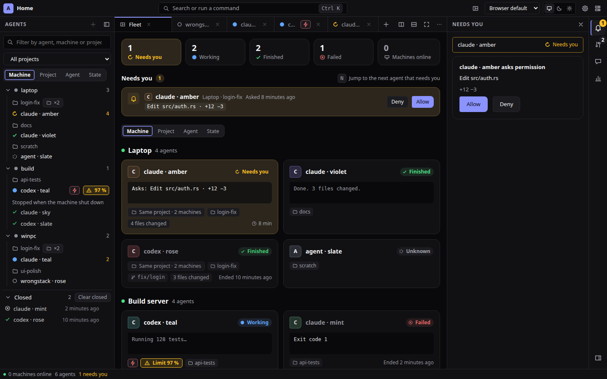
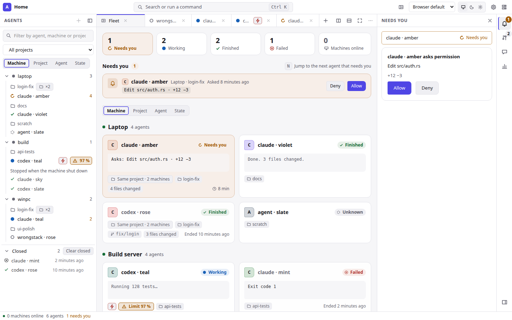

# Home: the fleet console

The Glance layer of `visual-language.md` ("Does anything need me?") as a real screen. A window nobody has arranged opens on a **Fleet** tab, in
front of the tabs of the agents opened for you; the same panel is in the layout's Show menu (`layout.md`, panel `fleet`) and the command
palette's "Go home" brings it back. An empty window is the fleet console too. On a phone the same data is the single column of `phone.md`.

Every tile state (needs you, working, finished, failed, idle, unknown, acting without asking, a plan limit):
`screens/home-redesign-fleet-{dark,light}.png` and, grouped by state, `screens/home-redesign-group-state-{dark,light}.png`; every kind
of request card (answered here, a machine's join card opened, a start request with Review, many identical asks opened):
`screens/home-redesign-requests-{dark,light}.png`; the phone: `screens/home-redesign-phone-{dark,light}.png`. The counts scroll with
the page (as stat tiles they take two or three rows in a narrow pane). The look follows ADR-0102:
colour is a surface (a tint, a hairline, an avatar, a pill), never a bar on one side; `scripts/e2e-home-no-stripes.mjs` checks the
rendered page for it.

## What is on it

1. **Five counts**, one per question: needs you, working, finished, failed, machines online, as the kit's stat tiles (a big number and
   its name with the state's mark). They are live. Only Needs you is tinted (amber), and only above zero; a zero is muted. The first four
   are filters of the tiles below (a press shows only those agents, a second press shows everything; a count of zero cannot be pressed);
   the machines count ("2 · of 3 machines online") opens the machines page. *Failed* ("Ended with an error") has the red cross in a ring
   (ADR-0102).
2. **What needs you**, most urgent first: requests that expire soonest, then requests of unknown expiry, then agents waiting in their
   terminals, the longest-waiting first. Each is a **request card** (the row size of the one request component, [approvals.md](approvals.md#one-request-three-sizes):
   amber tint and hairline, never a bar on one side): an icon chip for the kind of ask, the agent's avatar, the ask as its title
   ("codex · teal wants to run a command"; a start request's line is the start of its prompt), its machine and project, how long ago it asked, what it asks
   (a request answered here as a mono chip that wraps, never cut), and the answers at the end, Deny then the primary Allow (in a narrow
   column they go under the ask). Six cards are shown; the rest are one press away.
   * **Allow and Deny are in the row only for a plain yes or no that needs no reading and is shown whole**: one line each of action and
     detail, 120 characters at most in all, no structured text, no hidden character, and never a request to start an agent (it carries a
     folder, a prompt and settings), nor one that offers only an answer the agent remembers (ADR-0101: it has no plain Allow and is
     answered in its full card). A request that also offers **Allow always** keeps Allow and Deny here; the third button is in the full
     card ([approvals.md](approvals.md)). The row grows to hold such a request; it never clamps or cuts it (`scripts/e2e-fleet-rows.mjs`
     measures the longest one at 340, 420 and 820 px and in Large text). While the link is down the buttons are disabled and say why.
   * **Allow and Deny do nothing for a short dwell** (600 ms, as the attention dialog and the phone bar, threat model T44) after anything
     on the list changed (a card came, went, moved or shows anything else: the agent, its machine or project, the ask, which buttons it
     has; a card that moves could put a ready Allow under a click meant for another), after the person came back to the window (focus, or
     the tab shown again: at once, even before the window redraws) and after the link came back. They look off meanwhile, and a press sends
     nothing. How long ago it asked is not part of it: that text sits in a box of its own width (tabular digits), so the clock moving it
     does not move the buttons. **A request is answered once**: from the accepted press its buttons are off, and a double click, a press on
     the other button, the person coming back, a new layout or the list dropping the request and bringing it back cannot answer it again (it is
     held by the request, not by the list, until that answer settles). Once the
     answer went (signed and delivered to the machine), the card says "Answer sent. If this card stays, open it with Review." with a Review
     button for as long as the request is listed: a card that stays is the list catching up, and it never asks for a second answer. A failed
     answer (the window could not sign or send it, or the machine refused it) frees it, after a fresh dwell. One that has not settled keeps
     its card off. Other requests stay answerable meanwhile; an answer settling changes what its card shows, so the dwell starts again for
     every card.
   * **A machine that asks to join (ADR-0065) is a row of its own with one button, Review, and never an inline Approve**: the owner must compare the number on its screen with the
     card first, so the row shows the name and says what to do, never the number. It counts in the first count and sorts by when it runs out. See `docs/specs/pairing.md` section 14.
   * **Six or more agents asking for exactly the same thing are one row with a count and "Review each"** (same kind of request, same action
     and detail, same machine, project and agent kind; a request to start an agent is never collapsed): no stack of identical Allow
     buttons. Each is then reviewed in the full card.
   * How long ago it asked is on every row or on none (when the window does not know it for some, it shows it for no one). Everything else has *Review and
     decide*, which opens the agent where the whole request is shown and answered; for a start or a switch to act without asking it opens
     Review's dialog over Home instead (#1070: one Review, with its own dwell and the window's holds, [approvals.md](approvals.md#start-and-switch-requests)),
     and opening or closing it restarts the queue's dwell. The row's buttons are the banner's buttons: the same
     function answers, the same signing runs (ADR-0020); nothing is decided on text that was cut.
3. **Tiles**, grouped by machine, by project, by agent kind or by state (the viewer's choice, made with the shared segmented control,
   remembered in this browser only; the agent list uses the same choice). A tile is a flat card: the agent's avatar (its colour) beside
   its name and its state as a pill at the top; what it is doing in an inset mono well (two lines at most); in the foot grey tags for
   where it is (the project under a machine, the machine under a project, the branch) and changed files, the acting-without-asking bolt
   and the limit chip when they apply, and how long it has been in this state. **Needs you** is the amber tint with an amber hairline
   (the pulse is only the mark's, in the pill); **failed** is the red Failed pill (ADR-0102); hover is a stronger hairline and a one-pixel
   lift, never a shadow or a glow. Clicking a tile opens the agent like the agent list does. Most urgent first inside a group;
   groups that need you first; an offline machine says when it was last seen and that its agents keep running there.

"What it is doing" is the last line of the agent's terminal when the window has a preview of it, else what it asks, else why it stopped.
The hub does not send terminal previews to the web client yet, so today the line is mostly what it asks; nothing is made up.

## When there is nothing to show

| State | What it says | Next step |
| --- | --- | --- |
| Connecting, nothing known | "Connecting to your Agora…" (it does not claim there are no machines yet) | none |
| Hub unreachable, nothing known | "Cannot reach your Agora", agents keep running | Retry now |
| Fresh hub: no machine, no agent | "Connect your first machine" | the two commands (`agora hub code`, `agora node enroll …`) with Copy, and the machines page |
| Machines connected, no agent | "Your machines are ready. Start the first agent." | **Start an agent**; **Add a machine** (shows the two join commands and the window for new machines in place; it opens nothing by itself); the terminal command |
| Hub unreachable, something known | what was known, with a note that it may be out of date | Retry now |

Each of these is centred (redesign PR 11): the kit's icon chip, a title, one line, then its actions and any command in a copy chip. Where the clipboard is missing or refuses, the chip selects the command and says to copy it with the keyboard. Screenshots: `screens/entry-redesign-home-first-run-*`, `screens/entry-redesign-home-add-machine-*`.

## Rules it follows

* Render is pure: `net/fleet.ts` derives everything from the props (counts, order, queue, groups) with no clock and no state; the console
  memoises it on the lists and only the times move with the clock.
* Performance (`../design/performance.md`): one pass plus one stable sort per change of the lists (tested: 500 agents on 20 machines derive
  in a few milliseconds); tiles are memoised, groups use `content-visibility: auto`. It is not virtualised: 500 tiles measured about 25 ms
  to filter down and about 110 ms to filter back up in a development build, and a tile that is off screen costs no paint.
* Keyboard and touch: every count, the group switch, tiles, Allow, Deny and Review are buttons with names; touch targets are at least 44 px
  on touch screens and on the phone; the state is never colour alone; reduced motion is honoured (state marks stop animating).
* Large text and High contrast: sizes are rem and rows wrap instead of clipping.

## Not here yet (needs data or a decision)

* A last-output line and an activity sparkline for every agent (the Fleet Story, audit S1) need a terminal preview or an output-rate
  counter from the hub: an additive message, so an ADR.
* How long a *request* has waited is the agent's time in the "needs you" state; the request has no creation time of its own.
* "Looks stuck" needs the last-output time.
* From the redesign mockup, not built yet: the kind's name and model under the agent's name (the tile does not get them), a "Start again"
  action on a failed tile (a button cannot sit inside the tile's own button; Start again stays in the agent's view), and the sparkline above.
