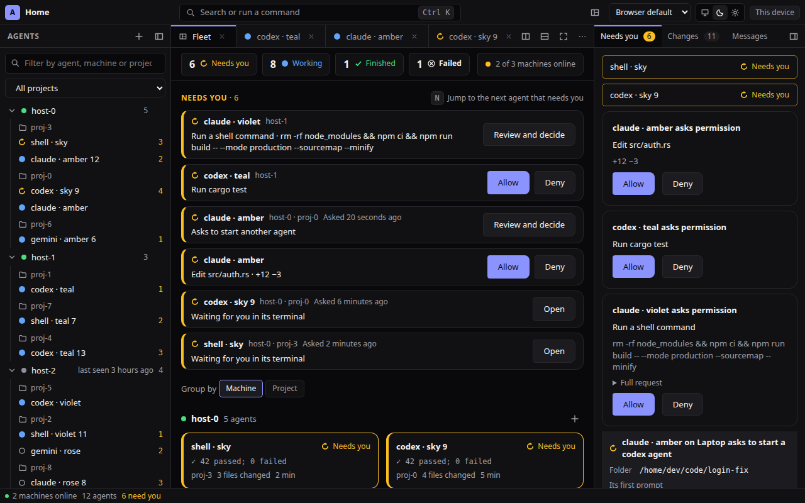
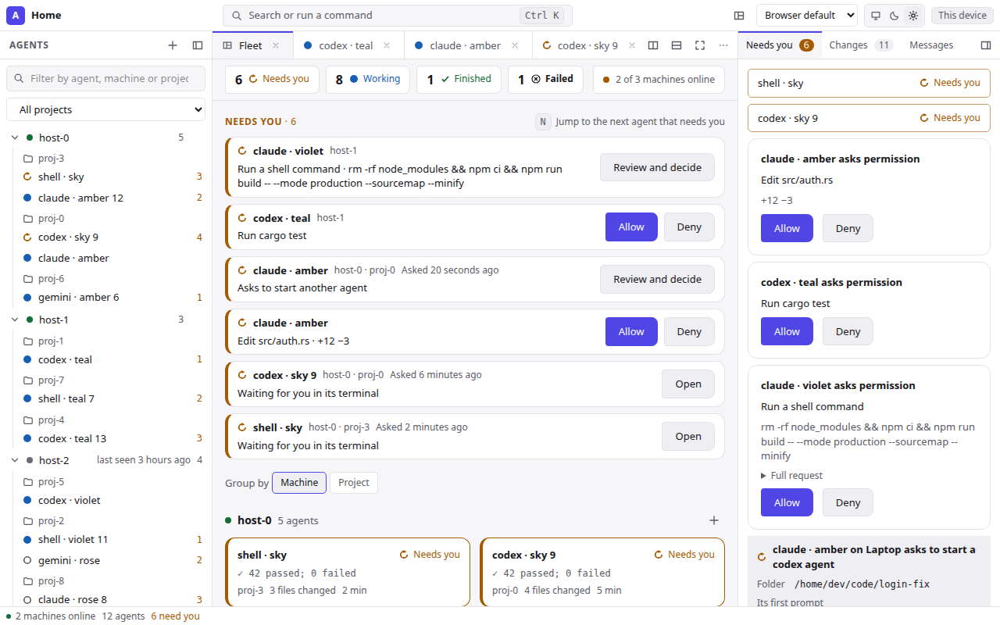

# Home: the fleet console

The Glance layer of `visual-language.md` ("Does anything need me?") as a real screen. A window nobody has arranged opens on a **Fleet** tab, in
front of the tabs of the agents opened for you; the same panel is in the layout's Show menu (`layout.md`, panel `fleet`) and the command
palette's "Go home" brings it back. An empty window is the fleet console too. On a phone the same data is the single column of `phone.md`.

## What is on it

1. **Five counts**, one per question: needs you, working, finished, failed, machines online. They are live. The first four are filters of
   the tiles below (a press shows only those agents, a second press shows everything; a count of zero cannot be pressed); the machines count
   opens the machines page. They use the state words and colours the window already has. *Failed* is the interim presentation of
   "Ended with an error" (a cross and words, still neutral on this screen). ADR-0102 makes failed red; this count switches to the kit's
   red Failed pill when Home adopts the widget kit (redesign PR 2).
2. **What needs you**, most urgent first: requests that expire soonest, then requests of unknown expiry, then agents waiting in their
   terminals, the longest-waiting first. Each row names the agent, its machine and project, says in one line what it asks and how long ago it
   asked. Six rows are shown; the rest are one press away.
   * **Allow and Deny are in the row only for a plain yes or no that needs no reading and is shown whole**: one line each of action and
     detail, 120 characters at most in all, no structured text, no hidden character, and never a request to start an agent (it carries a
     folder, a prompt and settings), nor one that offers only an answer the agent remembers (ADR-0101: it has no plain Allow and is
     answered in its full card). A request that also offers **Allow always** keeps Allow and Deny here; the third button is in the full
     card ([approvals.md](approvals.md)). The row grows to hold such a request; it never clamps or cuts it (`scripts/e2e-fleet-rows.mjs`
     measures the longest one at 340, 420 and 820 px and in Large text). While the link is down the buttons are disabled and say why.
   * **A machine that asks to join (ADR-0065) is a row of its own with one button, Review, and never an inline Approve**: the owner must compare the number on its screen with the
     card first, so the row shows the name and says what to do, never the number. It counts in the first count and sorts by when it runs out. See `docs/specs/pairing.md` section 14.
   * **Six or more agents asking for exactly the same thing are one row with a count and "Review each"** (same kind of request, same action
     and detail, same machine, project and agent kind; a request to start an agent is never collapsed): no stack of identical Allow
     buttons. Each is then reviewed in the full card.
   * How long ago it asked is on every row or on none (when the window does not know it for some, it shows it for no one). Everything else has *Review and
     decide*, which opens the agent where the whole request is shown and answered. The row's buttons are the banner's buttons: the same
     function answers, the same signing runs (ADR-0020); nothing is decided on text that was cut.
3. **Tiles**, grouped by machine, by project, by agent kind or by state (the viewer's choice, remembered in this browser only; the agent list uses the same choice). A tile shows the agent's state,
   what it is doing in one line, where it is (the project under a machine, the machine under a project), changed files and
   how long it has been in this state. Clicking a tile opens the agent like the agent list does. Most urgent first inside a group;
   groups that need you first; an offline machine says when it was last seen and that its agents keep running there.

"What it is doing" is the last line of the agent's terminal when the window has a preview of it, else what it asks, else why it stopped.
The hub does not send terminal previews to the web client yet, so today the line is mostly what it asks; nothing is made up.

## When there is nothing to show

| State | What it says | Next step |
| --- | --- | --- |
| Connecting, nothing known | "Connecting to your hub…" (it does not claim there are no machines yet) | none |
| Hub unreachable, nothing known | "Cannot reach your hub", agents keep running | Retry now |
| Fresh hub: no machine, no agent | "Connect your first machine" | the two commands (`agora hub code`, `agora node enroll …`) with Copy, and the machines page |
| Machines connected, no agent | "Your machines are ready. Start the first agent." | Start an agent; the terminal command |
| Hub unreachable, something known | what was known, with a note that it may be out of date | Retry now |

## Rules it follows

* Render is pure: `net/fleet.ts` derives everything from the props (counts, order, queue, groups) with no clock and no state; the console
  memoises it on the lists and only the times move with the clock.
* Performance (`../design/performance.md`): one pass plus one stable sort per change of the lists (tested: 500 agents on 20 machines derive
  in a few milliseconds); tiles are memoised, groups use `content-visibility: auto`. It is not virtualised: 500 tiles measured about 25 ms
  to filter down and about 110 ms to filter back up in a development build, and a tile that is off screen costs no paint.
* Keyboard and touch: every count, the group switch, tiles, Allow, Deny and Review are buttons with names; touch targets are at least 44 px
  on touch screens and on the phone; the state is never colour alone; reduced motion is honoured (state marks stop animating).
* Large text and High contrast: sizes are rem and rows wrap instead of clipping.

## Not here yet (needs data or a decision)

* A last-output line and an activity sparkline for every agent (the Fleet Story, audit S1) need a terminal preview or an output-rate
  counter from the hub: an additive message, so an ADR.
* How long a *request* has waited is the agent's time in the "needs you" state; the request has no creation time of its own.
* "Looks stuck" needs the last-output time. A failed state colour needs a token and an ADR.
