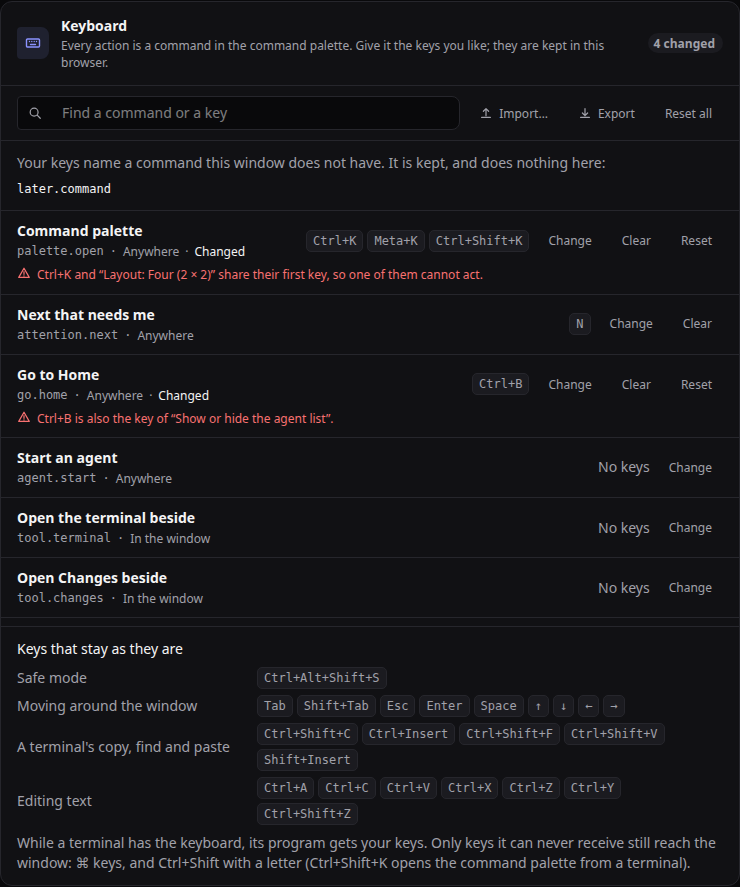
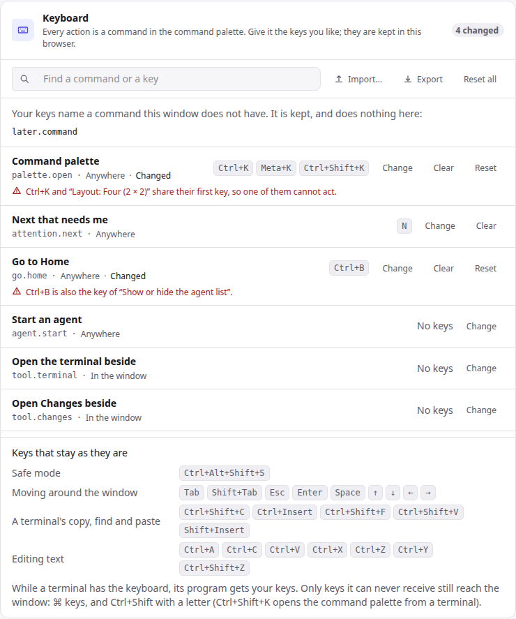
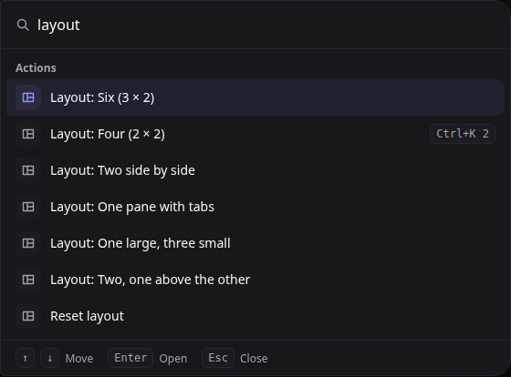
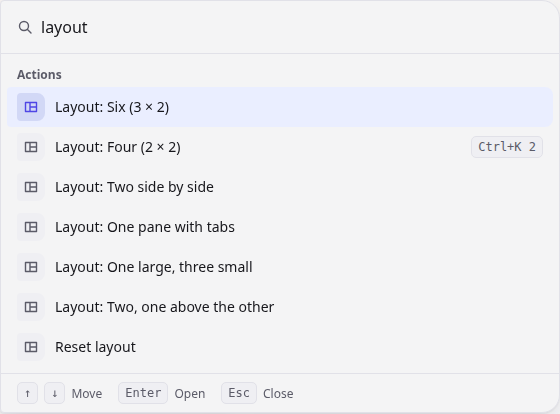
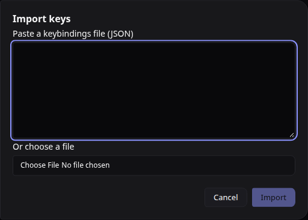
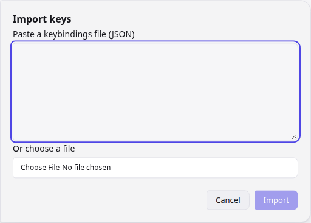

# Keybindings and commands (ADR-0068 rung 4)






Keys and commands are data (ADR-0068 decision 6). Every action of the web window is a **command** with a stable id, a name and,
optionally, keys. The command palette (Ctrl K) lists every command with the key it has now, and **Settings > Keyboard** changes the
keys. The person's changes are one small JSON file, the **keybindings file**, kept in this browser and exported or imported as a file.
This page is the file's specification and the web window's behaviour. The terminal client's commands and how it reads the same file are
in "The terminal client" below; its layout keys (rung 5) are in [layout.md](layout.md), "The terminal client".

## Commands

A command is data (`apps/web/src/keys/commands.ts`):

- **id:** dotted lower-case words (`layout.preset-2x2`). An id is never renamed or reused, since a keybindings file names it.
- **name:** a Fluent key (the palette's and Settings' words).
- **context:** where it acts, which is also when it is offered:
  - `anywhere`: on every page;
  - `window`: the window with its panes (not a phone, not Settings);
  - `pane`: the pane in focus;
  - `tabs`: a tab of the pane group in focus;
  - `side`: the side panel's rail.
- **group and icon:** the palette's heading and icon.
- **default keys:** none, one, or several alternatives (Ctrl+K and ⌘K).
- **fixed:** its keys are not the person's to change (only safe mode).

The **handler** is not in the list. The part of the window that can run a command registers it while it is on screen
(`keys/registry.ts`), with whether it can act now (a tab that exists, a connected hub). The app registers the palette, Home, the pages,
the language, the theme editor, plugins, safe mode and sounds. The window registers the agent list, the tabs, the layout and the focused agent's mute. The side panel
registers its rail. On Settings or on a phone, the window's commands are not on screen, so their keys do nothing there, as before.

| id | name | default keys |
| --- | --- | --- |
| `palette.open` | Command palette (not listed in itself) | Ctrl+K, ⌘K, Ctrl+Shift+K |
| `attention.next` | Next that needs me | N |
| `go.home`, `go.machines`, `go.settings`, `go.keyboard`, `go.audit` | Go to Home, my machines, Settings, Settings > Keyboard, Activity | none |
| `agent.start`, `terminal.new` | Start an agent, start a new terminal | none |
| `tool.terminal`, `tool.changes`, `tool.files`, `tool.manager` | Open the tool beside | none |
| `machines.allow`, `window.lock` | Allow a new machine to join, Lock | none |
| `language.system`, `language.en`, `language.tr` | Language | none |
| `theme.editor`, `plugins.open` | Edit theme, Plugins | none |
| `window.safe-mode` | Open in safe mode (**fixed**) | Ctrl+Alt+Shift+S, ⌘⌥⇧S |
| `sounds.toggle` | Turn sounds on or off (in the palette: "Turn sounds on" or "Turn sounds off"; not offered where the browser makes no sound or in safe mode) | none |
| `window.agents` | Show or hide the agent list | Ctrl+B, ⌘B, Ctrl+Shift+B |
| `pane.tab-1` … `pane.tab-9` | Go to tab 1 … 9 | Alt+1 … Alt+9 |
| `side.place-1` … `side.place-5` | Side panel, place 1 … 5 (in the palette: "Side panel: Needs you") | Alt+Shift+1 … Alt+Shift+5 |
| `layout.preset-1x1` … `layout.preset-focus` | Layout: one of the six presets | none |
| `layout.maximize`, `layout.split-right`, `layout.split-down`, `layout.close-pane`, `layout.reset` | the pane in focus; Reset layout | none |
| `agent.mute-sounds` | Mute or unmute the sounds of the focused pane's agent (while sounds are on) | none |

The defaults are the shortcuts the window had before this rung. The side panel's keys stay by **place** (the third subject of the rail,
whichever it is), because Board and Usage come and go.

**What changed from before this rung**, with the defaults:

- Modifiers match exactly. Before, Shift+N also went to the next agent, and K with Ctrl or ⌘ opened the palette whatever else was held
  (Ctrl+Alt+K, ⌘⇧K). Ctrl+Shift+K and Ctrl+Shift+B are kept as default keys, since they acted before and are the ones that reach the
  window from a terminal.
- A key that ran a command no longer does what the browser would do with it (N included), and a key a part of the page already handled
  (`preventDefault`) is not a command.
- N is not taken from any text field: before, only inputs, text areas and selects kept it; now also an editable element and a text box role.
- Digits are matched by their place, so on a Mac Option+1 picks a tab outside a text field (it typed `¡` and did nothing before), and
  inside one it stays a character (Option+Shift+1 used to open the side panel from a text field).
- On a Mac the side panel's tooltips show the Mac's symbols (`⌥⇧1`).

**Not commands:** the palette's searchable objects (an agent, a machine, a project, a theme, a task to give, closing a named agent) stay
rows of the palette, not commands with keys: they come and go with the fleet. **No command answers a request.** Allow, Deny and Allow
always are pressed on the request's own card, after the card has been on screen long enough to read (T44, `approvals.md`). A file that
names `request.*`, `approval.*`, `approve`, `allow` or `deny` is refused, so a shared keybindings file cannot pose as one that answers
for you.

## Keys

A key string is one stroke, or a chord of two strokes separated by one space:

```
Stroke   = { Modifier "+" } Key
Modifier = "ctrl" | "alt" | "shift" | "meta"          (also "control", "option", "cmd", "command")
Key      = "a"…"z" | "0"…"9" | "-" "=" "[" "]" "\" ";" "'" "," "." "/" "`"
         | "f1"…"f12" | "enter" | "escape" | "tab" | "space" | "backspace" | "delete" | "insert"
         | "home" | "end" | "pageup" | "pagedown" | "up" | "down" | "left" | "right"
```

- Case and the order of the modifiers do not matter; the window writes them in one spelling (`ctrl+alt+shift+meta+key`).
- Letters, digits and punctuation are matched by their **place** on the keyboard (the event's `code`), so Shift or a keyboard layout
  does not change which key it is. `Alt+Shift+1` is the same key whether the layout types `!` or `+` there.
- The modifiers must match exactly: `ctrl+k` is not Ctrl+Alt+K.
- `meta` is ⌘ on a Mac and the Windows or Super key elsewhere. A command that should be Ctrl elsewhere and ⌘ on a Mac lists both.
- A chord waits **1.5 s** for its second key. A key that does not complete it drops the chord and is taken as a key of its own; Esc
  drops it too.
- The window shows keys as keyboards print them: `Ctrl+Shift+K`, and on a Mac its symbols (`⌘K`, `⌥⇧1`). The title bar's hint keeps
  its old spelling (`Ctrl K`, `⌘ K`). `aria-keyshortcuts` is spelled as WAI-ARIA says (`Control+B`).

## Where a key acts

The window has one key listener (`keys/registry.ts`), on the window, **after** the page's own handlers. A dialog that keeps a key to
itself (a letter typed in it) keeps it from the window, as before. A key press is looked up in this order:

1. A second key while a chord waits completes it.
2. A **fixed key** (below) is never a command here.
3. **A terminal keeps its keys.** While a terminal has the keyboard, its program gets the key, and the window hears only keys the
   program can never receive in this window: any ⌘ (Meta) key, and Ctrl+Shift with a letter. So Ctrl+K, Ctrl+B, Alt+1, Alt+Shift+1 and
   N go to the program. **Ctrl+Shift+K** opens the command palette from a terminal, and ⌘K on a Mac. No chord starts in a terminal,
   because its second key would be the program's.
4. **A text field keeps what types text:** a letter, a digit, a symbol or Space, alone or with Shift, and on a Mac with Option too
   (Option+1 types `¡` there). So N is typed into a prompt; Ctrl, Alt and ⌘ keys still act there, as before.
5. A chord bound to this key waits for its second key. Otherwise the first command bound to it that can act now runs. The person's
   own keys come first (in the file's order), then the defaults. A command that cannot act lets the key go on, to the next command or
   to the page.

The safe-mode key is heard before all of this, by the window itself in the capture phase (ADR-0114, `plugins.md`).

## Fixed keys

No list of fixed keys existed before this rung; this is it. No binding may use these as any stroke of a chord, because something the
person relies on needs them (`FIXED_KEYS`):

| why | keys |
| --- | --- |
| Safe mode (ADR-0114) | Ctrl+Alt+Shift+S and ⌘⌥⇧S |
| Moving around the window by keyboard: focus, dialogs, lists, menus | Tab, Shift+Tab, Esc, Enter, Space, the arrows |
| A terminal's copy, find and paste (`terminal-fidelity.md`) | Ctrl+Shift+C, Ctrl+Insert, Ctrl+Shift+F, Ctrl+Shift+V, Shift+Insert, ⌘C, ⌘F, ⌘V |
| Editing text | Ctrl or ⌘ with A, X, Z, and Ctrl+C, Ctrl+V, Ctrl+Y, Ctrl+Shift+Z, ⌘⇧Z |

`window.safe-mode` is the one fixed command: a file that names it is refused, and its keys are always the defaults.

## The keybindings file, version 1

```json
{
  "version": 1,
  "bindings": [
    { "command": "palette.open", "keys": ["ctrl+p", "meta+p"] },
    { "command": "layout.preset-2x2", "keys": ["ctrl+k 2"] },
    { "command": "attention.next", "keys": [] }
  ]
}
```

- An entry **replaces** that command's keys; `[]` takes them all away. A command the file does not name keeps its defaults.
- The file holds only the person's changes. Export writes it as it is, and Import reads it back the same.

### Reading a file (validation)

Like a theme file (`themes.md`), the file is data and is never run: it is read with `JSON.parse` only, and its values are only ever
strings compared with the list. One function (`keys/file.ts` `readKeys`) reads every file from outside (this browser's storage, an
imported file). It never throws and reports every problem at once (at most 50, then how many more):

1. Larger than **64 KiB**: refused before it is read (`keys-error-too-big`). An imported file over the cap is never loaded into the page.
2. Not JSON (`keys-error-json`). Not an object with an integer `version` ≥ 1 and a `bindings` list of `{ command, keys }` objects
   (`keys-error-shape`). A `version` above 1: "made by a newer version" (`keys-error-newer`).
3. **A closed set of fields:** any other field, at the top or in an entry, is refused (`keys-error-field`).
4. `command` must look like an id (`keys-error-command`); a command that answers a request is refused (`keys-error-request`); a fixed
   command is refused (`keys-error-fixed-command`); a command listed twice is refused (`keys-error-twice`).
5. Each key string must parse (`keys-error-key`). A fixed key is refused with its reason (`keys-error-fixed-key`). At most 4 keys per
   command (`keys-error-too-many-keys`) and 200 entries (`keys-error-too-many`).
6. **Unknown commands are kept and marked:** a well-formed id this window does not have (a newer window's command) is kept in the
   file, written back on export, listed in Settings > Keyboard, and binds nothing here.

Any problem refuses the whole file: an import changes nothing and shows the problems; a stored file that cannot be read leaves the
defaults in force, and Settings says so.

### Conflicts

Two commands **conflict** when they have the same keys, or when one's key is the first stroke of the other's chord (Ctrl+K and
Ctrl+K Ctrl+S: the chord waits for its second key, so the shorter one cannot act). A conflicting file is still accepted, since the
person may be halfway through a change. Settings > Keyboard shows the conflict on both rows. At a key press, the person's own keys win
over a default, and a chord waits.

## Settings > Keyboard

Settings has a **Keyboard** card (`#/device/keyboard`; also **Keyboard settings** in the palette):

- A search over the commands' names, ids and keys; **Import…**, **Export** (downloads `keybindings.json`) and **Reset all** (asks first).
- Every command as a row: its name, its id, where it acts, **Changed** when the file names it, its keys, and **Change**, **Clear** and
  **Reset**. **Change** listens for the new keys: press them (two presses in a row make a chord), Esc stops, Tab leaves. A fixed key is
  refused there with its reason. Keys pressed while listening go to the recorder only, not to the window or a command.
- A conflict is a line under the row, in the danger colour, naming the other command.
- The safe-mode row is marked **Fixed**, with no buttons.
- **Keys that stay as they are:** the fixed keys, grouped by why, and how a terminal keeps its keys.
- The commands a file names that this window does not have, kept and listed.

**Import…** opens a one-column dialog: paste the file, or choose one, then **Import**.




## Storage and safe mode

This browser's `localStorage` key `agora.keybindings.v1` holds the file's text (removed when there are no changes). Reads and writes
are guarded: unavailable or full storage keeps a change for the visit. Another tab's change applies at once. Syncing through the hub per
person (ADR-0113 decision 6) and keybindings in theme packs (ADR-0113 decision 5) are later.

In **safe mode** (ADR-0114), the defaults only: the stored file is neither read nor written, so a file that took a key the person needs
cannot follow them there. A change made in safe mode holds for that visit only.

## The terminal client

The terminal client's keys are commands too (`crates/agora-tui/src/keys/`), and it reads **the same file**: a `keybindings.json` exported
from the web window, put in the Agora folder (`$AGORA_HOME`, else `~/.agora`), is the terminal client's. **Not wired yet:** the console
does not read that file when it starts, so the defaults below are in force; the reader, the checks and the keys in force are built and
tested, and `App::keys` takes them.

- **Reading the file** follows "Reading a file" above exactly (the same limits, the same closed fields, the same refusals, the web's fixed
  keys and fixed command), so a file is valid in one client exactly when it is valid in the other. It is read only when it is at most
  64 KiB (asked of the file system first). Each problem is a stable code, said from `locales/<lang>/tui.ftl` (`tui-keys-error-*`); any
  problem leaves the defaults in force.
- **A command the terminal client does not have** (a web window's: `go.settings`, `side.place-1`, …) is kept and binds nothing here.
- **Keys the terminal client keeps:** y, n, Shift+A, Alt+Y, Alt+N and Alt+A answer a request, and Ctrl+], F12, j, k, Home and End move
  around the window. A file may bind them (the web window has other uses for them); here such a key is left out of the binding and said.
- **What a terminal can report:** the terminal client hears characters, not key places. A letter with Shift is its capital (`shift+n` is
  N); Shift with a digit or a sign, Ctrl with Shift, and Meta (⌘) never arrive, so such a binding never acts here. `<` and `>` (the
  list's width) are not in the key grammar and stay as they are.
- **Where a key acts:** a command acts in the agent list, in the list and the details, or anywhere. Inside an agent's tab every key is the
  agent's except a one-stroke **Alt** key of a command that acts anywhere (the palette, the mouse, the tabs); no chord starts there, and a
  default Alt key the file took from its command goes to the agent again. Outside a tab, a default key the file took from its command
  does nothing. A chord waits 1.5 s for its second key; Esc drops it.

The terminal client's commands, with their default keys (the keys it had before):

| id | does | default keys | acts |
| --- | --- | --- | --- |
| `palette.open` | the commands (palette) | Ctrl+K, Alt+K | anywhere |
| `attention.next` | the next agent that needs you | Shift+N | the list |
| `pane.tab-1` … `pane.tab-9` | tab 1 … 9 | Alt+1 … Alt+9 | anywhere |
| `layout.preset-1x1`, `-2x1`, `-1x2`, `-2x2`, `-focus`, `-3x2` | the layout presets | 1, 2, 3, 4, 5, 6 | list, details |
| `layout.maximize`, `layout.pane-previous`, `layout.pane-next` | maximize or restore; the pane before or after | z, h, l | list, details |
| `layout.split-right`, `layout.split-down`, `layout.close-pane`, `layout.swap-next`, `layout.move-next`, `layout.take-out`, `layout.wider`, `layout.narrower`, `layout.taller`, `layout.shorter`, `layout.save-as`, `layout.reset` | the pane in focus; the layout | none | list, details |
| `window.mouse`, `window.details` | take or release the mouse; show or hide the details | m and Alt+M; i | anywhere (Alt+M); list, details |
| `tab.close` | close the tab or pane | w | the list |
| `machines.clean-up`, `app.quit` | clean up old machines; quit | none; q | list, details |
| `agent.start`, `agent.start-in-folder`, `agent.stop`, `agent.resume`, `agent.start-again`, `agent.review`, `agent.files`, `board.open`, `agent.remove`, `device.ask`, `devices.approve`, `typing.grant`, `machines.pair`, `theme.choose` | the console's letters for the selected agent | s, f, x, u, Shift+U, r, o, b, d, a, v, g, p, t | list, details |

No command answers a request; Ctrl+C still quits from the list (it is a fixed key, so no file can take it). Known gaps: the palette's and
the footer's words still name the default keys, and the palette does not show a changed key.

## Tests

`crates/agora-tui/src/keys/`: the key grammar and what a typed key is (`strokes.rs`), every command's id and defaults (`commands.rs`),
reading and refusing files as the web does (`file.rs`), and the keys in force, chords, Alt keys inside a tab, a default the file took
(`map.rs`); `app.rs` tests a file moving keys in the shell and inside a tab.

`apps/web/src/keys/`:

- `strokes.test.ts`: parsing, one spelling, refusals, a key pressed by its place, where a key may act, and the words keys are shown with.
- `file.test.ts`: reading and validating files, unknown commands kept, fixed keys and request commands refused, the keys in force, conflicts.
- `commands.test.ts`: ids, defaults that parse and are not fixed, the safe-mode key matching `plugins/safe.ts`, words in both languages.
- `registry.test.ts`: handlers, the matcher, chords, a terminal keeping its keys (in a page too), text fields, the bubble phase.
- `palette.test.tsx`: the whole window, where every command is in the palette with its key, and a changed key is used everywhere.
- `KeyboardSettings.test.tsx`: recording, chords, refusals, conflicts, clear and reset, import, search, storage and safe mode.
