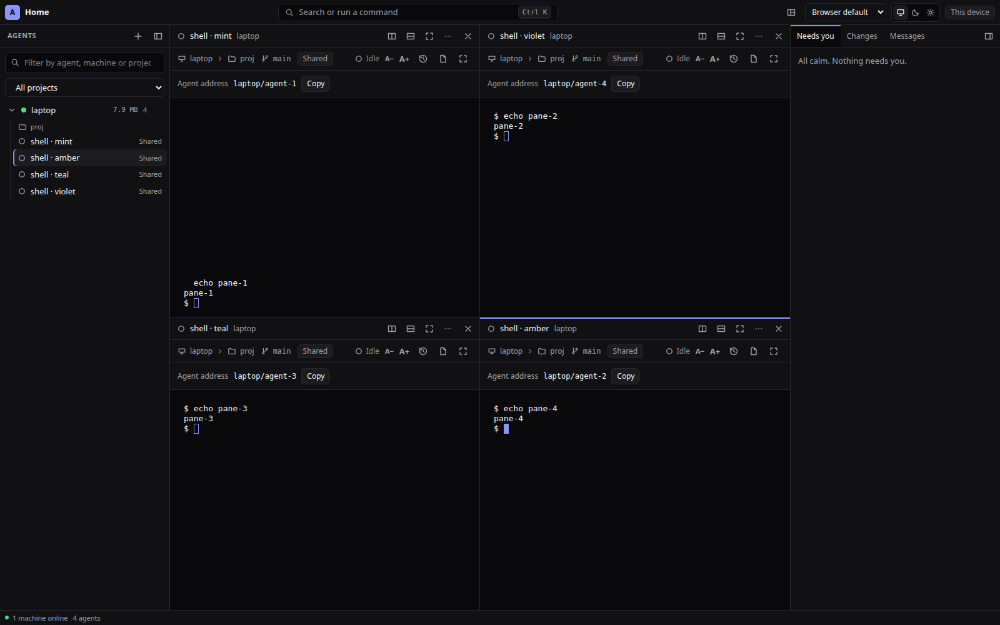
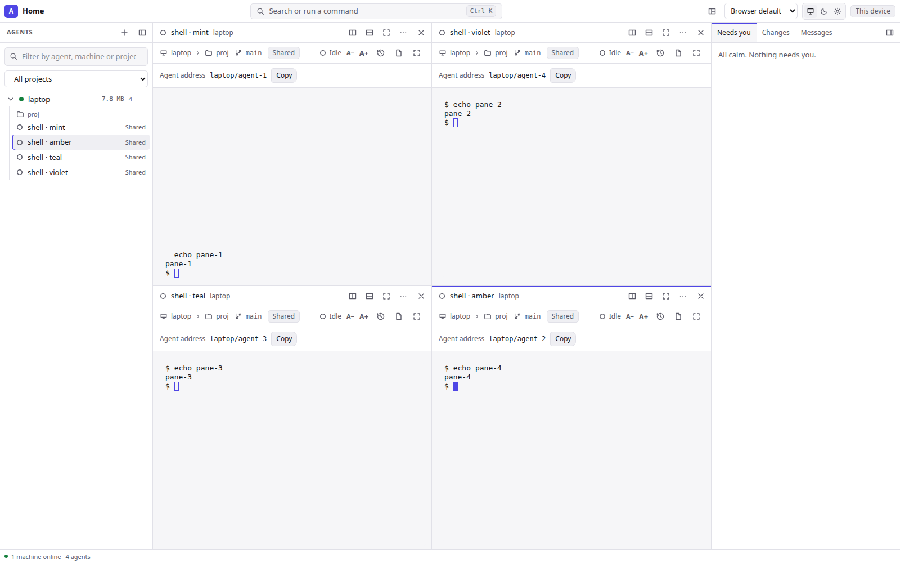
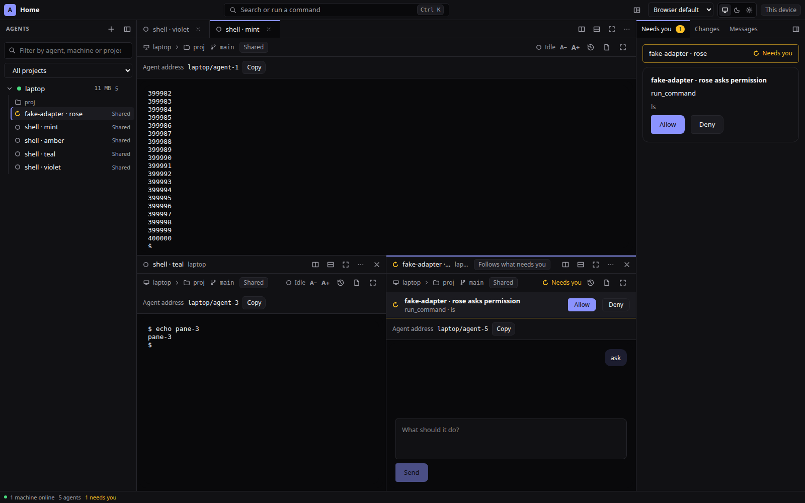

# Layout: panes, tab groups and splits (ADR-0068)





The centre of the window is a **layout**: a tree of splits, tab groups and panes that the user arranges, saves and shares. The
layout is plain, versioned JSON so every client (web today; the terminal client and any native client later, ADR-0068 rung 5–6)
reads and writes the same file. This page is the format's specification and the web window's behaviour. Rung 1 covers the
model, the presets and saved layouts; themes are `themes.md` (rung 2); the panel registry and keybindings are later rungs and are
not described here.

## Format, version 1

```
Layout = { "version": 1, "root": Node }
Node   = Split | Tabs | Pane
Split  = { "type": "split", "direction": "row" | "column", "ratios": number[], "children": Node[] }
Tabs   = { "type": "tabs", "active": number, "children": Pane[] }
Pane   = { "type": "pane", "id"?: string, "panel": string, "bind"?: Bind }
Bind   = { "agent": string } | { "follow": "attention" | "selection" }
```

- A **row** split lays its children side by side (in reading order: mirrored in a right-to-left language); a **column** split
  stacks them. `ratios[i]` is child `i`'s share of the split.
- A **tab group** shows one of its panes (`active`, zero-based) behind tabs.
- A **pane** shows one **panel**, bound to something. `id` is a short string unique in the layout; it lets a client keep what a
  pane draws (a live terminal) while the tree around it changes. A missing or repeated id is replaced by a fresh one when read.
- `bind.agent` is the hub-wide agent key (`<machine id>/<agent id>`). `follow: "attention"` shows the next agent that needs
  you; `follow: "selection"` shows the agent selected in the agent list.

### Panels (version 1)

| id | shows |
| --- | --- |
| `terminal` | the bound agent's terminal |
| `conversation` | the bound agent's chat |
| `agent` | terminal or chat, whichever the agent has (and its summary once it has ended) |
| `approvals` | what needs you (requests waiting for your OK) |
| `changes` | changed files across workspaces |
| `files` | the bound agent's files |
| `tasks` | shared tasks and files |
| `messages` | team chat between agents |
| `usage` | what was spent |
| `theme` | the theme editor (`themes.md`); added in rung 2, an older window shows it as an unknown panel |
| `empty` | a chooser: an agent, "what needs you next", "the selected agent", or one of the panels above |

A panel id this client does not know (a newer client's panel) is kept in the layout and drawn as a visible
**"unknown panel"** placeholder; it never fails the layout. A `bind` this client does not understand is dropped, the pane
shows unbound.

## Reading a layout (validation)

Every layout from outside (this browser's storage, an imported file) is read through one function that never throws:

1. Not JSON: refused (`layout-error-json`).
2. Not an object with an integer `version` ≥ 1 and a `root` node of a known `type`: refused (`layout-error-invalid`). A split
   with an unknown direction, a pane without a `panel`, a split inside a tab group are refused the same way.
3. `version` greater than 1: refused with "made by a newer version" (`layout-error-newer`). Nothing of it is guessed.
4. Normalised: ratios that are missing, of the wrong count, not finite or not positive are shared out equally; ratios are
   scaled to sum to 1; an empty split or tab group is dropped; a split with one child is replaced by that child; a split inside
   a split of the same direction is merged into it (ratios multiplied); a tab group inside a tab group is flattened; `active`
   is clamped. An empty tree is one `empty` pane.
5. Limits: at most **32 panes** (`layout-error-too-many`) and at most **6 levels** from the root to a pane, counting the pane
   (`layout-error-too-deep`).

A stored layout that cannot be read (or that a newer version wrote) is ignored and the window starts from the default; an
imported one shows the error in the import window and changes nothing.

## Operations

All changes go through one pure reducer (`apps/web/src/layout/engine.ts`). Each returns a valid tree; an operation that would
break a limit (a 33rd pane, a 7th level) changes nothing.

- **Split right / split down**: a new `empty` pane beside the pane (beside its whole tab group when it is a tab). Inside a
  split of the same direction the pane's share is halved; otherwise the pane and the new one form a new split, half each.
- **Close**: the pane goes; in a split its siblings take its space in proportion; a split left with one child collapses; the
  last tab closes its group; the last pane leaves one `empty` pane (the window's welcome).
- **Resize**: moves the line between two siblings; neither gets less than 10 % of the split.
- **Swap** two panes; **move** a pane to another pane's edge (before, after, above, below: beside it) or centre (as a tab
  there); **take out of the tabs** (beside its group).
- **Activate** a tab; **focus** a pane (keys and "open" go there).
- **Maximize** one pane (drawn alone) and **restore** (the tree as it was; nothing is changed by maximizing).
- **Bind**: show an agent, follow attention, follow the selection, or another panel.
- **Preset** applied to a list of agents (see below); **open** an agent (below); **prune** agents that are gone (a tab closes,
  a pane of its own stays in place, `empty`); **replace** with a saved or imported layout.

Pane ids are kept: a resize, swap, move or a preset that keeps an agent keeps its pane id, so its terminal is not re-created.

## Presets

Names are columns × rows. Panes are filled with the given agents in order, row by row; agents beyond the last cell become tabs
in the last pane; cells without an agent are `empty`. In the window the list is the agents already shown, then the running ones.

| Preset | Tree |
| --- | --- |
| 1x1 | one tab group of all agents (the window before layouts) |
| 2x1 | row of two |
| 1x2 | column of two |
| 2x2 | column of two rows of two |
| 3x2 | column of two rows of three |
| focus | row: one pane (70 %) and a column of three (30 %) |

### Examples

1x1:
```json
{ "version": 1, "root": { "type": "tabs", "active": 0, "children": [
  { "type": "pane", "id": "p1", "panel": "agent", "bind": { "agent": "laptop/agent-1" } },
  { "type": "pane", "id": "p2", "panel": "agent", "bind": { "agent": "vps/agent-7" } } ] } }
```

2x1 (side by side) and 1x2 (stacked):
```json
{ "version": 1, "root": { "type": "split", "direction": "row", "ratios": [0.5, 0.5], "children": [
  { "type": "pane", "id": "p1", "panel": "agent", "bind": { "agent": "laptop/agent-1" } },
  { "type": "pane", "id": "p2", "panel": "agent", "bind": { "follow": "attention" } } ] } }
```
```json
{ "version": 1, "root": { "type": "split", "direction": "column", "ratios": [0.6, 0.4], "children": [
  { "type": "pane", "id": "p1", "panel": "terminal", "bind": { "agent": "laptop/agent-1" } },
  { "type": "pane", "id": "p2", "panel": "approvals" } ] } }
```

2x2:
```json
{ "version": 1, "root": { "type": "split", "direction": "column", "ratios": [0.5, 0.5], "children": [
  { "type": "split", "direction": "row", "ratios": [0.5, 0.5], "children": [
    { "type": "pane", "id": "p1", "panel": "agent", "bind": { "agent": "laptop/agent-1" } },
    { "type": "pane", "id": "p2", "panel": "agent", "bind": { "agent": "laptop/agent-2" } } ] },
  { "type": "split", "direction": "row", "ratios": [0.5, 0.5], "children": [
    { "type": "pane", "id": "p3", "panel": "agent", "bind": { "agent": "vps/agent-1" } },
    { "type": "pane", "id": "p4", "panel": "agent", "bind": { "follow": "selection" } } ] } ] } }
```

3x2:
```json
{ "version": 1, "root": { "type": "split", "direction": "column", "ratios": [0.5, 0.5], "children": [
  { "type": "split", "direction": "row", "ratios": [0.3333, 0.3333, 0.3334], "children": [
    { "type": "pane", "id": "p1", "panel": "agent", "bind": { "agent": "a/1" } },
    { "type": "pane", "id": "p2", "panel": "agent", "bind": { "agent": "a/2" } },
    { "type": "pane", "id": "p3", "panel": "agent", "bind": { "agent": "a/3" } } ] },
  { "type": "split", "direction": "row", "ratios": [0.3333, 0.3333, 0.3334], "children": [
    { "type": "pane", "id": "p4", "panel": "agent", "bind": { "agent": "b/1" } },
    { "type": "pane", "id": "p5", "panel": "changes" },
    { "type": "tabs", "active": 0, "children": [
      { "type": "pane", "id": "p6", "panel": "agent", "bind": { "agent": "b/2" } },
      { "type": "pane", "id": "p7", "panel": "agent", "bind": { "agent": "b/3" } } ] } ] } ] } }
```

Focus + strip:
```json
{ "version": 1, "root": { "type": "split", "direction": "row", "ratios": [0.7, 0.3], "children": [
  { "type": "pane", "id": "p1", "panel": "agent", "bind": { "follow": "attention" } },
  { "type": "split", "direction": "column", "ratios": [0.3333, 0.3333, 0.3334], "children": [
    { "type": "pane", "id": "p2", "panel": "agent", "bind": { "agent": "laptop/agent-1" } },
    { "type": "pane", "id": "p3", "panel": "agent", "bind": { "agent": "laptop/agent-2" } },
    { "type": "pane", "id": "p4", "panel": "approvals" } ] } ] } }
```

## The web window

- **Layout menu** (title bar): the six presets, Maximize/Restore (the pane in focus), Save layout as…, Saved layouts…
  (use, rename, delete), Export (downloads `layout.json`), Import… (paste or choose a file; errors are shown, nothing changes),
  Reset layout.
- **Pane bar**: a tab group shows its tabs (drag a tab, arrows/Home/End move, Delete closes); a pane on its own shows the
  agent's state, name and machine (or the panel's name), and "Follows what needs you" / "Follows the selection" when it does.
  Buttons: split right, split down, maximize (restore while maximized), **Pane options** (Show…, Move to…, Swap with…, Take out
  of the tabs, Close), close. The pane in focus has an accent line; one whose agent needs you has an amber one.
- **Dragging**: drag a tab or a pane's bar onto another pane: within a quarter of an edge it goes beside, in the middle it
  becomes a tab. The keyboard does the same through Pane options → Move to… and Swap with….
- **Dividers** are `role=separator` with `aria-orientation`, `aria-valuenow` (the line's place in its split, in percent) and
  min/max: drag them, or focus one and use the arrows (Shift: bigger steps; Home/End: the limits). Panes are `role=region` with a
  label (`role=tabpanel` in a tab group).
- **Selecting an agent in the list**: a pane that follows the selection shows it; otherwise it comes to the front where it is
  shown, or opens as a new tab in the pane in focus (filling it when it is empty); selecting the agent of the pane in focus closes
  that pane (as the tabs did before layouts).
- **Follow attention**: each such pane shows a different agent that needs you, oldest first, keeps it while it still needs you,
  then moves on; with nothing waiting it says so.
- **Phones** (narrower than 700 px): no tiling; every pane is a tab of one group and only the pane in focus is drawn. The saved
  layout is unchanged. Since ADR-0067 rung 2 a phone shows its own single column instead of the window ([phone.md](phone.md)), so
  this narrow mode is what the layout engine does if the window is ever drawn that narrow; the saved layout is kept for wider ones.
- **Until you arrange it** (no layout action yet), the window opens up to four running agents as tabs of one pane, as before;
  any change you make stops that. Reset layout starts over.

## Storage

This browser's `localStorage`: `agora.workspace.v1` holds `{ version: 1, layout, focus, zoom, touched }`; `agora.layouts.v1`
holds `{ version: 1, items: [{ name, layout }] }` (at most 50; names up to 60 characters; saving under an existing name
replaces it). Reads and writes are guarded: unavailable or full storage keeps the layout for the visit only. On the first
visit after this change, the tabs the window had open (`agora.layout`) become one tab group with the same tab in front (two
or more watched side by side become a 2 × 2 grid of the first four, the rest as tabs). Syncing layouts through the hub per
user is optional and later (ADR-0068).

## Performance (ADR-0022)

Only panes on screen hold a terminal stream: a tab behind another, every pane hidden by a maximized one, and every pane but
the one in front on a phone draw nothing and have unsubscribed. Panes are drawn flat, keyed by pane id, so resizing, swapping,
moving or applying a preset that keeps an agent never re-creates its terminal, and a divider keeps keyboard focus while it moves.
Typing goes straight to the terminal's own connection (input outranks output), so a flood in one pane does not hold up another.
`apps/web/src/layout/streams.test.ts` checks the subscriptions with fake sources; `scripts/e2e-layout.mjs` checks them in a
real browser.
