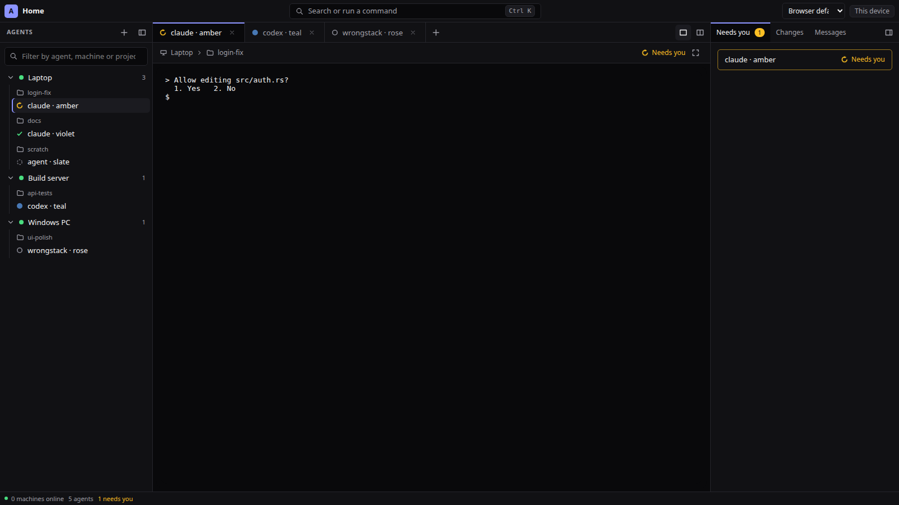
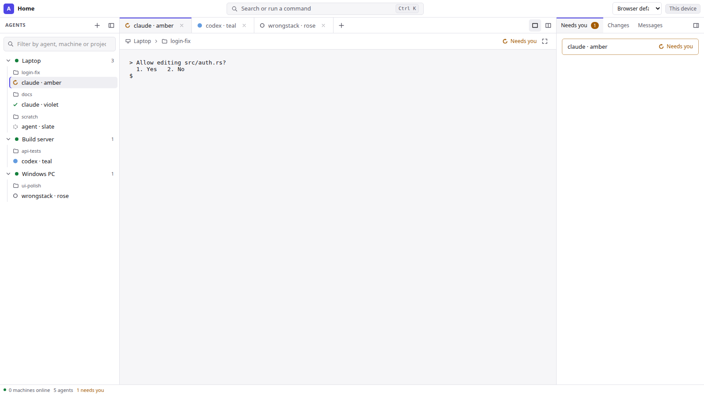
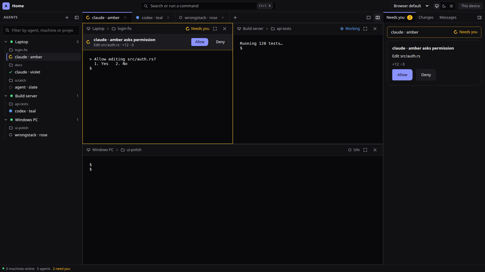
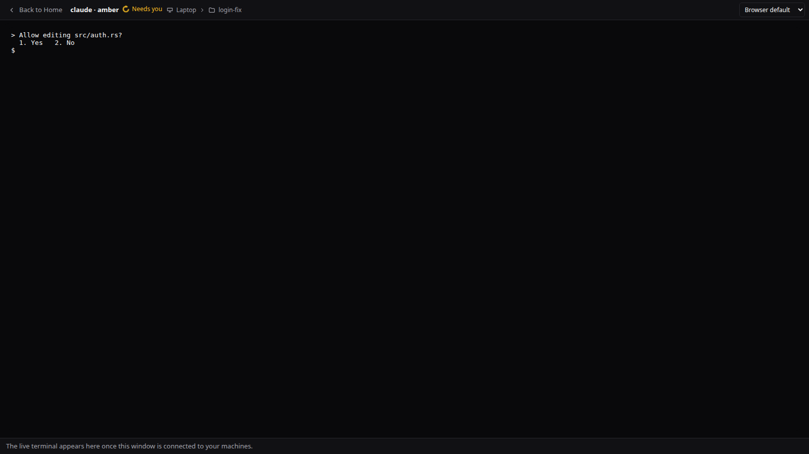
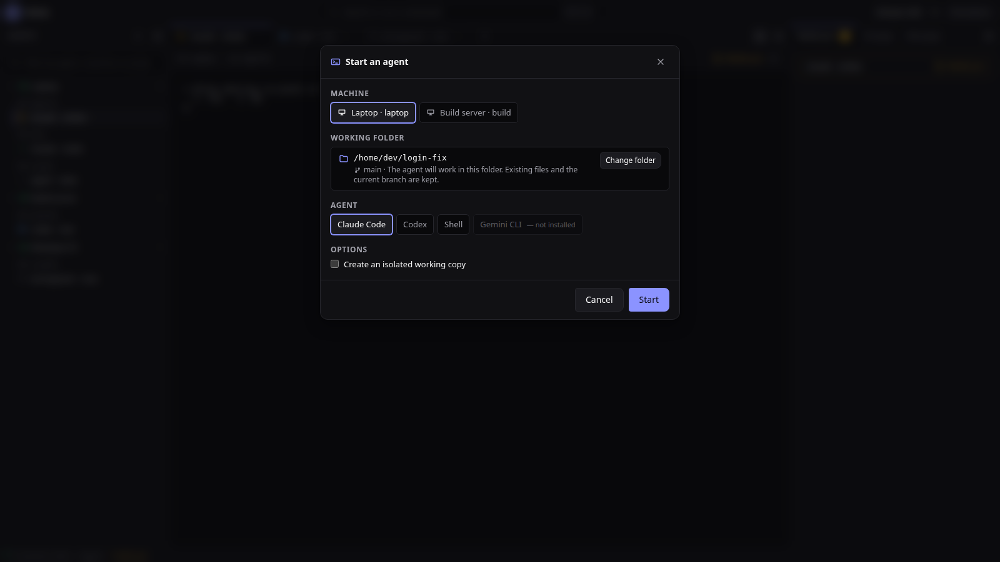
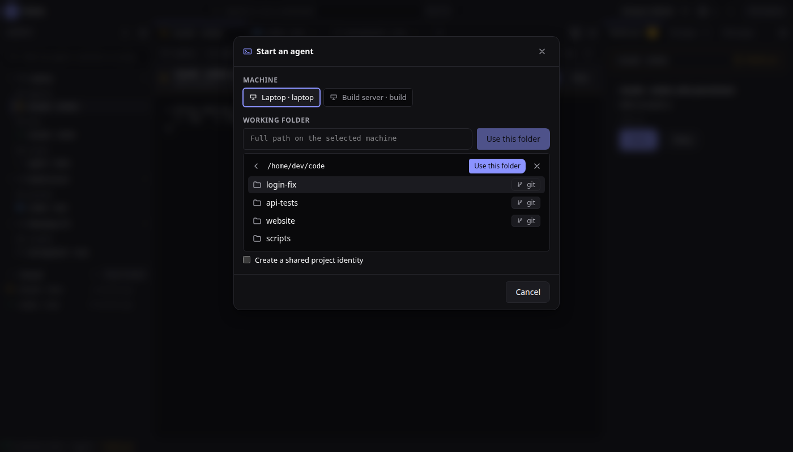
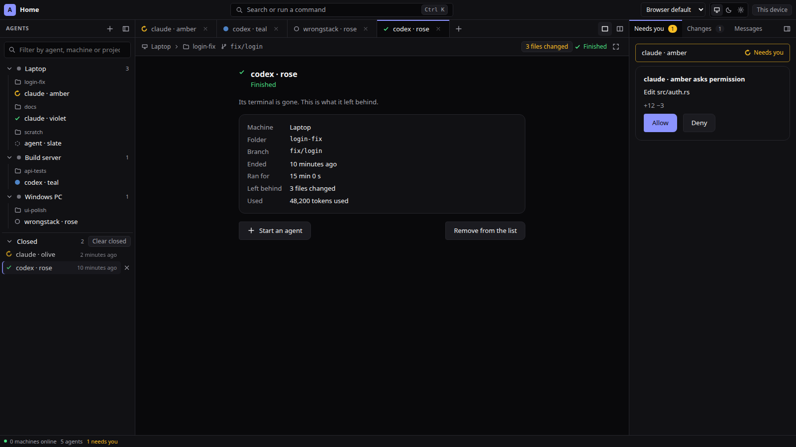
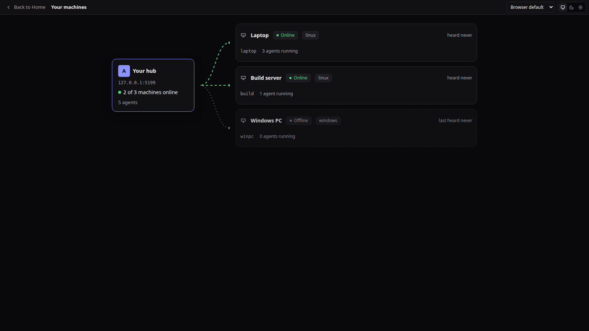

# Main window

## Browsing folders

**Browse folders** under the working-folder field opens a list of the machine's sub-folders (`directory.list`, ADR-0053; it starts in the home folder, or the typed path when there is one). Click a folder to step into it, the arrow goes up one, a Git project is marked, and **Use this folder** continues as if the path had been typed (the machine still resolves and shows it before anything starts). A machine without the command keeps the typed path.

## Closed agents

An agent whose process is gone moves from its folder to **Closed**, below the machines, with how long ago it ended; a failed one is marked. Opening it shows a summary (how it ended, when, for how long, folder and branch, files left behind with Review/History/Files, tokens and cost), **Start an agent** on this machine and **Remove from the list**. **Clear closed** removes them all. **Remove from this list** is remembered in this browser only; **Remove for everyone** asks the hub to forget the agent (`agent.forget`, ADR-0053): every client stops listing it, while its earlier events and its cost stay in the hub's record. A hub without the command answers with an error and the agent is only hidden here.

## Hub and machines

`#/machines` draws the hub with a live link to every machine it knows (animated when connected, dotted when not), a card per machine (state, system, node version, agents, terminals, memory, cost, when it was last heard, or for an offline one "last seen", ADR-0070) and the agents running there as chips. An offline machine also shows "last seen" on its row in the agent list and in its tooltip.

## Layout (editor-style, 2026-11-12)

The window is laid out like an editor, with the terminal as the content. At most two side panels are visible (visual-language.md); each hides with its button.

- **Title bar:** product mark, the search and command field (Ctrl+K), connection state, language, device.
- **Left, Agents:** a tree of machine, folder, agent. A machine row has a start button (visible on hover and focus). Agents show their state shape, shared-folder label and changed-file count. The project filter and search narrow the tree. Clicking an agent opens it as a tab; clicking the one in front closes it.
- **Middle, panes (ADR-0068, [layout.md](layout.md)):** a layout of panes and tab groups: one pane with a tab per watched agent by default, or 1x2, 2x1, 2x2, 3x2 and one large with three small from the **Layout** menu in the title bar, saved by name, exported and imported. Panes are split, resized by their dividers, dragged onto each other, maximized and restored; a pane can follow what needs you or the selected agent. Above each terminal: machine, folder and branch, changed files, cost, state, History, Files, Full size, and the copyable agent address.
- **Right, Details:** tabs for Needs you (opens first whenever something needs you), Changes, Board, Messages, Spent.
- **Status bar:** machines online, agents, how many need you, cost so far.
- **Empty state:** a start button, the agents that are running, and the two keyboard shortcuts.
- **Phones:** a single column instead of this window: what needs you, machines and agents, then one agent (ADR-0067 rung 2, [phone.md](phone.md)). A tablet keeps this window; on a touch screen its terminals get the key bar.

The older three-column description below stays valid for what each area holds.

Agreed layout (2026-11-06). Three columns plus a top bar, shown in the **Focus** layer.

Default state follows `visual-language.md`: the window opens on **Home** (Glance: attention strip + fleet of
live agent tiles). Selecting an agent opens this three-column layout. The right column shows one panel at a
time (Files, Changes, Team chat, Usage as tabs) and can be collapsed; the Machines list is a filter, not a
permanent section. Labels below use internal terms; the UI uses the vocabulary in `visual-language.md`.

## Top bar
- Scope selector (all machines or one project); connected node count.
- Approvals indicator with count; opens the approvals queue (`approvals.md`).
- Global kill switch (stop all agents) behind a confirmation.

## Left column: navigation
- **Projects** tree. Each project expands to its agents and non-agent terminals (servers, tests, logs).
  - Agent row: kind, instance number when several of the same kind exist, state badge
    (`working`, `blocked`, `done`, `idle`, `unknown`).
  - Project row shows a rollup of the most urgent agent state.
- **Machines** list: node name, OS, connection status.

## Center: selected item
- Header: agent name, machine, selected folder/branch.
- Mode toggle per agent: **Terminal** (native agent UI) and **Chat** (structured view, L2/L3 only).
- Inline approval banners for blocked agents.

## Right column: project context
- **Files**: lazy tree of the project checkout on the selected agent's node. Badges for added/modified;
  lock icon for files under a lease.
  Built today (web, read-only; `apps/web/src/components/FilesView.tsx`), in the Files window and in a pane ("Show… → This
  agent's files", beside its terminal):
  - The tree marks each changed file with its status letter, and each folder that holds one with a dot. "N changed" lists only
    the changed files, and a name filter searches every file listed so far.
  - Open files are tabs. The path bar's folders open the tree down to the file.
  - The file shows with line numbers and marks in the gutter (added, changed, removed above), read again whenever the node's
    count of changed files moves. The text is drawn a screenful at a time.
  - Ctrl F finds in the file. `/` filters the tree. The whole file can be copied.
  - In a narrow pane the tree sits above the file.
  - Syntax colours (highlight.js, loaded on demand) for files up to 256 KiB in about 25 languages, chosen by file name.
  - Not built yet: lease locks, editing.
- **Changes**: workspace diff summary (+/−); shared folders appear once and have a shared-folder label. No per-agent attribution is implied. Opens the review screen (`review.md`).
- **Mesh**: project channels with unread counts; task board progress (`task-board.md`).
- **Usage**: tokens and estimated cost for the selected agent and project (`../design/usage-and-cost.md`).

## Other screens
`review.md`, `approvals.md`, `task-board.md`, `onboarding.md`, `settings.md`.

## Principles
See `experience.md`. Command palette, attention flow, and fleet view are part of this window.

## Start an agent (ADR-0052)

One window: **Machine** chips, then **Working folder** (a known folder in one click, or a typed path), then **Agent** chips and options. Choosing the folder shows the resolved folder, branch and the rule that nothing is changed before anything starts.

Choose an online **Machine**, a known **Project** or another **Working folder** on that machine, then **Use this folder**.
The canonical folder is shown before choosing an agent and starting it. Default launch uses exactly this folder; it does not
create a branch or working copy. A Git folder offers **Create an isolated working copy** as an unchecked option. Non-Git
folders offer terminals/chat and files without Git history or diffs. Newly selected folders appear without restarting the machine.

**Create a shared project ID** explicitly writes `.agent-project.json`. Explain that committing/copying this file groups copies
on other machines; it does not sync source files. A changed previously confirmed ID requires an explicit association checkbox.
The project filter groups the same identity across machines, retaining each machine/path and its sessions. Several agents in
one folder display **Shared folder**. If a machine lacks directory support, show an update message and keep the form open.
Directory actions require a browser device trusted on the machine; the node verifies its exact signed selection.

## Addresses and machine identity

Machine host names are display labels; enrollment IDs remain the identity used for navigation, project-machine counts and
online status. Two machines with the same host name stay separate. Their IDs appear beside the name and in the launch selector
and machine details. A project shared by two enrolled IDs counts as two machines even when both host names match.

Each live agent pane and focused view shows its hub-qualified **Agent address** (`<node>/<agent>`) with an explicit copy action.
Copy the actual routing identifier, never construct it from the host name. The address remains selectable when clipboard access
is unavailable and the UI explains manual copying. Demo tiles without an enrolled identity offer no fictitious address.
