# Main window

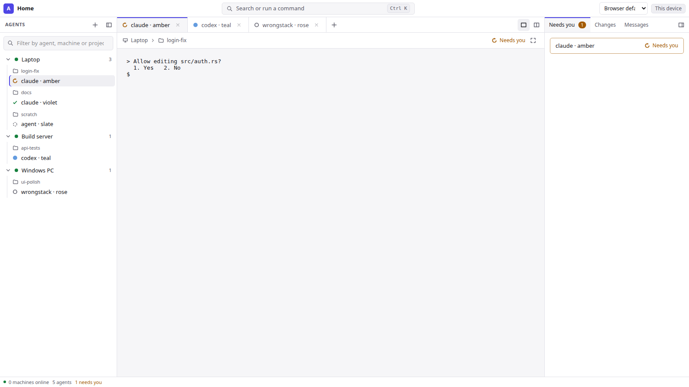

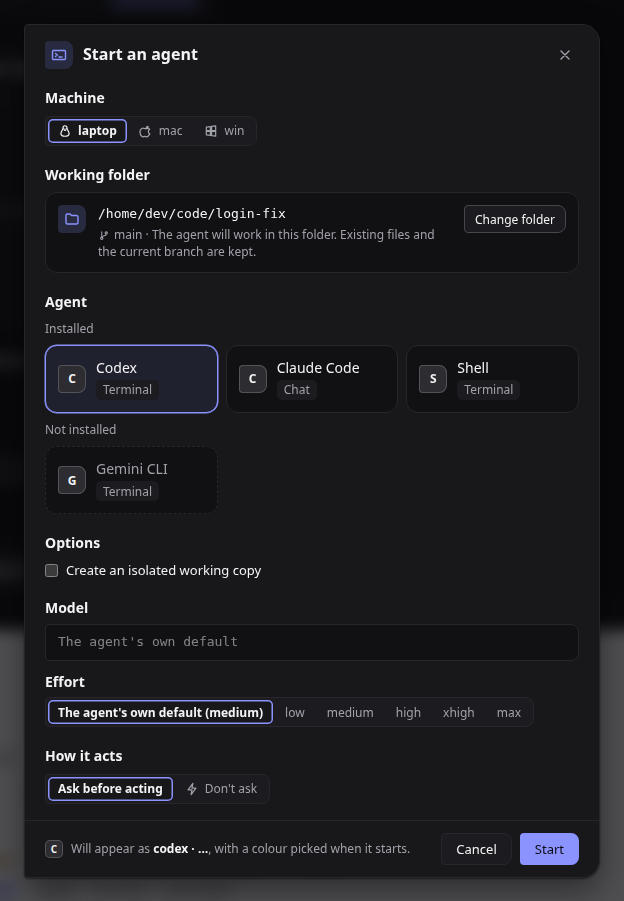

## Browsing folders

**Browse folders** under the working-folder field opens a list of the machine's sub-folders (`directory.list`, ADR-0053; it starts in the home folder, or the typed path when there is one). Click a folder to step into it, the arrow goes up one, a Git project is marked, and **Use this folder** continues as if the path had been typed (the machine still resolves and shows it before anything starts). A machine without the command keeps the typed path.

## The side panel's lists

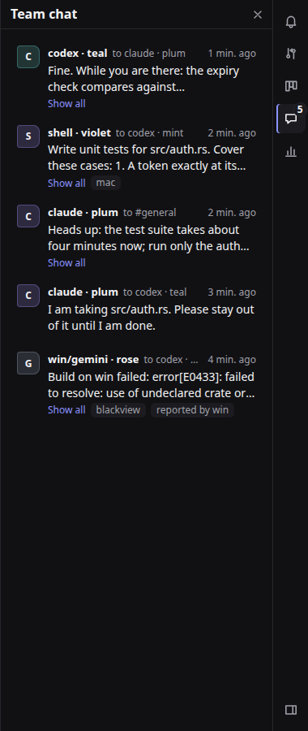
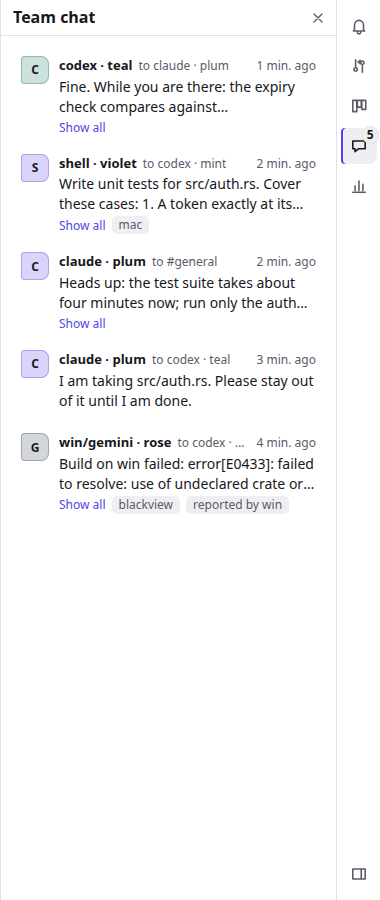
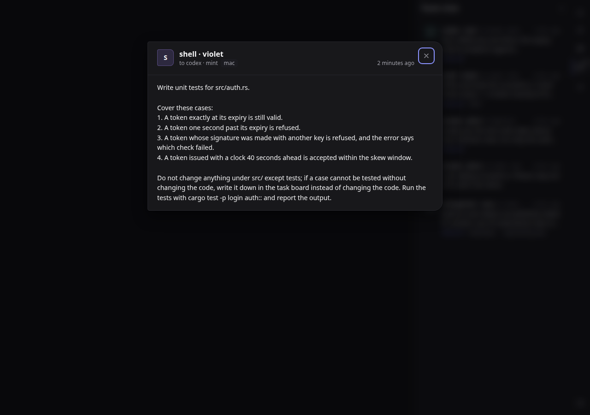
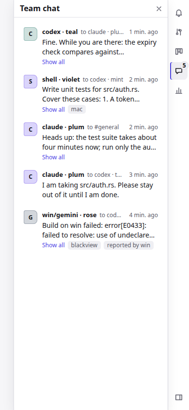
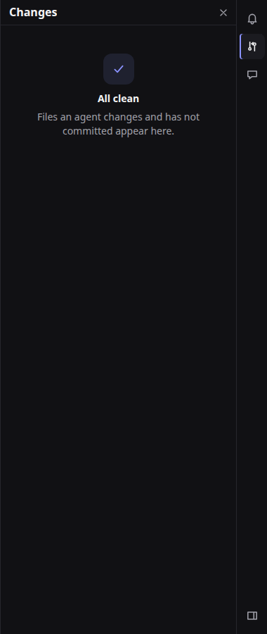
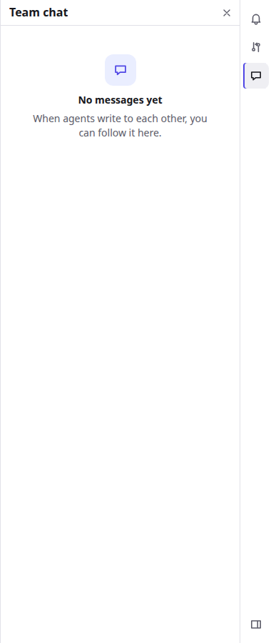
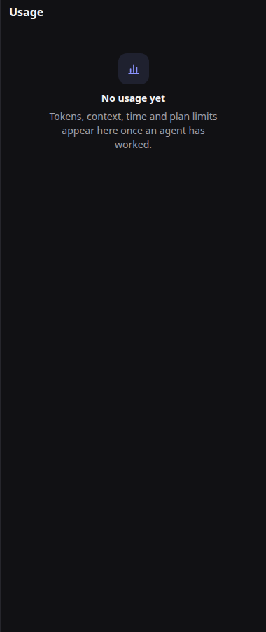
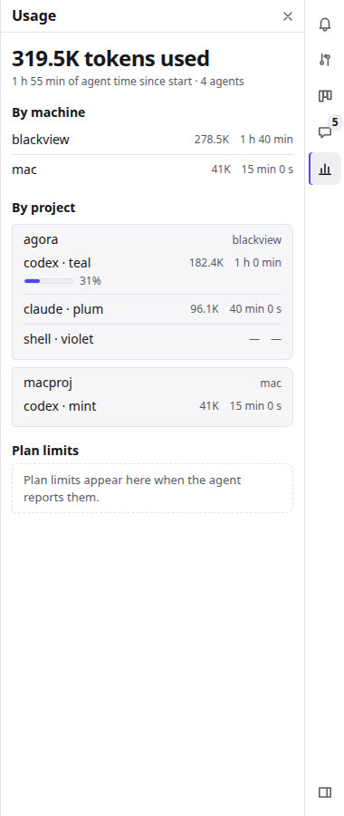
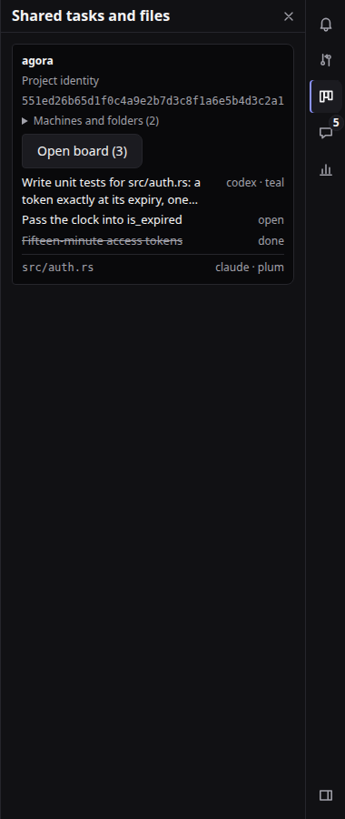

More sizes and themes: `screens/panels-redesign-*` (desktop and narrow, dark and light).

- **Titles:** the panel's name is a 16 px title and a group inside it (Usage's **By machine**, **By project**, **Plan limits**) a 14 px
  one, both in sentence case: no tiny uppercase labels in the panel.
- **Team chat** (the agents' messages, the mesh; the rail's Messages subject is named Team chat, as the UI vocabulary says): one row per message with the sender's avatar (its colour and the first letter of its
  kind; a neutral one for a sender this window does not list), the sender in bold, "to" the recipient, and how long ago on one line;
  the text under it is cut to two lines. **Show all** appears under the text when the two lines cut it, beside the machine of a message
  between machines and "reported by" for a copy only another machine recorded, as tags. The whole row is one button: a click, Enter or
  Space opens the message in full in a reading view (sender, recipient, time, tags and the whole text with its line breaks); Esc or Close
  goes back to the row, and the panel stays open. Agent text is untrusted data: it is drawn as plain text only (never HTML or markdown,
  no clickable links), without control or bidirectional characters, in the rows and in the reading view. A window that opens, reloads
  or reconnects shows the recent messages from the hub (ADR-0103: up to 50); a person given a project sees its recent messages from
  before the grant too, as they see its board and agents, and only the messages an agent of a project they were given sent.
- **Empty lists** (Changes, Team chat, Shared tasks and files, Usage, and the layout's panels that show them) all use the kit's empty
  state: an icon in a tinted chip, a short title, one line on what will appear. Usage's own empty state names the plan limits, so no
  second note sits under it; plan limits a tool did report still show.
- **Shared tasks and files:** a long project identity stays on one line and ends in an ellipsis (the whole id in its tooltip and when
  copied); a long task title is cut to two lines (the board shows it whole).

## Closed agents

An agent whose process is gone moves from its folder to **Closed**, below the machines, with how long ago it ended; a failed one is marked. Opening it shows a summary (how it ended, when, for how long, folder and branch, files left behind with Review/History/Files, tokens and cost), **Start an agent** on this machine and **Remove from the list**. **Clear closed** removes them all. **Remove from this list** is remembered in this browser only; **Remove for everyone** asks the hub to forget the agent (`agent.forget`, ADR-0053): every client stops listing it, while its earlier events and its cost stay in the hub's record. A hub without the command answers with an error and the agent is only hidden here.

**Close agent** ends a running agent of any kind (the same `agent.stop` as `agora agent stop`, no new message): in the **⋯** menu of its row in the agent list (shown on hover or focus, always on a touch screen), in the **⋯** menu of its pane or full-size header, on the phone's agent screen, in the command palette ("Close agent: name", which opens the agent and asks there), and, in a chat agent's message box, by typing `/exit` or `/quit` (never sent as text; if the agent offers a command of that name, that one is sent instead). It asks first, in the kit's dialog (audit B15, #1070): a red icon chip, "Close name?", "Ends this agent. Its conversation stays in the closed list until you remove it.", plus "It is working now: the current turn will be lost." while the agent works or waits for an answer; then **Keep it running** first, with the focus (Enter keeps the agent), and the red **Close agent** last. One click on **Close agent** is enough for an idle agent; **Keep it running**, Escape and a click outside close the dialog and nothing else (Escape never reaches the pane, list or panel behind it). The target is always the agent of the clicked item, one confirm at a time, and one dialog even when the agent is drawn in two panes. It is built from kit parts (the kit's ConfirmDialog, #1056, has no busy or error state). Screens: `docs/ux/screens/close-agent-{dark,light}.png`, `close-agent-working-{dark,light}.png`. A refusal shows its reason from the error code (not allowed, the machine's policy, a permission that is still needed, offline, ...) and the agent keeps running; after a close the agent is in the closed list with the usual **Remove from this list** and **Remove for everyone**. It is a different control from **Stop turn**, which only ends the turn.

## My machines

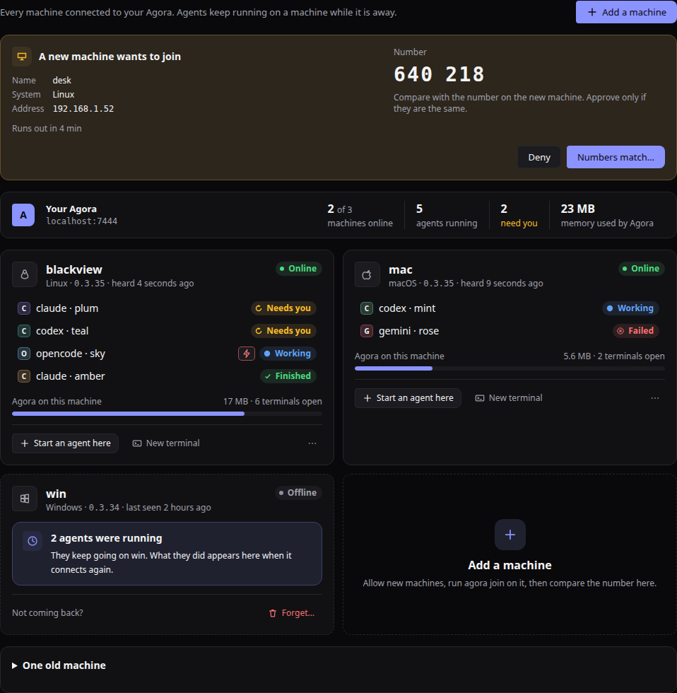

`#/machines` (**My machines**, redesign PR 9) lists every machine your Agora knows as a card, built from the widget kit; nothing on it
moves by itself (the old diagram with animated links is gone):

- **Header:** one line on what the page is and **Add a machine** (the primary action). It shows the steps: allow a new machine to join
  (the existing switch for new machines, which only its own button opens, for 10 minutes), run `agora join` on that machine, and approve
  here only if the two numbers match. Without an owner's session (or in the demo) the steps are a hint only.
- **A request to join** (ADR-0065), when there is one, comes next as a request card in the "needs you" tint: who asks (name, system and
  address, each on a row of its own, so a chosen name cannot pass for an address), the number in two groups of three in the 28 px display
  size, then **Deny** and **Numbers match…**. The second press, **Yes, the numbers match**, works only after the question has been up for
  half a second, as everywhere else. On this page the request is shown in place, so it does not also float over the window.
- **Your Agora:** a strip with four counts: machines online ("2 of 3"), agents running, how many need you (amber only above zero) and the
  memory Agora uses on all the machines.
- **A machine online:** its system as an icon tile, its name, "Linux · 0.3.35 · heard 4 seconds ago" (ADR-0070), an **Online** pill, its
  agents as rows (avatar, name, the acts-without-asking sign, a state pill; a failed one in red), a meter of the memory Agora uses there
  (its share of the total over all machines, with the amount and the open terminals), and **Start an agent here**, **New terminal** (with
  a live link) and **⋯** (copy the machine ID, agent settings). The machine ID is shown once, beside the name, and only when the name does
  not already say it (two machines may share a host name).
- **A machine offline** has a dashed card, "last seen", a note when agents were running there ("2 agents were running: they keep going and
  report back when it connects", nodes are autonomous) and a red ghost **Forget…**. An offline machine also shows "last seen" on its row
  in the agent list and in its tooltip.
- **Add a machine** ends the list as a dashed card with the `agora join` hint; it opens the same steps.

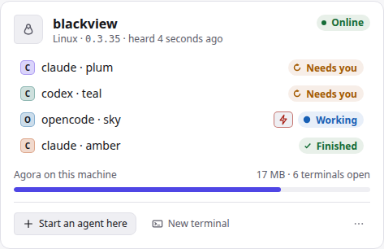
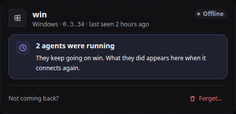
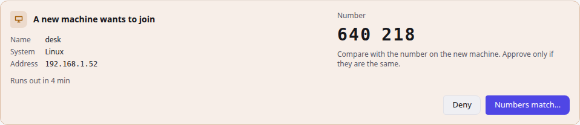

**Old machines** (ADR-0073): a machine not seen for more than a day is listed apart, folded, under **n old machines**, and is not
offered for new agents. An offline machine has **Forget…**, and the old ones have **Clean up…**: one dialog lists them, ticked,
with when each was last seen and how many agents were running then, and one box also refuses them if they connect again (a new join
code is needed then). The dialog is a destructive one (ADR-0102): a red icon chip, the machine as a row, the refuse choice as a
bordered row with its box, then **Keep** (first, and focused) and **Forget ⟨name⟩** (or **Forget n**) in red. Your Agora forgets them
for every window (`node.forget`, owner only); what they did stays in the history and the costs, and a machine that connects again comes
back with the agents it still runs. A refusal is shown on the machine's row in red. `agora hub machines` does the same from the hub's
machine.

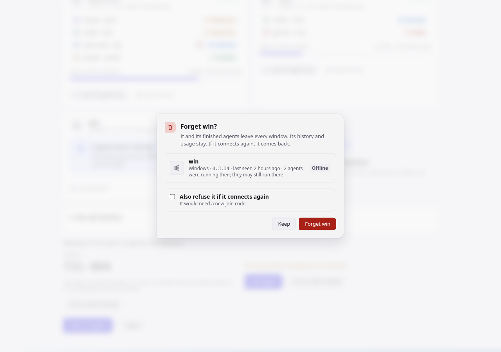
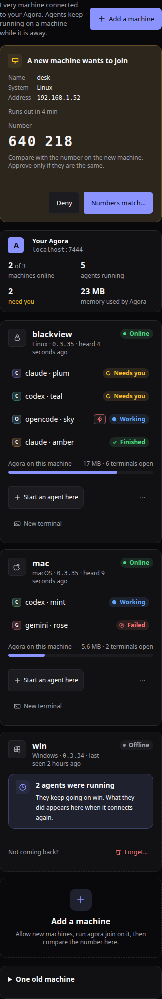

## Layout (editor-style, 2026-11-12)

The window is laid out like an editor, with the terminal as the content. At most two side panels are visible (visual-language.md); each hides with its button.

- **Title bar:** product mark, the search and command field (Ctrl+K, or the key chosen in Settings > Keyboard, `keybindings.md`), connection state, language, device.
- **Left, Agents:** a tree of machine, folder, agent. A machine row has a status dot, its name, its agent count and a start button (visible on hover and focus); an offline machine says **offline · 2 hr** (how long it has been away; its tooltip says when it was last seen). An agent row leads with the agent's avatar (its colour and the first letter of its kind, with an amber dot when it needs you), then the name, and trails its facts: the shared-folder label, the changed files as a neutral **±6** (its accessible name says "6 files changed"), the acts-without-asking bolt bare in red, and the state's shape last. The agent in front is an accent tint and a bolder name, never a bar on its edge (ADR-0102). Agents a machine's restart stopped are under **Stopped** (its tooltip and accessible name say "Stopped when the machine shut down"); **Closed** agents wait under their own heading with a quiet **Clear**. The project filter and search narrow the tree. Clicking an agent opens it as a tab; clicking the one in front closes it. On a narrow window (700 to 1023 px) the list starts hidden and, when shown, sits above the panes with a height of its own (up to about a third of the window, never less than its search, project filter, Group by and a few rows); its agents scroll inside it, the panes take the rest, and the panes' tab bar always starts below it (#1069; `scripts/e2e-midwidth.mjs`, screens `docs/ux/screens/midwidth-900-{light,dark}.png`). Screens: `docs/ux/screens/explorer-redesign-desktop-{dark,light}.png`.
- **Middle, panes (ADR-0068, [layout.md](layout.md)):** a layout of panes and tab groups: the Fleet tab and one tab per watched agent by default, or 1x2, 2x1, 2x2, 3x2 and one large with three small from the **Layout** menu in the title bar, saved by name, exported and imported. Panes are split, resized by their dividers, dragged onto each other, maximized and restored; a pane can follow what needs you or the selected agent. Above each terminal: machine, folder and branch, changed files (a neutral chip), cost, state, History, Open beside (Changes, Files, File manager), Full size, and the copyable agent address. A tab names its agent with the avatar and the name; a pane's bar does the same.
- **Tool panes (ADR-0068):** Terminal, Changes, Files and File manager are panes of the layout, not only dialogs and side panels: they are placed in splits and tab groups, dragged, maximized, closed and remembered on this device with the rest of the layout. Open one from the **+** of a tab group (also **New terminal**), from the command palette (**Open Changes beside**, **Open Files beside**, **Open the File manager beside**, **Open the terminal beside**, **Start a new terminal**), from the **Open beside** menu in an agent's header, from the changed-files chip there, and from the icon beside each workspace in the rail's Changes list. Opened from an agent, a pane shows that agent's folder; opened from nowhere it shows a short list of the folders (or terminals) it could show. A pane's bar names the folder and switches to another (another agent's, the same project on another machine) without closing the pane; the pane's own name leads in its tab (**Changes · claude · amber**). A tool already open for that agent comes to the front instead of a second one; a terminal for an agent already on screen brings that agent forward. Phones keep their single column and the dialogs.
  - **Changes:** the files list (grouped by folder, filter by status and name) beside the diff, as in the review screen: side by side or unified, unchanged lines folded and shown on request, the file as it is now. Not available without a link to the machine (it says so).
  - **Files:** the tree, a file with syntax colours and the places it changed in the gutter, open files as tabs, search by name (`/`) and in the file (Ctrl F).
  - **File manager:** a breadcrumb, a folder tree (one Tab stop; arrows, Right and Left), and a list of name, kind (an icon and a word, by extension) and size that sorts on a click on the column and filters by name (`/`). Arrows move between rows, Enter or a click opens a folder or previews a file (syntax colours; text only, a private file is never read), Backspace or Left goes up, Escape closes the preview, then clears the filter. **Copy path** (relative to the folder), **Download** (a chosen, non-private file, as the machine returns it), **Agent terminal** (the agent's terminal beside, at the folder's top only). **Rename, Move, Delete and Upload are shown switched off** with the reason as their tooltip and description: changing files needs your approval on the machine and a policy the machine does not offer this window yet. Not shown, because the machine does not report them: a modified time, a full path, listing a folder outside an agent's own. The chosen folder and file are an accent tint; the row with keyboard focus has a ring on all four sides (no bar on one edge). Screens: `docs/ux/screens/explorer-redesign-files-{dark,light}.png`.
  - **Terminal:** one agent's terminal as a tile. A plain terminal on a machine and folder is a normal start of the `shell` kind (**New terminal** opens the start window on it, then the new terminal appears as a pane); a machine without a `shell` manifest says so and offers the agents instead.
  - Every pane has an empty state (nothing to show yet, with what makes it appear), a loading state, and an error with Try again; all are announced, keyboard-operable and still under reduced motion.
- **Right, Details:** an icon rail that is always visible (also on a narrow window), with Needs you (badge with the count; opens first whenever something needs you), Changes (count), Board, Messages and Usage (Board and Usage appear only when there is something; Usage is a bars icon, and shows tokens, context and time, never money, with the open subject's own tooltip left off so it cannot cover the panel's values). Each icon has a tooltip with its name and shortcut (Alt+Shift+1 to 5 by place, unless changed in Settings > Keyboard; the same key closes the panel). The subject opens beside the rail and is part of the layout on a wide window, a drawer over the content on a narrow one (Esc closes it); whether it is open and which subject is remembered on this device. The Needs you icon is always there, on Home too: it is never hidden, even though the Fleet console lists the same requests. The Needs you list shows each agent once: by its request's card when it has one (the card opens the agent), else by a row (an agent that waits in its terminal with no request open) (`docs/ux/screens/approval-panel-*.png`).
- **Tab rows that do not fit** (the pane tabs): they scroll sideways, the edge with more fades, the tab in front is kept in view, and a **More tabs** menu lists the tabs that are cut off. An agent's tab keeps its avatar and about eight characters of its name, which gives way from the front so the colour word that tells two agents of one kind apart stays (**cl… · teal**); the tab in front never shrinks for the others and shows its whole name (up to 220 px, or the strip's width).
- **Narrow panes** are measured by their own width, not the window's: below about 416 px a pane's bar folds split right and split down into its ⋯ menu (which always has them), and below about 288 px maximize too, so the name keeps the room. Where even that is too narrow (a tab row under 176 px, a bar under 208 px: below that fewer than six characters would show) a tab or the bar shows the avatar and the state only, with the name as its tooltip and its accessible name, never a few letters of it. Under about 384 px an agent's header drops the machine and the branch (they stay in its tooltip) so the folder reads whole, and its tools wrap inside the pane. Screens: `docs/ux/screens/explorer-redesign-narrow-{dark,light}.png`.
- **Agent-list rows** keep the agent's name readable and the acts-without-asking sign whole (#945): the name has at least 40 % of the row and gives way only after "started by …" and the machine; when the name and the badges do not fit on one line, the badges wrap below the name. In a row narrower than 16rem the limit chip says only "82 %" (never the warning sign alone: the percentage is what it says) and **Shared** is hidden; the row's tooltip starts with the full name and says Shared.
- **Group by** (the agent list and the Fleet console share one choice, remembered on this device): Machine, Project, Agent (kind) and State. A project is the hub's machine-independent project id, so the same project open on several machines is one group, marked **Same project · n machines** (on tiles, in the list and on the group), with a gentle hint when agents on two or more machines have changes in it. Folders that merely share a name are never merged; an agent without a project id is grouped only with the same folder on the same machine.
- **Agent header** (agents with a chat): one row with a Model and a Mode menu (only what the agent reported over ACP, or its own settings including an Effort menu when it offers them, ADR-0090), context fill, elapsed time (when this window saw it start) and the tokens used. No money is shown here.
- **Acts-without-asking sign:** an agent that acts without asking (started with a permission-skipping option, or switched to a mode or setting that skips approvals) shows one sign and no words, everywhere it is shown: a lightning bolt in the risk colour (the fixed red of `--diff-removed`), never the amber warning sign of the limit chip, which keeps its percentage. Its accessible name and its tooltip say what it means ("Runs without asking: Started so that it acts without asking you first"; after a switch, that it holds until the agent ends or is switched back, "with your approval" only when this window saw the approval, and the mode or setting that causes it, "Because of: Mode: Bypass permissions"). The tooltip opens on hover, on keyboard focus and on a tap, stays open while the pointer rests on it, is drawn over the page so a row or the window's edge never cuts it, and closes on Esc or a tap elsewhere. Where the sign is inside another control (an Agents-list row, a tab, a tile, a give-task row) it is not a stop of its own: that control's keyboard focus opens the tooltip, a tap on the sign shows it without pressing the control (a tap elsewhere on the control still does), and the meaning is part of the control's name (a tile's own label says "Runs without asking"; the Agents-list row's tooltip says it too). Screens: `docs/ux/screens/agents-no-ask-tip-{light,dark}.png`, `session-no-ask-tip-{light,dark}.png` (the tooltip; the chat composer's sign now sits beside Mode as a red-tinted tag: `polish-redesign-chat-acts-freely-{light,dark}.png`).
- **Asks less chip (ADR-0101):** an agent that holds at least one "always" answer shows a quiet **Asks less** chip (neutral chrome) on its tile, pane header and chat controls; the tooltip and accessible name list what it remembers. It never shows beside Acts freely. See `docs/ux/approvals.md`.
- **Command palette (redesign PR 11):** results in groups (Go to, Agents, Actions, Machines and projects, Tasks, Appearance) in that order, and once you type, each group where its best match ranks; a leading icon per row, the agent's avatar on agent rows, the key where one exists (**N**; since ADR-0068 rung 4 every command of the window is listed, with the key it has now, `keybindings.md`), and key hints in the footer (both hidden on a touch screen). The selected row is an accent tint; arrows and Enter follow the rows as shown. "Nothing matches" is an empty state with a hint. Screenshots: `screens/entry-redesign-palette-*`.
- **Command palette extras:** **Machine: ⟨name⟩** (the machines page, at that machine), **Project: ⟨name⟩** (shows that project's agents; not on a phone), **Allow a new machine to join** (brings the existing window for new machines into view on Home; its own button still opens it and each join is still approved with the number), **Lock** (only when a screen password is set; the same action as the title bar's Lock) and **Settings** (This device). Entries are names and navigation: none carries a secret and none answers a request by itself.
- **Status bar:** machines online, agents, how many need you, cost so far.
- **Home, the fleet console ([fleet-console.md](fleet-console.md)):** a window nobody has arranged opens on a **Fleet** tab in front of the agents' tabs: five live counts as stat tiles (needs you, working, finished, failed, machines online) that filter the tiles, what needs you first as request cards with Allow and Deny for a plain yes or no (a start or a switch to act without asking has **Review**, which opens Review's dialog over Home: #1070), then every agent as a tile (avatar, status pill, no coloured edge) grouped by machine or by project. With no machine, no agent or no link it teaches the next step instead.
- **One terminal in several windows:** a terminal open in more than one window (two machines, or a phone and a laptop) has the size of the smallest of them, so it fits every one; a bigger window shows it at its top left with a thin line where it ends, and gets its own size back as soon as the smaller window closes it. A terminal client on the machine itself still sets the size it wants (ADR-0072; docs/specs/protocol.md, "Shared terminal size").
- **Phones:** a single column instead of this window: the same five counts, what needs you, machines and agents, then one agent (ADR-0067 rung 2, [phone.md](phone.md)). A tablet keeps this window; on a touch screen its terminals get the key bar.

The older three-column description below stays valid for what each area holds.

Agreed layout (2026-11-06). Three columns plus a top bar, shown in the **Focus** layer.

Default state follows `visual-language.md`: the window opens on **Home** (Glance: attention strip + fleet of
live agent tiles). Selecting an agent opens this three-column layout. The right column shows one panel at a
time (Files, Changes, Team chat, Usage as tabs) and can be collapsed; the Machines list is a filter, not a
permanent section. Labels below use internal terms; the UI uses the vocabulary in `visual-language.md`.

## Needs you, loudly

A blocked agent is never invisible. The Needs you tab, the fleet console, the status bar count, the tab title and (on a phone) the bar at the
bottom always show it; nothing below can hide them. On top of that, **This device** chooses how loud the window is (kept in this browser
only, default **A card over the window**): a card, a small banner only, or nothing extra.

- **The card** (`AttentionLayer`) opens for a request: for a plain yes or no that is shown whole (the fleet console's `decidableInline`) it has
  **Allow** and **Deny**; for anything else (a request to start an agent, settings, long, several-line or structured text, a hidden
  character, a machine asking to join) it says what and has only **Review**, which goes to the full card; for a start or a switch to act
  without asking, Review opens the whole request in Review's dialog in the card's place (#1070: one Review, not the agent's card and a
  second Review there; the dialog has its own dwell and guards and the window's holds, [approvals.md](approvals.md#start-and-switch-requests)),
  and nothing opens over it until it is closed; closing it leaves the request put off, as Later does. It never cuts what is asked, and it
  is never offered for an agent that waits in its terminal with no request open (the banner and the list carry that). On a phone the bar
  at the bottom does this job ([phone.md](phone.md)), so there is no card. It is the full size of the one request component
  ([approvals.md](approvals.md#one-request-three-sizes)): its title is the ask itself ("codex · teal wants to run a command") with the
  agent's avatar and the machine as a tag, and its buttons are Later, Deny, "Allow always" where offered, then Allow. Screens:
  `docs/ux/screens/approval-dialog-{dark,light}.png`.
- **It never takes the keyboard.** It opens only while the window is the one in front and the person is not typing: not with the cursor in
  a field or a terminal, and not within 1.5 s of the last key typed into one. Otherwise it waits, the banner (bottom corner at the end of the line, not modal)
  shows how many wait, and it opens when the person stops. A card that is open stays what it is; a newer request waits behind it
  ("1 more needs you after this").
- **It cannot be clicked by accident.** Allow and Deny do nothing for 600 ms after the card appeared or anything it shows changed (the
  request, the agent's name, the machine's name; the same dwell as the phone bar, restarted by every change), after the person comes
  back to the window (focus, or the tab shown again) and after the link comes back. Nothing is focused when it opens (Enter answers
  nothing), and the link must be up. A request is answered once: after Allow or Deny its buttons stay dead (the card says the answer was
  sent and offers Review). The card is an alert dialog and says "An agent needs you" in an assertive live region when it opens; a long
  name is cut and wraps, so the buttons are never pushed out of view.
  **Esc, a click outside the card and Later all mean Later**: nothing is sent, and it comes back only through the banner, or is read and
  answered in a Needs you list. The banner is hidden while a Needs you list is on screen (the side panel on Needs you, or a panel of the
  layout showing it), since that list shows the same requests; it comes back when the list closes. Nothing about a request is stored
  anywhere; only the two choices of This device are.
- **Notifications** (only after the person presses **Turn on notifications** in This device; the window never asks on its own): while the
  window is in the background, one system notification says "An agent needs you"; an option adds the agent's and the machine's name, only when it is a plain name
  (letters, digits, spaces, `. _ - @`, at most 24 characters, one request) and otherwise the generic text. A request that arrived while the
  window was in front and is still waiting when it goes to the background is told about then. It
  never carries what is asked (a request's text, a command, a path, a prompt). A burst is one notification, plus one more with the final
  count when 15 s have passed; a new one replaces the old. Pressing it brings the window forward and opens the card (or, with Banner
  only, the list). **Nothing extra** sends none. The tab title shows `(n)` and the app badge the count, whatever the choice.

Screenshots in both themes: `docs/screenshots/needs-you-modal/`. Tests: `apps/web/src/components/AttentionLayer.test.tsx`.

## Sounds, and a finished mark that lasts until seen

Both come from what the window already knows (the agents' states and the Needs you list); no message was added. A sound is never the only
sign: everything it says is on screen too.

- **Sounds** (This device → **Sounds**, `#/device/sounds`; kept in this browser only, **off until the person turns them on**, so a window
  never surprises anyone). Two short sounds made in the browser (WebAudio notes, no audio file): **finished** (two soft rising notes) when
  an agent goes from working to idle or finished, and **needs you** (two short notes at one pitch) when an agent comes onto the Needs you
  list (a machine asking to join has no sound: its card has the window's other signs). Each can be turned off and tried (**Play**); the volume is Quiet, Medium or Loud. **Mute this
  agent's sounds** is in the agent's menu (the ⋯ of its pane, its row in the agent list and its phone screen) while sounds are on, and is
  remembered in this browser. The rules (`net/sounds.ts`):
  - never in safe mode (ADR-0114), and never for the agent in the focused pane while the window is in front;
  - only while the window is hidden or not focused, unless **Also while this window is in front** is on;
  - a burst is one sound: at most one a second, the most urgent of the burst (needs you before finished), decided from the clock, not a
    timer, so a background tab cannot add one; each agent sounds at most once per change of its state, and an agent with a request open is
    one thing that needs you however many requests it opens, until it leaves the list;
  - the first look at the fleet (opening the window, signing in again) is taken as it is: no sound for what was already there. A closed
    agent finished only when its program exited by itself with status 0: one that ended with an error (Failed), was stopped (Close agent)
    or was interrupted with its machine has no sound and no mark.
  A browser plays sound only after the person has interacted with the page: the first click or key in a visit (or the Sounds switch)
  starts the audio, and a sound that could not start at once is dropped rather than played late.
- **Finished, not seen yet.** An agent that finishes while the person is not looking at it keeps a mark on its tile (a green **New** pill
  with the check), its row in the agent list and its tab (a small green-tinted disc with the check), until they look at it: its own view
  (the agent or its terminal) in a visible pane while the window is in front, or its full-size view. It also goes when the agent works
  again or waits on the person, and when it leaves the list. It uses the Finished green and its check only, never amber and never a bar
  ([visual-language.md](visual-language.md)), so it cannot be read as "needs you", which keeps its amber dot and floor (ADR-0113). Its
  words, "Finished while you were away. Open it to clear this mark.", are its tooltip and what a screen reader says. The marks are memory
  only: a reload is a new look at everything. Screens: `docs/ux/screens/finished-mark-{dark,light}.png`,
  `docs/ux/screens/sounds-settings-{dark,light}.png`. Tests: `net/sounds.test.ts`, `net/finished.test.ts`,
  `components/agentAlerts.test.tsx`.
- **In the desktop app** (M6.7; ADR-0048 Amendment A, **Proposed**): **App notifications**, a card in Settings shown only inside
  the app (`#/device/app-notifications`), **off until the person turns them on** and kept in the app's page storage. It has one switch
  for when an agent finishes and one for when an agent needs you. It uses the same events and the same rules as the sounds
  (`net/desktopNotify.ts`):
  - never in safe mode;
  - only while the window is hidden or not focused. A notification while the person is looking at the window says nothing they cannot
    see, so there is no "also while in front", and the agent in the focused pane is notified only while the window is out of focus;
  - one request to the app every 2 s at most, what came meanwhile going with it, each agent once per change of its state.

  The page sends the app only the kind, the agent's id and its name when it is plain (the Needs you card's rule). The app writes the
  words itself ("claude · amber finished.", "An agent needs you.", "3 agents finished.") and holds to the same rules again. It brings
  the window forward and opens the agent when the notification is clicked (`apps/desktop/README.md` says what each system does). The
  app's own count of approvals waiting stays always on. Inside the app, the Needs you card's browser-notification switch is off and
  points to App notifications. The page first asks the app once, with no event, whether it has the command; an app built before
  App notifications refuses, and there the card is not shown and the browser's switch stays as it was. Muting an agent's sounds does not mute its notifications
  (the terminal client has no mute either).
  Screens: `docs/ux/screens/app-notifications-{dark,light}.png`, `docs/ux/screens/app-notifications-needs-you-{dark,light}.png`.
  Tests: `net/desktopNotify.test.ts`, `components/appNotify.test.tsx`; the app's side in `apps/desktop/src-tauri/src/notify.rs`.
- **In the terminal client** (`agora tui`, M6.7): the same two signs from the same rules (`crates/agora-tui/src/alerts.rs`, ported from
  `net/finished.ts` and `net/sounds.ts`): an agent *finishes* when it goes from working to idle or finished and ended cleanly; it *needs
  you* when it comes onto the Needs you list (a request waiting, or blocked in its terminal on a machine that is online, as the list's
  `!` says), once until it leaves the list; the first look (the client just started) is taken as it is, and a machine asking to join
  has no alert. What differs, since a terminal is not a browser:
  - the alert is the terminal's own **bell** (BEL), **on by default** (the person's terminal already decides how a bell sounds or
    whether it flashes); and, **off by default**, a **desktop notification** asked of the terminal: `OSC 9` (in the terminals that
    implement it, iTerm2, WezTerm and Ghostty among them) or `OSC 777 ; notify` (foot, WezTerm and Ghostty among them), only one of the
    two, so a terminal that knows both shows one; a terminal that knows neither ignores it. Its title is the product name and its text a fixed phrase in the person's language ("claude · amber finished",
    "… needs you") with the agent's name made safe: no control, bidirectional or invisible character and no `;`, at most 40
    characters. Nothing at all is written when the client's output is not a terminal. Inside tmux or screen a notification needs their
    pass-through; the bell works as it always does there;
  - the client cannot tell whether its window is in front, so it takes it as in front: never an alert for the agent in focus (the
    active tab, or the pane in focus of a tiled layout), and an alert for every other agent;
  - at most one alert every **2 seconds** (a bell or a notification is louder than the web's soft notes), the most urgent of a burst
    (needs you before finished); one that waited is given only if it still holds and its agent is not in focus by then;
  - no volume, per-sound switch, per-agent mute or safe mode here.
  The **finished mark** is a green `✓` in the marker place of the agent's row in the list (before its name, where `!` and `•` go; the
  theme's Finished colour under a theme, checked to read on its list; plain without colours; never the attention colour), and the inspector says "Finished while you were away. Open it to clear this mark."
  It goes when the agent is on screen (its tab in front, or a visible pane of a tiled layout), works again or waits on you, or leaves
  the list; it is kept in memory only. **Settings** are in `tui-settings` in the Agora folder (`$AGORA_HOME/tui-settings`, else
  `~/.agora/tui-settings`, beside `tui-theme`), one `name = value` a line, `#` for a comment: `sound = on|off` (default `on`) and
  `desktop_notify = off|on|osc9|osc777` (default `off`; `on` is `osc9`); a file over 4 KB or a value not known keeps the default. The
  command palette's **Turn the bell off** / **Turn the bell on** changes `sound` at once and writes the file again (with both settings,
  comments not kept). Tests: `crates/agora-tui/src/alerts/tests.rs` (the transition table, the mark, the gate, the settings, the
  payload), the mark's render tests in `crates/agora-tui/src/app.rs`, `tuicmd::alert_tests`.

## Top bar
- Scope selector (all machines or one project); connected node count.
- Approvals indicator with count; opens the approvals queue (`approvals.md`).
- Global kill switch (stop all agents) behind a confirmation.
- Right end of the bar, in this order: layout, language, theme, then two icon links, **Settings** (a gear, `#/device`, also `#/settings`) and **Machines** (stacked servers, `#/machines`), then **Lock**. Each is a link with a tooltip and an accessible name (no visible text); the one whose page is open is marked (`aria-current="page"`, accent colour and an underline). The same icons end the title bar of Settings and Machines. On a phone the bottom bar has the same two entries.
- **Settings** is one page (redesign PR 8, ADR-0102): a 20 px page title, then two groups with 16 px titles, **This device** and **My machines**, and a side index on the left with an icon per section and the count of other devices (a row of links above the content on a narrow screen; its group labels are the page's only uppercase text). Every section is a **settings card**: an icon chip, a title, one line on what it is for and its state as a pill or its one action, then setting rows (name and hint at the start, control at the end).
  - **Name and fingerprint:** the device name and the fingerprint in mono; the pill says how many machines trust this browser ("Trusted on 2 machines", or "Not trusted yet"); while a machine does not trust it, **Ask another device to approve** with its outcome, and the `agora node trust` command.
  - **Appearance:** the colour scheme as a segmented control (System, Dark, Light; the same choice as the title bar's buttons), **Edit theme**, and the language.
  - **Needs you:** the attention mode as a segmented control (Card, Banner, Nothing extra; arrows move and choose); notifications in the background as a switch that asks the browser for permission only when it is turned on, disabled with the reason when the browser blocks or has none; once on, a second switch adds the agent and machine names, with what they may show.
  - **Passkey:** **Add a passkey** in the card's head; from another machine with a screen password set, a password field first (the button waits for it).
  - **Screen password:** a "Set" or "Not set" pill, an aligned two-column form (current password when one is set, new, again; at least 8 characters and the two must match), and the idle lock as a select.
  - **Your other devices:** list rows with a system icon, the name, the fingerprint in mono and when it was last used as a date written in the window's language ("today, 9:32 PM", "yesterday, 7:40 PM", "Oct 13, 9:40 PM"), and a trust pill (waiting for your approval in amber, trusted on its machines in green, not trusted or removed in grey). **Remove** is a red ghost button, offered only from a browser a machine trusts and never for a removed device; it asks first, in a dialog with the device's name, **Keep it** first (and focused), and **Remove** in red.
  - **Machines:** rows with a system icon, the name, its system, when it was last heard and whether it trusts this browser, a version tag and an Online or Offline pill, each a link to its card on Machines; the head says how many are online, and **Manage machines** (beside the group title) opens `#/machines` (forget and clean up are there).
  - **Agents:** for one machine at a time (a segmented control, or a list beyond four machines), a grid of kind cards with an avatar in the kind's colour, how it runs and the settings it takes, a red bolt where it offers "Don't ask", and a dashed card for one the machine cannot find; opening a card shows the values each setting accepts, its options (the one that skips permission questions labelled) and the missing program.

  A section has an address: `#/device/<section>` (`device`, `appearance`, `notifications`, `passkeys`, `lock`, `devices`, `machines`, `agents`). The same page on demo data, every section filled and nothing sent anywhere, is at `#/gallery/settings` (its visual-regression baseline and screenshots: `screens/settings-redesign-*`). The web window has no notion of "the machine this hub runs on", so there is no "This machine" section.

## Left column: navigation
- **Projects** tree. Each project expands to its agents and non-agent terminals (servers, tests, logs).
  - Agent row: kind, instance number when several of the same kind exist, state badge
    (`working`, `blocked`, `done`, `idle`, `unknown`).
  - Project row shows a rollup of the most urgent agent state.
- **Machines** list: node name, OS, connection status.

## Center: selected item
- Header: agent name, machine, selected folder/branch.
- Mode toggle per agent: **Terminal** (native agent UI) and **Chat** (structured view, L2/L3 only).
- Inline approval cards for blocked agents (above the content, so they never scroll away): the card size of the one request component,
  the ask whole. A pane narrower than 360 px draws it in the row size with the buttons under the text, never squeezed beside them
  (`docs/ux/screens/approval-terminal-*.png`, `approval-narrow-pane-*.png`).
- **Chat agent (structured, ACP):** a log that reads like a coding tool, in a centred column (780 px) under a header row: the state as the kit's status pill with its running time (tint, shape and word; the mark breathes while it works), the context bar and the tokens used. This row is the only place a live chat agent's state and tokens are shown: the full-size view's and the pane's headers leave them out (a terminal agent, and a closed chat agent whose row has no state, keep theirs there). The person's requests are bubbles on the right in the accent tint, with their time; a request for permission that waits is drawn in the needs tint (two soft tints of one lightness); everything the agent says and does between two requests is one **turn** with the agent's own avatar (its colour and the first letter of its kind, as on its tile), its name, the model and the time (chunks of one reply are joined and grow in place while it streams). Tool calls in a row are **one bordered group** with a header ("3 steps", plus " · 4.1 s" only when the entries carry times) and the kinds and the last step; the newest group is open, older ones are folded, and a group that waits on you or failed is always open. Each step is a row with a kind icon, its title, the file or command as a mono chip and a fold with its input; an edit whose diff the agent sent shows the diff inside its row (line numbers, +/- glyphs and bars, a hunk header), and a diff no step claimed is its own card. A **Files changed** card lists each file once with totals, jumps to its change, and opens the review screen. With a node that speaks the rich form (ADR-0090, capability `chat.rich`) a tool call is ONE row that changes in place (never a second row): a status mark (a spinner while it runs, a hollow ring while it waits, a tick, a cross), how long it took, the files it touched as chips, and folded what it printed (the last 12 lines, the rest on request); a group with a failed call, or right before a request that waits for you, is open and says so, wherever it sits. A thinking block (collapsed, dashed, "Thought for N s", "Thinking…" while it goes on, plain text) is drawn from the node's thought entries. A request for permission is a read-only record in the turn ("Asked for permission", "Permission given", "Permission refused", "Not answered") with a way to the pinned bar; it never answers anything. An older node's conversation is drawn exactly as before. The pending approval is pinned above the composer; in a pane shorter than 400 px (header and composer included) it is one row so the log keeps its room (#1082): the ask whole with Deny and Allow beside it where `decidableInline` allows and the card is at least 30rem wide (480 px at the default text size, larger with larger text, as the callout's own breakpoint), otherwise the title and Review, which opens the whole card in place (a start or a switch: Review opens its dialog); "always" is never answered from the row, and the dwell starts again whenever the row and the card swap (screens: `docs/ux/screens/polish-redesign-chat-short-*.png`). Markdown: headings, lists, tables, inline code, code blocks with a language label, a copy button and syntax highlighting (the file viewer's highlighter), and **links only for http(s)** (`javascript:`, `data:`, `file:` and addresses with credentials stay as text); raw HTML is never drawn. Full timestamps are on hover; a date separator marks a new day; errors are notices with a warning icon. The plan is a card with a numbered list; with the node's step status it ticks the done steps, marks the step in hand (a dot, weight and `aria-current`) and draws a progress bar; an older node's plan is the plain numbered list. The log follows new entries only while the reader is at the bottom; scrolled up, a **Jump to latest** pill counts what arrived. A window or pane resize (or the composer growing) is not the reader scrolling: a log that follows stays on its newest entry. Opening a fold or going to a file's change keeps what the reader opened in view, and the log leaves the tail if that takes it off its bottom. At most 120 items are drawn at once, **Show earlier** adds 120 more and keeps the reading position. In a viewer's window (ADR-0106, #1140) the composer has no box to type in and no Send: it says "You can watch here. A member or the owner talks to this agent.", its empty log does not ask them to tell the agent what to do, and its menus show what the agent runs with, their choices off. The composer is multiline (Enter sends, Shift+Enter a new line, input-method confirmation is not a send) with the Mode and Model menus the agent reported and, read-only, what this device chose at start (an effort). With the agent's own settings (`AgentSessionConfig`) the menus are those settings (mode, model, **Effort**, the rest under **More settings**); choosing one sends `AgentSetConfig`, also while the agent works. A choice the node marks as acting without asking (a mode such as Bypass Permissions, marked "does not ask") is an ordinary choice that is sent like any other (ADR-0090 Amendment A): the machine answers that it needs the owner's approval, the control says **Waiting for your approval** (it shows no new value meanwhile) and the machine's request appears above the composer as a short card (the setting and the choice with their ids, then the folder) with **Deny** and **Review** (redesign PR 5); Review opens the machine's whole card in a dialog, written from its rendering with the real option and value ids beside the agent's names, with **Deny** and **Allow**; Allow signs the decision on this device (`agora-approval-skip-v1`). Allow is only in Review and stays off for a short dwell from the moment it opens (a visible bar and "Read it first"), one click sends one decision (both answers wait a few seconds after it, and stay off while that answer is on its way or once it went, on every surface: #1048), Deny on its card has no dwell (it is off only while the card is busy or the request is held), while in a freshly opened Review both Deny and Allow wait for its open dwell, so a double click on Review answers nothing (#1070), nothing is focused for you, and the attention dialog and the phone bar never answer it inline: it is read whole in its card on the phone too. Applied: the controls show the **Acts freely** sign right beside the Mode menu as a red-tinted tag, the bolt alone with no words as everywhere (an agent started that way shows it there for its whole life; with no Mode menu it leads the row; its accessible name and tooltip say "with your approval" only when this window saw that exact value approved; after a restart, a resume or the agent's own switch it says only that the agent acts without asking) for as long as the agent's current mode or setting is one that skips, and it goes when the machine reports a safe value (switching back never asks). Denied, expired or withdrawn (also when the agent ends or restarts, which removes the card at once): the control returns to its previous value and says so. A policy that forbids it (`agent.option_forbidden`) is said in words and the choice stays marked "not allowed on this machine". The window cannot read a node's capabilities, so it answers such a card only for a machine that has answered a switch with `agent.approval_needed` in this session (any other card is read-only with a note), and a card of a shape it does not know (including one without the node's `skips: true`) says "update your window", signs nothing, and can only be dismissed locally. What was heard and answered is forgotten on every new connection. An approved switch whose report comes late is not called declined: the control says it waits for the agent, and after 20 seconds that the agent has not confirmed yet. Typing `/` opens the agent's slash commands (arrows, Enter or Tab to choose, Escape to close); a choice only puts `/name ` in the box. While the agent works **Stop turn** ends the turn only (the agent stays; it is not Stop agent; **Close agent** and `/exit` end the agent, after a confirm). A prompt sent during a turn waits: its bubble says "Waiting" and a line above the composer says "1 queued" with its text and **Drop the queue**, which asks first because it also stops the turn; a prompt the node dropped reads "Not sent". The window cannot read a node's capabilities (the snapshot has none), so it goes by what the node sent: rich entries, settings or commands, or a prompt answered in the rich form. History: the node replays the last 500 entries or 256 KiB of the conversation from its memory on every (re)connect of a window; it is gone when the node restarts. Not available: editing the last prompt, and (for an older node) everything that needs ADR-0090.
- **Terminal agent:** a **live summary** strip above the terminal with state, the last line on its screen, time running, tokens and the changed-files count (one click opens the Changes panel). Nothing else is shown: a terminal agent has no structured stream.

## Right column: project context
- **Files**: lazy tree of the project checkout on the selected agent's node. Badges for added/modified;
  lock icon for files under a lease.
  Built today (web, read-only; `apps/web/src/components/FilesView.tsx`), in the Files window and in the Files pane (the pane's **Show…** menu or **Open beside**, beside its terminal):
  - The tree marks each changed file with its status letter, and each folder that holds one with a dot. "N changed" lists only
    the changed files, and a name filter searches every file listed so far.
  - Open files are tabs. The path bar's folders open the tree down to the file.
  - The file shows with line numbers and marks in the gutter (added, changed, removed above), read again whenever the node's
    count of changed files moves. The text is drawn a screenful at a time.
  - Ctrl F finds in the file (a query with a capital letter matches case exactly; otherwise every case form matches, Turkish `i`/`İ`
    and `ı`/`I` included). `/` filters the tree. The whole file can be copied.
  - The tree is one Tab stop: arrows move between the items shown, Right opens a folder and goes into it, Left goes back up and
    closes it, Home and End go to the ends.
  - When the changes are larger than 512 KiB, the files after the cut carry no mark, and the tree says so with the machine's count.
  - In a narrow pane the tree sits above the file.
  - Syntax colours (highlight.js, loaded on demand) for files up to 128 KiB in about 25 languages, chosen by file name.
  - Not built yet: a lock mark on a file in the file browser (the task board lists the leases an agent holds), editing.
- **Changes**: workspace diff summary (+/−); shared folders appear once and have a shared-folder label. No per-agent attribution is implied. Opens the review screen (`review.md`).
- **Mesh**: project channels with unread counts; task board progress (`task-board.md`).
- **Usage**: tokens, context and active time per machine, project and agent. The totals are three stat tiles (tokens used, time since start, agents; none tinted, since nothing there asks for you), the sections are 14 px sentence-case titles (By machine, By project, Plan limits), each agent row has its avatar, and meters are 6 px and fully rounded: the accent below 80 percent and amber from 80 percent, the quota warning family; nothing else in Usage is amber. With nothing measured yet it is the kit's empty state. No money: most people pay a subscription, so a dollar figure is not shown in headers, cards or summaries; what an agent itself reports about cost sits behind a disclosure inside Usage ("may not reflect your plan"). **Plan limits** (ADR-0091) are what the tool itself reported, never worked out: one progress bar per tool and window ("Five hours", "Seven days", "N minutes") with the percentage, the reset time (relative and absolute, in the window's timezone) and "Observed N minutes ago"; amber from 80 percent, stronger from 95. A window past its reset time says "Reset" (the old percentage is not shown); a reading older than the window itself says "Out of date"; kinds known to have plan limits that reported nothing get one quiet line ("No limit information from this tool: Claude Code"), never a block per machine, and other kinds show nothing Machines that report the same tool are shown apart (each machine's own plan state). An agent's card and row carry a small "Limit 82 %" chip from 80 percent (a fresh reading only), and the start window shows a hint, never a block, when the chosen kind's window is at 95 percent or more. One clock for all of it, ticking at most every 30 seconds. No money.

## Other screens
`review.md`, `approvals.md`, `task-board.md`, `onboarding.md`, `settings.md`.

## Principles
See `experience.md`. Command palette, attention flow, and fleet view are part of this window.

## Start an agent (ADR-0052)

One window: **Machine**, then **Working folder** (a known folder in one click, or a typed path), then **Agent** and options. Choosing the folder shows the resolved folder, branch and the rule that nothing is changed before anything starts.

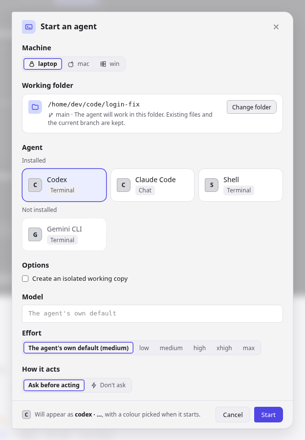
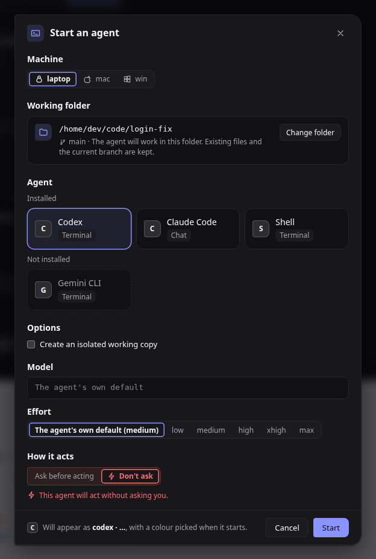
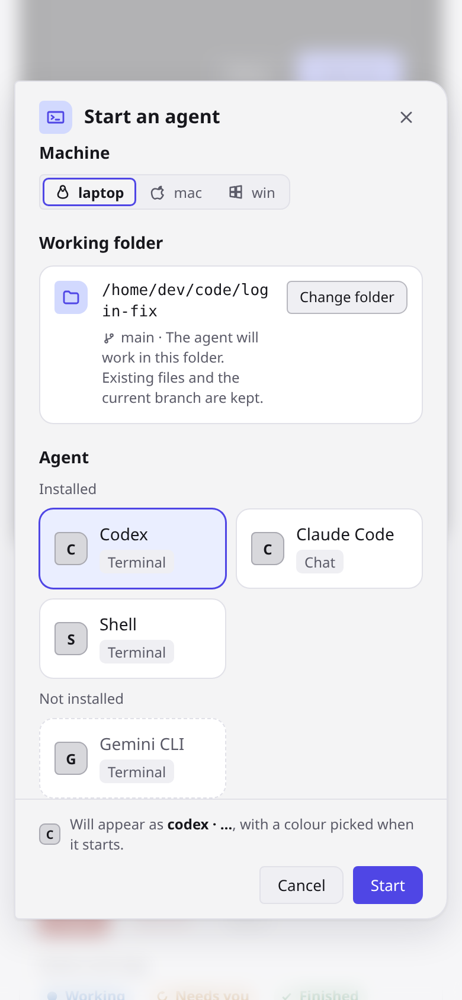
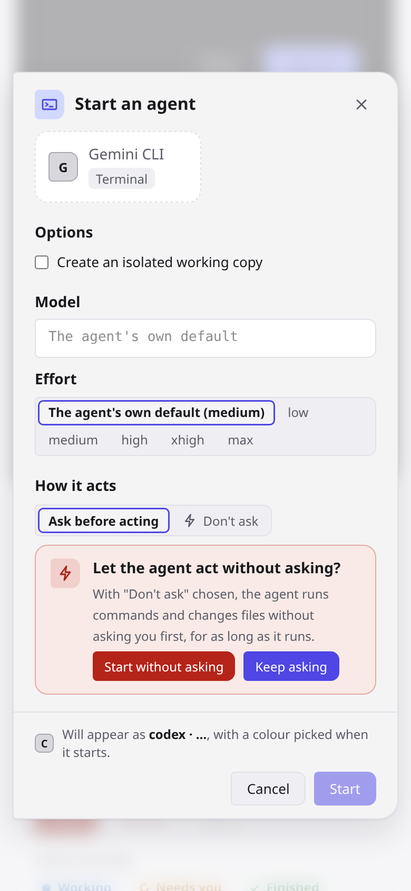

Built from the widget kit (redesign PR 10; screens `start-redesign-{agent,missing,confirm,noask}-{dark,light}.png` and
`start-redesign-{agent,confirm,noask}-phone-{dark,light}.png`):

- **Machine** is a segmented control of the online machines, each with its system's outline (Linux, macOS, Windows; the plain machine
  for any other) and its name; one tab stop, the arrow keys move and choose.
- **Agent** is a card per kind the machine lists: a letter avatar, the name, and a **Terminal** or **Chat** tag (Chat for a structured
  agent, ACP or an adapter). The cards are one radio group with one tab stop: the arrow keys move and choose (mirrored right to left),
  Home and End go to the ends, and each card is named by the kind's name alone. Installed kinds come first; kinds the machine cannot find
  follow under **Not installed** as dashed cards. Choosing one of those shows why it cannot start (the missing program by name, ADR-0069),
  and only then; it offers no options and **Start** stays off for it.
- **How it acts** is a segmented control, **Ask before acting** or the kind's option that skips permissions (**Don't ask**). Ask is
  always the default. Picking Don't ask only opens the confirmation ("Let the agent act without asking?", with **Keep asking** as the
  focused primary answer and **Start without asking** in red; **Start** waits while it is open, ADR-0059). Once confirmed, the control
  turns red with the note "This agent will act without asking you." (ADR-0102: acting without asking is red, never amber).
- Beside the buttons a preview line says **Will appear as codex · …** with a letter avatar: the agent's name starts with its kind, and
  its colour comes from the id the machine gives it when it starts, so the window does not show one before.
- A refused start, a failed folder listing and a folder outside the task's project are said in red.

Choose an online **Machine**, a known **Project** or another **Working folder** on that machine, then **Use this folder**.
The canonical folder is shown before choosing an agent and starting it. Default launch uses exactly this folder; it does not
create a branch or working copy. A Git folder offers **Create an isolated working copy** as an unchecked option. Non-Git
folders offer terminals/chat and files without Git history or diffs. Newly selected folders appear without restarting the machine.

**Create a shared project ID** explicitly writes `.agent-project.json`. Explain that committing/copying this file groups copies
on other machines; it does not sync source files. A changed previously confirmed ID requires an explicit association checkbox.
The project filter groups the same identity across machines, retaining each machine/path and its sessions. Several agents in
one folder display **Shared folder**. If a machine lacks directory support, show an update message and keep the form open.
Directory actions require a browser device trusted on the machine; the node verifies its exact signed selection.

## Addresses and machine identity

Machine host names are display labels; enrollment IDs remain the identity used for navigation, project-machine counts and
online status. Two machines with the same host name stay separate. Their IDs appear beside the name and in the launch selector
and machine details. A project shared by two enrolled IDs counts as two machines even when both host names match.

Each live agent pane and focused view shows its hub-qualified **Agent address** (`<node>/<agent>`) with an explicit copy action.
Copy the actual routing identifier, never construct it from the host name. The address remains selectable when clipboard access
is unavailable and the UI explains manual copying. Demo tiles without an enrolled identity offer no fictitious address.
