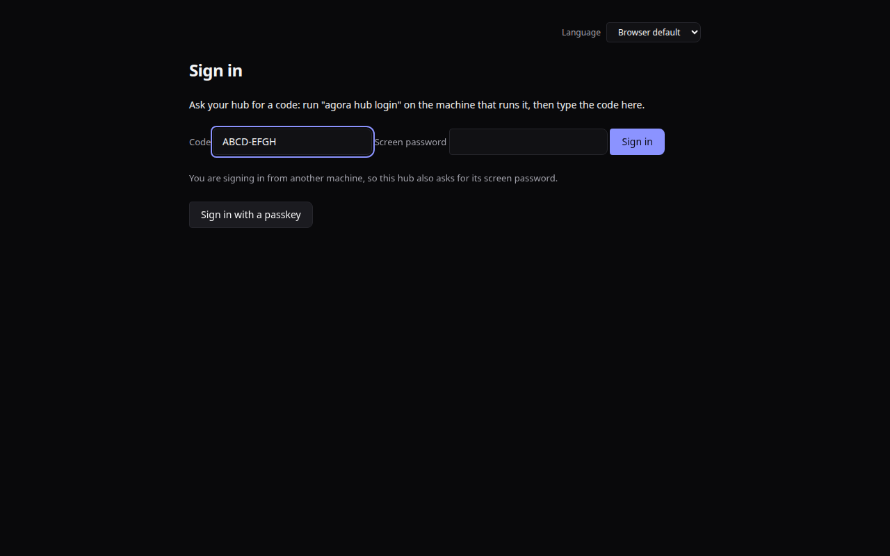
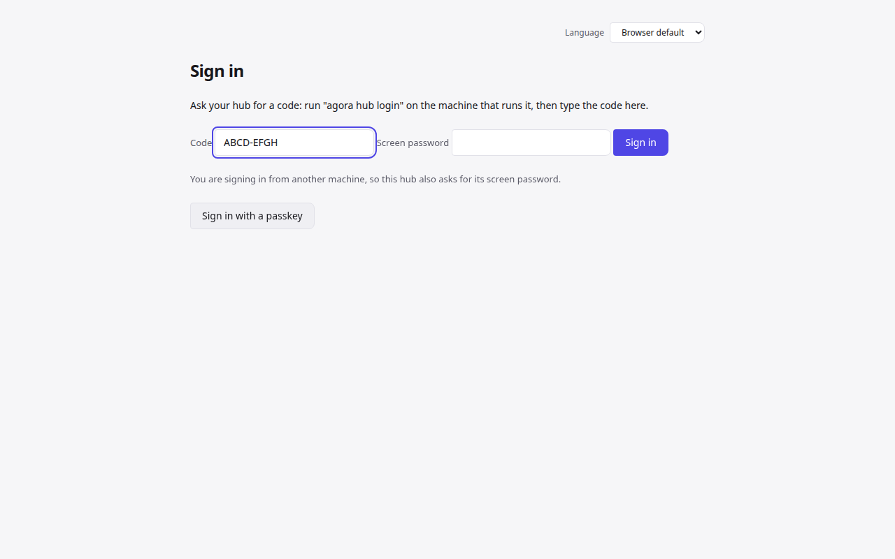
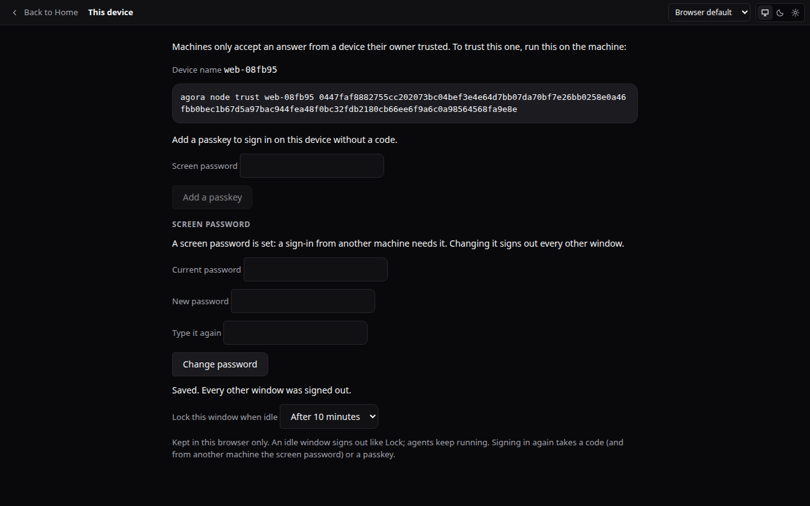

# Protect your window with a password

ADR-0067 rung 1. A sign-in code proves you could run `agora hub login` on the hub's machine a few minutes ago. Once the window is
reachable from other machines (a LAN address today; Tailscale or a tunnel later), set a **screen password** too: a sign-in from
another machine then needs the code **and** the password. The browser on the hub's own machine is never asked.

## Set it

On the machine that runs the hub:

```
agora password set      # asks twice; nothing is shown as you type; at least 8 characters
agora password status
agora password clear    # a code alone is enough again
```

`agora password set` refuses to read the password from a pipe or a file; Ctrl-C while typing stops it (exit 130) with the terminal
back to normal. Or, in the window: **This device → Screen password**
(changing it there needs the current one). Setting, changing or clearing it signs out every other window (from the command line:
every window), and each change is in the Activity page.




## Lock

- **Lock** in the title bar signs this window out at the hub and shows the sign-in page. Agents keep running: locking ends the
  window's session only, never a machine's link or an agent.
- **Lock this window when idle** (This device; off by default; 5, 10, 30 or 60 minutes) is kept in this browser only. After that long
  without a key, click, touch or scroll the window does what Lock does: its session ends at the hub, so reloading the tab opens
  nothing. Signing in again takes a code (and, from another machine, the screen password) or a passkey.



## Passkeys

A passkey you added on a device (This device → Add a passkey) signs that device in without a code and without the password: it
already proves who you are. That is why adding one from another machine asks for the screen password too (a session alone is not
enough), and why setting, changing or clearing the password removes every passkey that was added from another machine without it
(before a password was set, or before this rule). Passkeys added on the hub's own machine, or with the password, stay. Passkey tries
count only toward the per-address limit, never the hub-wide one.

## When it says "too many tries"

Wrong codes and wrong passwords count alike. After 5 misses from one address it waits a minute, then twice as long after each
further miss, up to an hour; a right sign-in from there starts the count again. After 50 misses from all addresses together every
other machine waits too, but the hub's own machine never waits more than a minute and is never held by that shared limit, and a
passkey is not held by it either. Every attempt, right or wrong, is in the Activity page with its address and browser.

## How it is kept

The hub stores a salted PBKDF2-HMAC-SHA256 hash (600 000 rounds, a random salt per password), never the password; it is never
logged or sent back. Forgot it? Run `agora password clear` or `agora password set` on the hub's machine.
