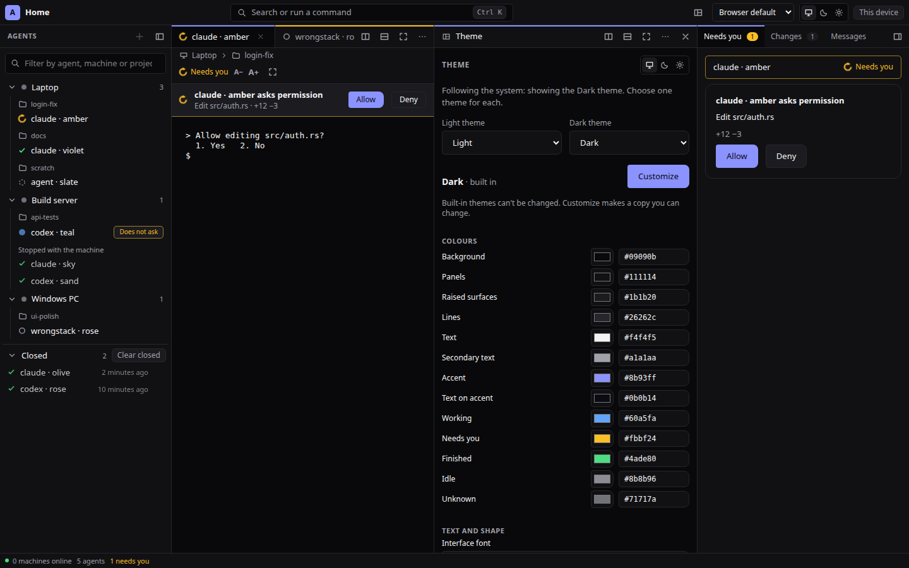
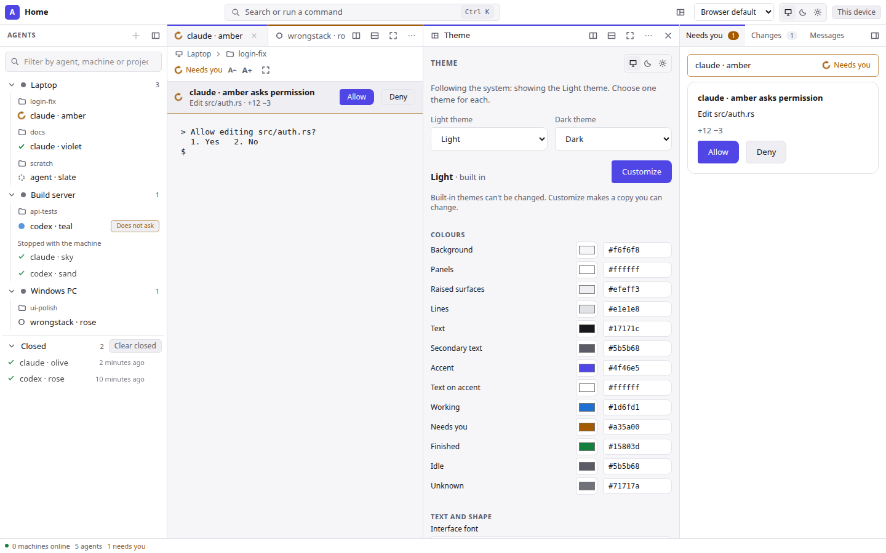
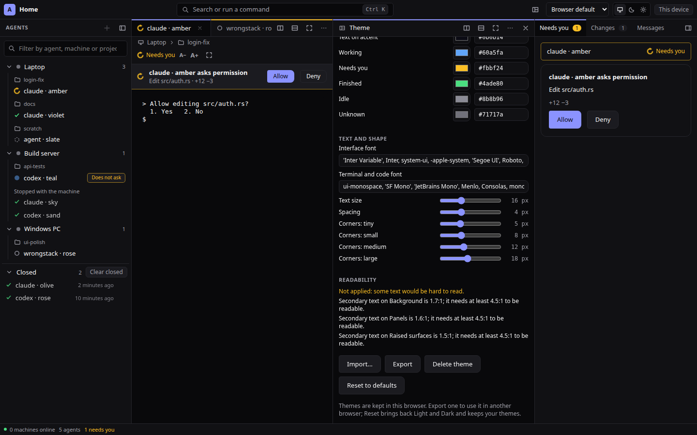
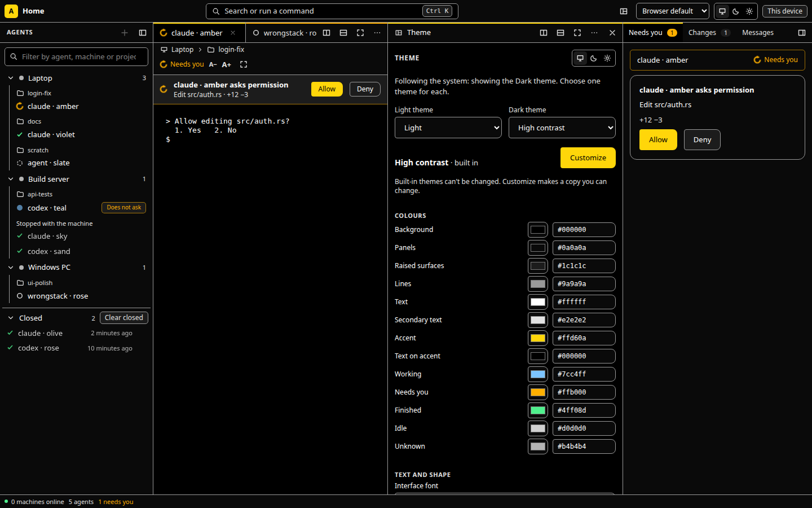
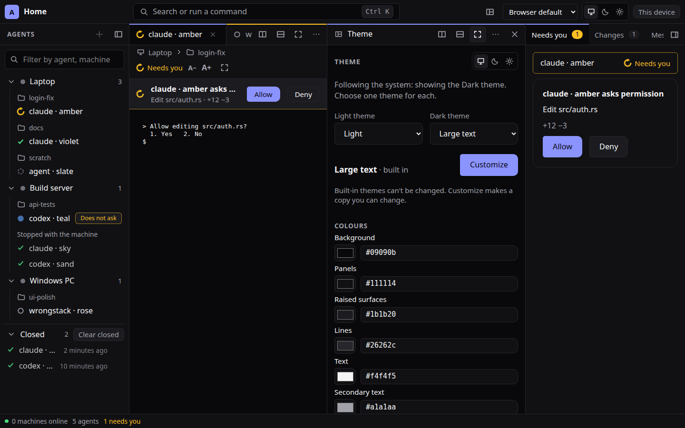
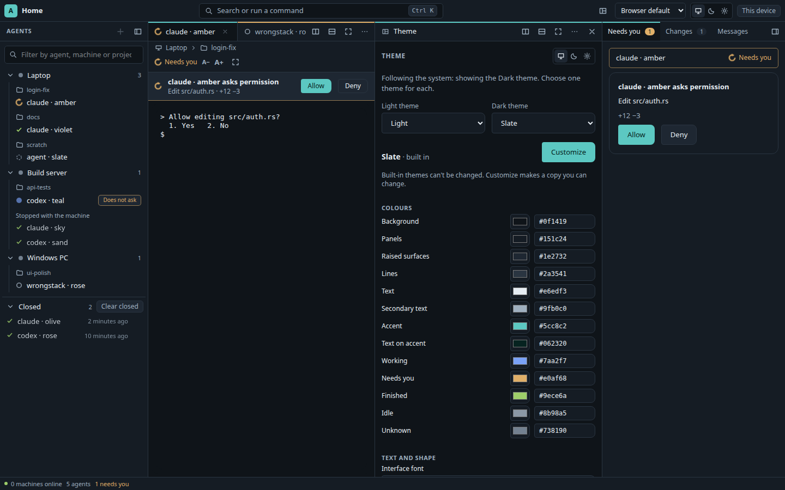
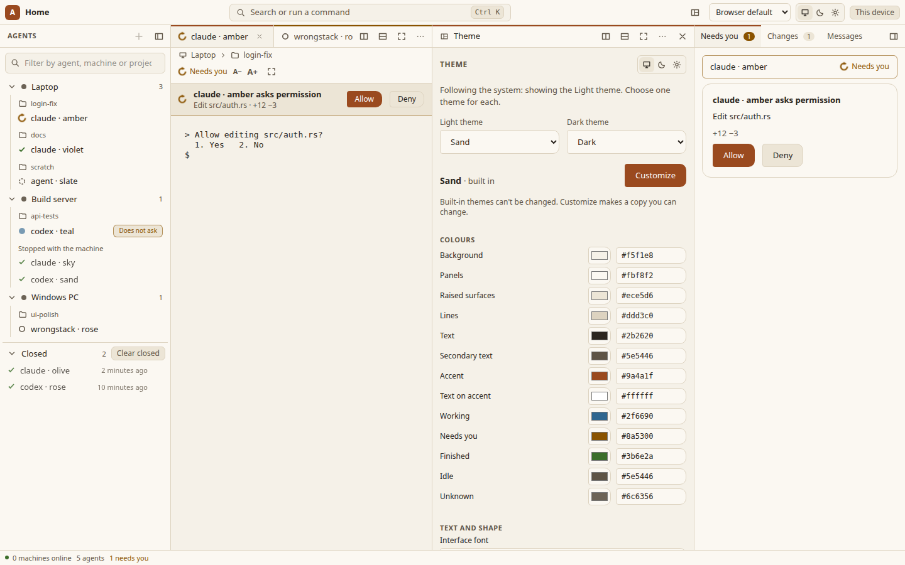

# Themes: design tokens as data (ADR-0068, rung 2)





A **theme** is a small file of **design tokens** (the variables in `apps/web/src/design/tokens.css`). Every colour, font, size,
corner and spacing a component draws comes from a token (`visual-language.md` §3), so a theme restyles the whole window without
code. This page is the file format's specification and the web window's behaviour. Rung 2 covers the web window; the terminal
client maps the same tokens in rung 5. The hub is not involved: themes and the choice are kept in the browser (syncing them
per person through the hub is an optional later step, ADR-0068).

## Format, version 1

A theme file is JSON:

```json
{
  "agora-theme": 1,
  "name": "Night",
  "scheme": "dark",
  "tokens": { "accent": "#ff9f43", "on-accent": "#1a1000", "text-16": "18px" }
}
```

- `agora-theme`: the format version. `1` is the only one; a file with a higher number is refused with "made by a newer
  version", nothing of it is guessed.
- `name`: 1 to 60 characters. Control and text-direction characters are removed before it is shown.
- `scheme`: `"dark"` or `"light"`. It decides which slot the theme fills (below), the browser's `color-scheme`, shadows and
  the terminal's 16-colour palette.
- `tokens`: any of the tokens below. Tokens left out come from the built-in **Dark** or **Light** theme of the same scheme, so
  a theme can be one line. Exporting writes every token, so a file reads the same in a client whose defaults differ.

No other field is allowed.

### Tokens

| Token | What it styles (as the editor names it) | Value |
| --- | --- | --- |
| `surface-0` | Background (the window, terminals) | colour |
| `surface-1` | Panels (bars, cards) | colour |
| `surface-2` | Raised surfaces (selected rows, buttons) | colour |
| `border` | Lines | colour |
| `text` | Text | colour |
| `text-muted` | Secondary text | colour |
| `accent` | Accent (the brand colour, links, focus) | colour |
| `on-accent` | Text on accent | colour |
| `state-working`, `state-needs-you`, `state-finished`, `state-idle`, `state-unknown` | the agent states | colour |
| `font-ui` | Interface font | font list |
| `font-mono` | Terminal and code font | font list |
| `text-16` | Text size: the base size; every text size scales with it | 12–24 px |
| `space-1` | Spacing: the 4 px grid unit; every gap and padding is a multiple | 3–6 px |
| `radius-xs`, `radius-s`, `radius-m`, `radius-l` | Corners | 0–16, 0–24, 0–32, 0–40 px |

- A **colour** is `#rgb` or `#rrggbb` (stored as lowercase `#rrggbb`). Named colours, `rgb()` and transparency are not
  accepted: contrast must be computable exactly.
- A **font list** is family names separated by commas, quoted or not (`'JetBrains Mono', monospace`); at most 200 characters
  of letters, digits, spaces and `_ . , ' " -`. Nothing else, so a value can never end the CSS declaration it is put in.
- A **size** is `"18px"` or the number `18`, within the token's range.
- `text-12`, `text-13`, `text-14`, `text-20`, `text-28` and `space-2` … `space-8` exist in `tokens.css` but **follow** from
  `text-16` and `space-1`; a file that sets one is refused with "follows from `text-16`: set `text-16` instead".
- Motion (`motion-*`) and `shadow` are not themeable: motion follows the system's reduced-motion setting, shadows follow the
  scheme.

Sizes stay relative to the browser's own text size: `text-16: 20px` makes the root font size 125 % of the browser's, and the
window's text and spacing (rem-based) grow with it. The terminals keep their own text size (A−/A+).

## Reading a theme (validation)

Every theme from outside (an imported file, this browser's storage, a change in the editor) goes through one function that
never throws and reports **every** problem at once, each with a message from `locales/<lang>/web.ftl`:

1. Not JSON (`theme-error-json`); not an object with an integer `agora-theme` ≥ 1 (`theme-error-invalid`); a newer version
   (`theme-error-newer`).
2. An unknown field (`theme-error-unknown-field`), a bad name (`theme-error-name`) or scheme (`theme-error-scheme`).
3. Each token: unknown (`theme-error-unknown-token`), derived (`theme-error-derived-token`), or a value that is not allowed
   (`theme-error-bad-color`, `-bad-size` with the range, `-bad-font`).
4. **Readability** (WCAG 2.2 AA), once every colour is valid: `text`, `text-muted` and `accent` need **4.5:1** on each of the
   three surfaces, `on-accent` 4.5:1 on `accent` (contrast minimum, 1.4.3); each state colour needs **3:1** on each surface
   (non-text contrast, 1.4.11: states are always colour + shape + word). A failing pair is reported as
   "Secondary text on Panels is 1.6:1; it needs at least 4.5:1 to be readable" (`theme-error-contrast`; the ratio is rounded
   down, so a shown 4.5 always passes).

A theme with any problem is refused as a whole: an import adds nothing, a stored one is dropped (the defaults stand in), an
edit is not applied.

## Built-in themes

| Theme | Scheme | What it is |
| --- | --- | --- |
| **Dark** | dark | the default dark (`tokens.css`) |
| **Light** | light | the default light (`tokens.css`) |
| **High contrast** | dark | pure black and white, visible lines, a yellow accent; text at least 15:1 |
| **Large text** | dark | Dark with text and spacing a quarter larger, softer corners |
| **Slate** | dark | a cool blue-grey with a teal accent |
| **Sand** | light | a warm paper tone with a terracotta accent and softer corners |






Built-in themes cannot be changed; a test keeps Dark and Light equal to `tokens.css` and every built-in theme readable.

## Choosing (per person, in this browser)

- The title bar's three buttons are unchanged: **Follow the system**, **Dark**, **Light**.
- Each scheme has **its theme**: "Light theme" and "Dark theme" in the editor. Following the system switches between the two
  by itself (Sand by day, Slate by night); Dark or Light shows that scheme's theme. Choosing a theme of the other scheme while
  one is forced moves to that scheme, so the choice shows.
- The command palette (Ctrl K) lists **Theme: ⟨name⟩** for every theme, and **Edit theme**.
- Stored in this browser's `localStorage`: `agora.theme` (the scheme, as before this rung), `agora.theme.choice.v1` (the two
  themes) and `agora.themes.v1` (the person's own themes, at most 20). Storage that is missing, full or blocked costs only the
  memory: every choice still holds for the visit. Another tab of the same browser applies a change at once (live reload).
- **Reset to defaults** goes back to following the system with Light and Dark; the person's themes are kept.

## The theme editor

A panel of the window (panel id `theme`, `layout.md`), so the window it styles stays in view. It opens beside the pane in
focus (as a tab there when the layout has no room for another pane), from **Edit theme** in the palette, the **Appearance**
section of **This device**, or a pane's **Show** menu. On a phone, which has no panels (ADR-0067 rung 2, [phone.md](phone.md)),
the same two ways open it as a screen of its own (`#/theme`) with Back.

- Built-in themes are shown read-only with **Customize**, which makes a copy "⟨name⟩ (mine)" and selects it.
- On one of your themes every token is a field: colours as a swatch and a hex field, fonts as text, sizes as sliders. A change
  that is valid is saved and shown on the whole window at once; a value still being typed is kept in the field while the window
  keeps the last good one.
- **Readability** lists every pair below its minimum; while any is listed the change is **not applied**, so the window never
  becomes unreadable while it is being edited.
- **Import…** reads a theme file (refused with its reasons, or added and selected), **Export** saves the theme on screen as
  `theme.json`, **Delete theme** removes one of yours (its scheme falls back to Light or Dark), **Reset to defaults** as above.

## Not yet (later rungs)

- A separate terminal palette (the 16 ANSI colours) in the theme file: today it follows the scheme.
- A themes folder watched on disk (the desktop app, the terminal client): the browser has no folder, so "live reload" here is
  the editor and other tabs.
- Syncing themes and the choice through the hub per person (optional, needs its own ADR, ADR-0068).
