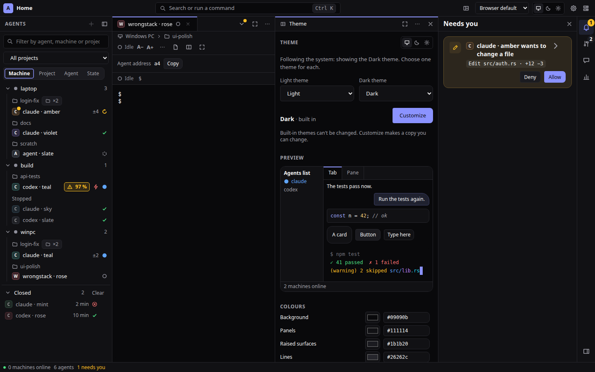
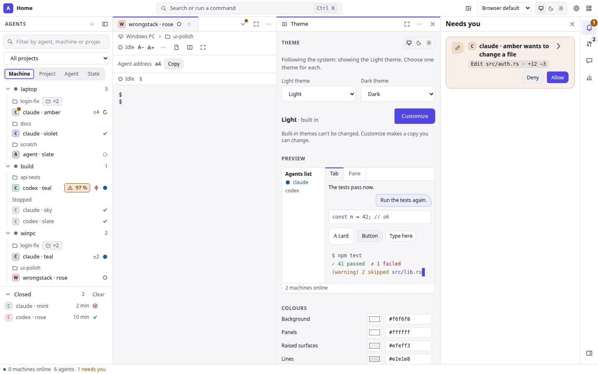
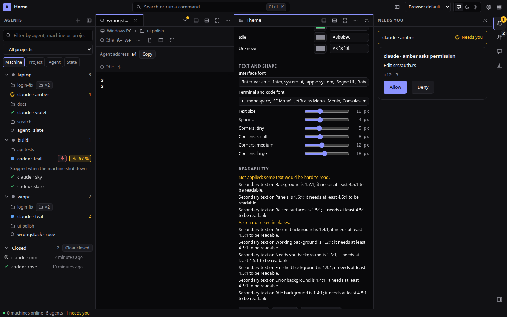
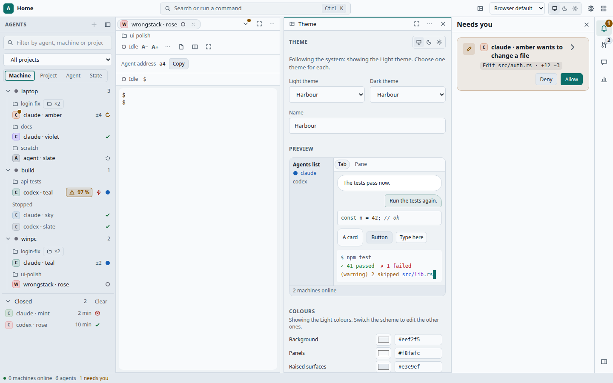
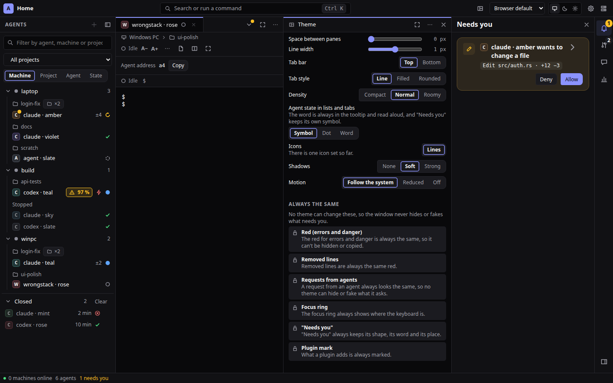
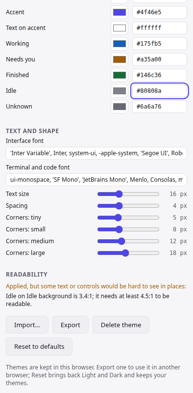
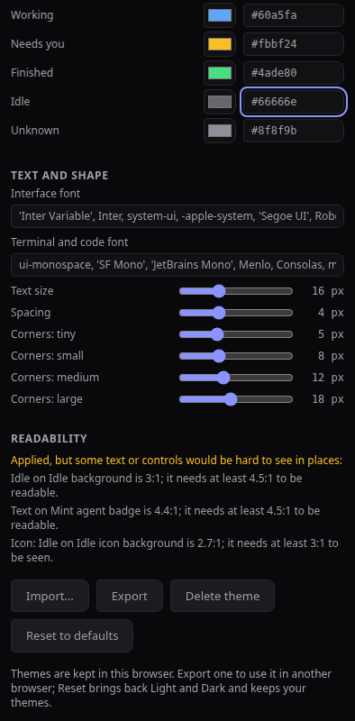
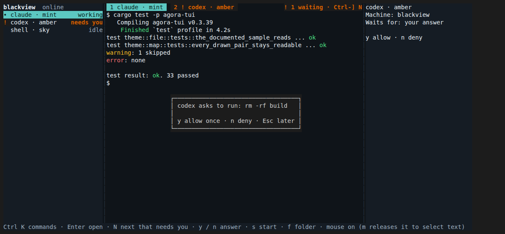
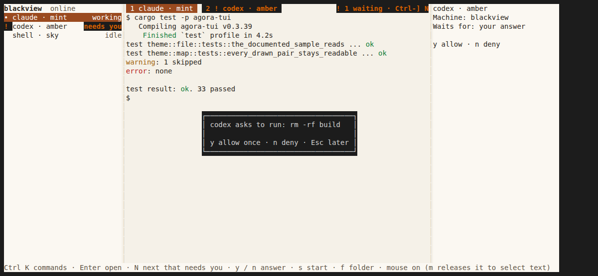
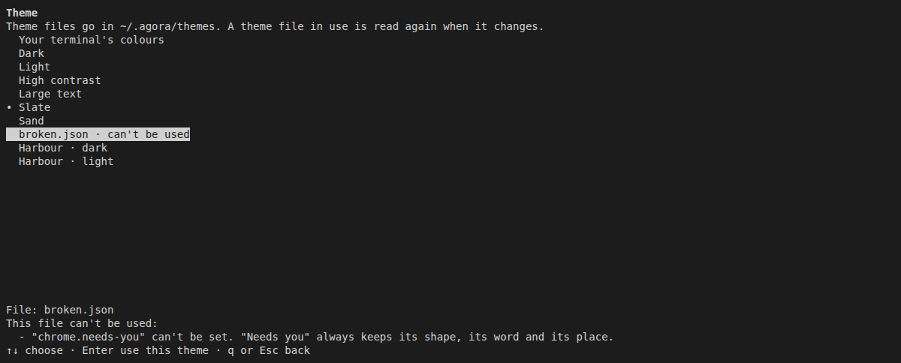

# Themes: design tokens as data (ADR-0068 rung 2, ADR-0113 format 2)





A **theme** is a small file of **design tokens** (the variables in `apps/web/src/design/tokens.css`). Every colour, font, size,
corner and spacing a component draws comes from a token (`visual-language.md` §3), so a theme restyles the whole window without
code. This page is the file format's specification and the web window's behaviour. Rung 2 covers the web window; the terminal
client reads the same files ([below](#the-terminal-client), ADR-0113 build step 3). Themes and the choice are kept in the browser (syncing them
per person through the hub is a later step, [ADR-0113](../adr/0113-deep-themes-and-community-themes-stay-data.md) decision 6). The hub is
involved only for the [community catalog](#the-community-catalog), which it fetches on its owner's command (build step 5).

**Format 2** ([ADR-0113](../adr/0113-deep-themes-and-community-themes-stay-data.md), below) goes deeper where the look comes from:
both schemes in one file, the terminal's palette, the colours of the window's parts, and the window's chrome (pane borders and
gaps, the tab bar, density, how a state is shown, shadows, motion), always as values from closed lists, never CSS. A theme stays
data: it never holds code, CSS, `url()` or anything from the network, and it can never change what needs you ([the floor](#the-floor-what-no-theme-can-change)).

## Format, version 1

A theme file is JSON:

```json
{
  "agora-theme": 1,
  "name": "Night",
  "scheme": "dark",
  "tokens": { "accent": "#ff9f43", "on-accent": "#1a1000", "text-16": "18px" }
}
```

- `agora-theme`: the format version: `1` here, `2` [below](#format-version-2). A file with a higher number is refused with
  "made by a newer version", nothing of it is guessed. Format 1 files are still read as they always were, with one change the
  floor asks for: a `text-16` under 16 px is shown at 16 px with a warning (`theme-warning-text-lifted`), so no text is under
  12 px. Export writes format 2.
- `name`: 1 to 60 characters. Control and text-direction characters are removed before it is shown. When a format-1 theme is
  stored or exported as format 2, the pieces format 2 refuses (`url(`, `@import`, `;`, `}`, `expression(`, `<`) are removed from
  its name, so every theme format 1 accepts stays one format 2 accepts.
- `scheme`: `"dark"` or `"light"`. It decides which slot the theme fills (below), the browser's `color-scheme`, shadows and
  the terminal's 16-colour palette.
- `tokens`: any of the tokens below. Tokens left out come from the built-in **Dark** or **Light** theme of the same scheme, so
  a theme can be one line. Exporting writes every token, so a file reads the same in a client whose defaults differ.

No other field is allowed.

### Tokens

| Token | What it styles (as the editor names it) | Value |
| --- | --- | --- |
| `surface-0` | Background (the window, terminals) | colour |
| `surface-1` | Panels (bars, cards) | colour |
| `surface-2` | Raised surfaces (selected rows, buttons) | colour |
| `border` | Lines | colour |
| `text` | Text | colour |
| `text-muted` | Secondary text | colour |
| `accent` | Accent (the brand colour, links, focus) | colour |
| `on-accent` | Text on accent | colour |
| `state-working`, `state-needs-you`, `state-finished`, `state-idle`, `state-unknown` | the agent states | colour |
| `font-ui` | Interface font | font list |
| `font-mono` | Terminal and code font | font list |
| `text-16` | Text size: the base size; every text size scales with it | 12–24 px |
| `space-1` | Spacing: the 4 px grid unit; every gap and padding is a multiple | 3–6 px |
| `radius-xs`, `radius-s`, `radius-m`, `radius-l` | Corners | 0–16, 0–24, 0–32, 0–40 px |

- A **colour** is `#rgb` or `#rrggbb` (stored as lowercase `#rrggbb`). Named colours, `rgb()` and transparency are not
  accepted: contrast must be computable exactly.
- A **font list** is family names separated by commas, quoted or not (`'JetBrains Mono', monospace`); at most 200 characters
  of letters, digits, spaces and `_ . , ' " -`. Nothing else, so a value can never end the CSS declaration it is put in.
- A **size** is `"18px"` or the number `18`, within the token's range.
- `text-12`, `text-13`, `text-14`, `text-20`, `text-28` and `space-2` … `space-8` exist in `tokens.css` but **follow** from
  `text-16` and `space-1`; a file that sets one is refused with "follows from `text-16`: set `text-16` instead".
- In format 1, motion (`motion-*`) and `shadow` are not themeable: motion follows the system's reduced-motion setting, shadows
  follow the scheme. Format 2 has `motion` and `shadow` chrome values.

Sizes stay relative to the browser's own text size: `text-16: 20px` makes the root font size 125 % of the browser's, and the
window's text and spacing (rem-based) grow with it. The terminals keep their own text size (A−/A+).

## Format, version 2




```json
{
  "agora-theme": 2,
  "name": "Harbour",
  "inherits": "slate",
  "dark": {
    "tokens": { "accent": "#5cc8c2" },
    "regions": { "sidebar": { "surface": "#0b1016" }, "person-entries": { "surface": "#14302f", "line": "#2b6b68" } },
    "terminal": { "background": "#0b1016", "foreground": "#d8e1ea", "red": "#ff7b72" },
    "syntax": { "keyword": "#ff9e8f" }
  },
  "light": { "tokens": { "accent": "#0b6e69", "on-accent": "#ffffff" } },
  "shape": { "radius-m": "10px" },
  "text": { "font-mono": "'JetBrains Mono', monospace", "weight": 400, "line-height": "normal", "ligatures": true },
  "chrome": { "pane-borders": "always", "pane-gap": 8, "tab-style": "pill", "density": "compact" }
}
```

Fields (no other is allowed, at any level):

- `agora-theme`: `2`. `name`: as in format 1.
- `inherits` (optional): the id of a built-in theme (`dark`, `light`, `high-contrast`, `large-text`, `slate`, `sand`). Values the
  file leaves out come from it: its colours for its own scheme, and its shape and fonts for both. Without it they come from the
  default **Dark** or **Light**. A file with `inherits` and no scheme sections is that theme with the file's chrome and text.
- `dark`, `light` (at least one, or `inherits`): the colours of that scheme. A theme with both fills both slots (below); one with
  one fills that one. Each holds:
  - `tokens`: the 13 colour tokens of format 1 (surfaces, lines, text, accent, states). Sizes and fonts are not here.
  - `regions`: the colours of the window's parts, each `{ "surface", "text", "line" }`, each optional (below).
  - `terminal`: the terminal's colours, each optional (below).
  - `syntax`: code colours, each optional: `keyword`, `string`, `comment`, `number`, `function`, `type`, `attr`, `meta`. Left out,
    they are mixed from the theme's colours as in format 1 (`app.css` `--syntax-*`).
- `shape`: `text-16` (**16**–24 px: the smallest text is three quarters of it, and no text is under 12 px), `space-1`, and the
  four corners, as in format 1.
- `text`: `font-ui` and `font-mono` (font lists as in format 1: installed fonts only, the same safe alphabet), `weight` (300,
  400 or 500), `line-height` (`"normal"`, each text size's own, or a number from 1.2 to 1.8) and `ligatures` (`true` or `false`;
  the interface and code blocks, not terminals: xterm has no ligatures without an add-on).
- `chrome`: the window's frame (below).

Export writes every token, every shape, text and chrome value, and the regions, terminal and syntax colours the theme sets (not
`inherits`), so a file reads the same in a client whose defaults differ, and a file exported and imported is identical.
Themes are kept in this browser as format-2 files; one stored before this format is a format-1 file and is read as above.

### Regions

| Region | `regions` key | Drawn without a theme in (surface / text / line) |
| --- | --- | --- |
| Agents list (the sidebar) | `sidebar` | Panels / Text / Lines |
| Tabs: the tab in front, and the lines between tabs | `tab-bar` | Background / Text / Lines |
| Pane bars | `pane-bar` | Panels / Text / Lines |
| Status line (the bottom bar) | `status-line` | Panels / Secondary text / Lines |
| Cards (agent tiles, the kit's cards) | `cards` | Panels / Text / Lines |
| Text fields and menus | `inputs` | Panels / Text / Lines |
| Buttons (not the main or red ones) | `buttons` | Raised surfaces / Text / Lines |
| Agent replies in a conversation | `agent-entries` | none (they sit on the pane) / Text / none |
| Your messages in a conversation | `person-entries` | Accent background / Text / the accent's hairline |
| Code blocks in a conversation | `code-blocks` | Panels / Text / Lines |

Each part is a CSS variable (`--sidebar-surface`, …) that the window reads with today's token as its fallback, so nothing
changes until a theme sets one. Agent replies get a box (padding, a corner, a line) only when a theme colours them.

### Terminal

`background`, `foreground`, `cursor`, `selection` and the 16 colours `black`, `red`, `green`, `yellow`, `blue`, `magenta`,
`cyan`, `white` and their `bright-` forms. Left out, a terminal draws as before: the pane's background, the theme's text, the
accent as cursor and selection, and the window's palette for the scheme. Every terminal pane takes them, and takes them again on
every theme change (`agora-theme` event). The selection is drawn at 40 % over the background, fainter in a terminal not in focus,
so text keeps its own colour on top. The terminal's frame and its search matches follow the terminal's background and text.

### Chrome

Every value is a word from a list or whole pixels in a range. The theme sets it on `<html>` as a data attribute (the list's own
word, never the file's text) or as a number variable (`--pane-gap`, `--line-width`), and the stylesheet reads it; a theme never
builds CSS.

| Key | Values (default first) | What it does |
| --- | --- | --- |
| `pane-borders` | `auto`, `always`, `off` | Auto: a line between panes that touch (with a gap, the gap alone). Always: a line around every pane. Off: none. |
| `pane-gap` | 0–16 px (0) | Space between panes; the background shows through. |
| `line-width` | 0–2 px (1) | The window's lines: between and around panes, under pane bars, the header, the status line, the Agents list's edge. |
| `tab-bar` | `top`, `bottom` | Where a pane's bar (its tabs or title) sits. |
| `tab-style` | `underline`, `filled`, `pill` | The tab in front: an accent line, filled with the accent (its state mark on a chip of the background), or rounded tabs with no lines between them. |
| `density` | `normal`, `compact`, `roomy` | The height of pane bars and tabs, rows and cards, with a mouse or trackpad only (under a finger every target keeps the platform's size). The Agents list's rows and a "needs you" tile keep their size. |
| `state-display` | `symbol`, `dot`, `word` | How an agent's state shows in lists and tabs. The word is always in the tooltip and read aloud; "Needs you" always keeps its own symbol. |
| `icons` | `lines` | The icon set. There is one so far; the key is there so a theme can name it. |
| `shadow` | `soft`, `none`, `strong` | The one elevation (menus, overlays); cards and panels stay flat. |
| `motion` | `system`, `reduced`, `off` | Follow the system's reduced-motion setting; reduced: the marks that pulse or breathe (a state, a working dot, a loading row) stand still; off: no animation or transition at all. |

## The floor: what no theme can change

A theme can make the window look like anything, but it can never make it lie or hide what needs you (ADR-0113 decision 3). A file
that sets any of these, by these names anywhere in it, is refused with the reason (`theme-error-floor`, `theme-floor-*`):

| Name in a file | What it is |
| --- | --- |
| `danger`, `on-danger` | The one red for errors and danger, and its label (`--danger`, `--on-danger`) |
| `diff-removed` | The removed-line colour (the same red) |
| `approval-card`, `approval` | A request from an agent: its frame, colours and text, and the action it asks about |
| `focus-ring`, `focus` | The focus ring |
| `needs-you`, `attention` | The "needs you" treatment: shape, word and place, not only colour |
| `plugin-marker` | The mark on what a plugin adds (ADR-0114) |

The names are matched whole: `state-needs-you` (the colour of the state) and `accent` (which the focus ring is drawn in) are
format-1 tokens and stay themeable, checked for readability as before. Beyond the names:

- **No text under 12 px**: `text-16` is at least 16 px in format 2 (`theme-error-text-floor`); format 1 is lifted (above).
- **The window keeps it out of the regions, the text values and the fonts.** A request card, the "Needs you" card and tile, and
  anything drawn in the "needs you" tone draw their buttons, cards, fields and code in the base tokens whatever the theme's regions
  say, and keep the window's own fonts (never a theme's font list), text weight, line height and ligatures (`app.css`, the floor
  rules). The "Plugin" marker beside a plugin panel's name (ADR-0114, `plugins.md`) is held by the same rules. A state display never replaces the "needs you" symbol; with the filled tab style a state's mark sits on a chip of the
  background, where every state is held to 3:1. Density never changes a "needs you" tile, and never applies under a finger (coarse
  pointer), so every hit target keeps the platform's minimum. What the floor does not hold: the base text size (it only grows,
  16–24 px, so text can only get larger), the base colours (`state-needs-you`, `accent`, surfaces, checked for readability as in
  format 1), the window's layout around a card (gaps, lines, the bar's place), and motion: `reduced` and `off` still the "needs you"
  mark's pulse as the system's reduced-motion setting does; its shape, word and place stay. A theme that
  sets every region, chrome and text value and inherits the base colours leaves a request card pixel-identical (checked with
  pixelmatch on the right panel's card in both schemes for this change).
- **A file is at most 256 KiB** (`theme-error-too-large`, the per-person settings cap of ADR-0113), and at most 50 problems are
  listed, then "…and N more" (`theme-error-more`).
- **Never CSS**: a value anywhere (the name too) containing `url(`, `@import`, `;`, `}`, `expression(` or `<` is refused
  (`theme-error-unsafe`), and no style property is set.

The editor lists the floor as locked rows, each with its reason.



## Reading a theme (validation)

Every theme from outside (an imported file, this browser's storage, a change in the editor) goes through one function that
never throws and reports **every** problem at once, each with a message from `locales/<lang>/web.ftl`:

1. Not JSON (`theme-error-json`); not an object with an integer `agora-theme` ≥ 1 (`theme-error-invalid`); a newer version
   (`theme-error-newer`).
2. An unknown field (`theme-error-unknown-field`), a bad name (`theme-error-name`) or scheme (`theme-error-scheme`).
3. Each token: unknown (`theme-error-unknown-token`), derived (`theme-error-derived-token`), or a value that is not allowed
   (`theme-error-bad-color`, `-bad-size` with the range, `-bad-font`).
4. **Readability** (WCAG 2.2 AA), once every colour is valid: `text`, `text-muted` and `accent` need **4.5:1** on each of the
   three surfaces, `on-accent` 4.5:1 on `accent` (contrast minimum, 1.4.3); each state colour needs **3:1** on each surface
   (non-text contrast, 1.4.11: states are always colour + shape + word). A failing pair is reported as
   "Secondary text on Panels is 1.6:1; it needs at least 4.5:1 to be readable" (`theme-error-contrast`; the ratio is rounded
   down, so a shown 4.5 always passes).
5. **Text on coloured backgrounds** (#1021), once the theme is otherwise accepted: the widget kit's soft backgrounds for
   accent, working, needs you, finished, the red and idle (`--tint-*`, ADR-0102) are mixed from the theme's own colours
   (`color-mix(in oklab)`, 14 % into `surface-1` in a dark theme, 10 % in a light one; the red is the fixed one). The check mixes
   them the same way (`themes/tints.ts`, the math the kit's contrast test uses) and asks **4.5:1** of the role's own colour,
   `text` and `text-muted` on each. A failing pair is reported in the same sentence, naming the background: "Idle on Idle
   background is 3.4:1; it needs at least 4.5:1 to be readable" (`theme-error-contrast` with `theme-tint-*`, the red as
   `theme-colour-danger`).
6. **The kit's other colours** (#1054), with the same shared math and the same minimums the kit's contrast test holds the
   built-in themes to (`design/kitContrast.test.ts`, ADR-0102 item 6):
   - the fixed red as words (errors, a red text button) on each surface, and an agent's initial (`text`) on its badge (the
     agent colour mixed 22 % into `surface-1`), at **4.5:1**: "Text on Mint agent badge is 4.4:1; it needs at least 4.5:1 to be
     readable" (`theme-error-contrast` with `theme-colour-*`, `theme-avatar`);
   - each **control indicator** at **3:1** (WCAG 1.4.11): a switch's track, thumb and outline, the chosen option's ring (red
     on a risky choice), a selected card or count's ring, a filled button, the focus ring on every coloured background, a role's icon on its chip
     (mixed 22 %). These pairs are one table (`themes/tints.ts` `INDICATORS`), which the kit test holds equal to the rules in
     `app.css`. A failing pair names the control and says it must be seen, not read: "Icon: Idle on Idle icon background is
     2.7:1; it needs at least 3:1 to be seen" (`theme-error-control`, `theme-control-*`). A pair that item 4 or another
     warning already asks at least as much of is reported there only (an accent below 3:1 on a surface is already refused).

7. **Format 2** (`themes/file.ts`): every problem of 1–3 at every level of the file, named by where it is
   (`dark.regions.sidebar.text`): an unknown field (`theme-error-unknown-field`), a value of the wrong kind
   (`theme-error-field-color`, `-size`, `-list` with the allowed words, `-line-height`, `-switch`, `-group`), a token in the wrong
   group ("`text-16` goes in `shape`", `theme-error-moved-token`), an `inherits` that is not a built-in theme, a theme with no
   scheme (`theme-error-no-look`), anything the floor refuses, and any unsafe value. Then, for each scheme it has (a problem names
   its scheme when the theme has both, `theme-issue-in-scheme`):
   - the pairs of 4 on its own tokens;
   - each region it colours: its text on its surface at **4.5:1**; on a surface of its own, also secondary text and the accent at
     4.5:1 and every state at **3:1** (`theme-error-contrast`, or `theme-error-seen` for a state);
   - the terminal's text on its background at **4.5:1**, when the theme sets either;
   - warnings only: each of the 16 colours the theme sets, or all of them on a background it sets, at **3:1** on the terminal's
     background (not the one the background stands in for: black on a dark background, white on a light one; programs choose these
     colours); the cursor at 3:1; the selection (drawn at 40 % over the background) at 1.3:1 against it, so one that is the
  background is noticed; a syntax colour it sets at 4.5:1 on the code blocks; and 5 and 6.

A theme with any problem in 1–4 or the refusals of 7 is refused as a whole: an import adds nothing, a stored one is dropped (the defaults stand in),
an edit is not applied. A problem in 5 or 6 is a **warning**: the theme is accepted, saved and shown, and the warning is listed.
These pairs came after people had saved themes under 1–4 alone (a state colour needs only 3:1 on a surface but 4.5:1 as words
on its own background), and refusing would drop such a stored theme on the next load.

## Built-in themes

| Theme | Scheme | What it is |
| --- | --- | --- |
| **Dark** | dark | the default dark (`tokens.css`) |
| **Light** | light | the default light (`tokens.css`) |
| **High contrast** | dark | pure black and white, visible lines, a yellow accent; text at least 15:1 |
| **Large text** | dark | Dark with text and spacing a quarter larger, softer corners |
| **Slate** | dark | a cool blue-grey with a teal accent |
| **Sand** | light | a warm paper tone with a terracotta accent and softer corners |


Built-in themes cannot be changed; a test keeps Dark and Light equal to `tokens.css` and every built-in theme readable.

## Choosing (per person, in this browser)

- The title bar's three buttons are unchanged: **Follow the system**, **Dark**, **Light**.
- Each scheme has **its theme**: "Light theme" and "Dark theme" in the editor. Following the system switches between the two
  by itself (Sand by day, Slate by night); Dark or Light shows that scheme's theme. Choosing a theme of the other scheme while
  one is forced moves to that scheme, so the choice shows. A format-2 theme with both schemes is listed under both, and choosing
  or importing it makes it the theme of both.
- The command palette (Ctrl K) lists **Theme: ⟨name⟩** for every theme, and **Edit theme**.
- Stored in this browser's `localStorage`: `agora.theme` (the scheme, as before this rung), `agora.theme.choice.v1` (the two
  themes) and `agora.themes.v1` (the person's own themes, at most 20). Storage that is missing, full or blocked costs only the
  memory: every choice still holds for the visit. Another tab of the same browser applies a change at once (live reload).
- **Reset to defaults** goes back to following the system with Light and Dark; the person's themes are kept.

## The theme editor

A panel of the window (panel id `theme`, `layout.md`), so the window it styles stays in view. It opens beside the pane in
focus (as a tab there when the layout has no room for another pane), from **Edit theme** in the palette, the **Appearance**
section of **This device**, or a pane's **Show** menu. On a phone, which has no panels (ADR-0067 rung 2, [phone.md](phone.md)),
the same two ways open it as a screen of its own (`#/theme`) with Back.

- **Preview** (at the top): a small copy of each part of the window (the Agents list, tabs, a pane bar, an agent reply, your
  message, a code block, a card, a button, a text field, the status line) drawn by the window's own rules, and a few lines of a
  terminal in the theme's palette, so a change shows there as on the window.
- The fields are grouped: **Colours** (of the scheme on screen; a theme with one scheme offers "Add Light colours" or "Add Dark
  colours", a theme with both says which it shows), **Parts of the window** (three optional colours per region), **Terminal**
  (the four and the 16), **Code colours**, **Text and shape** (fonts, weight, line height, ligatures, sizes, corners) and
  **Window** (the chrome values, as segmented choices and sliders). An optional colour left empty shows the colour it follows and
  can be cleared again.
- **Always the same**: the floor as locked rows, each with its reason.

- Built-in themes are shown read-only with **Customize**, which makes a copy "⟨name⟩ (mine)" and selects it.
- On one of your themes every token is a field: colours as a swatch and a hex field, fonts as text, sizes as sliders. A change
  that is valid is saved and shown on the whole window at once; a value still being typed is kept in the field while the window
  keeps the last good one.
- **Readability** lists every pair below its minimum; while any is listed the change is **not applied**, so the window never
  becomes unreadable while it is being edited. The warnings of 5 and 6 (text or a control that is hard to see only in the
  kit's colours) are listed under "Applied, but some text or controls would be hard to see in places"
  (`theme-contrast-warning`): the change is applied. When surface pairs fail too (not applied), they follow under "Also hard
  to see in places" (`theme-contrast-also`). An imported theme with such warnings is added; when it is the theme of the
  scheme not on screen, its warnings are listed under the buttons after "Added. When it is shown, some text or controls
  would be hard to see in places" (`theme-import-warning`), since its Readability is not shown. With nothing to warn about,
  Readability says "All text and controls are easy to see (WCAG AA)".

  
  
  
  

  All of these are taken by `scripts/screenshots-themes.mjs` from the demo window (it turns the "Needs you" card off for
  the shot, `agora.attention.mode`).
- **Import…** reads a theme file of either format (refused with its reasons, or added and selected for every scheme it has),
  **Export** saves the theme on screen as `theme.json` in format 2, **Delete theme** removes one of yours (its schemes fall back
  to Light and Dark), **Reset to defaults** as above.

## The terminal client

`agora tui` reads the same theme files, format 1 and 2, with the same rules (ADR-0113 decision 4, build step 3;
`crates/agora-tui/src/theme/`).







These are drawn by the client into ratatui's test screen and shown in a browser (the terminal's own colours as #1c1c1c and
#d0d0d0), so the cells are exactly what the client writes.

- **Where themes come from.** The six built-in themes above, and every `*.json` file directly in the **themes folder**:
  `themes` in the Agora folder, so `~/.agora/themes` (or `$AGORA_HOME/themes`), beside the client's device key. The theme in use
  is kept in `tui-theme` there (one line: `terminal`, `built-in <id>` or `file <dark|light> <file name>`). The first entry,
  **Your terminal's colours**, is no theme: the client draws exactly as it did before themes (the default).
- **Choosing.** `t` in the agents list, or **Theme…** in the commands (Ctrl K), opens the theme list: whole-screen, drawn in the
  theme the keyboard is on, so a theme shows before it is chosen. Enter uses it at once and keeps it for the next start; q or Esc
  goes back. A theme with both schemes is two rows ("Harbour · dark", "Harbour · light"): a terminal has no light or dark setting
  to follow, so the person picks one. A viewer may choose a theme too: it changes nothing on the hub.
- **Live reload.** The file in use is asked for its size and time once a second (nothing is read unless they changed) and read
  again when it changed. A file that can no longer be used leaves the terminal's own colours with a notice ("press t to see why");
  the choice is kept, so the theme comes back when the file is fixed. The folder itself is read when the list opens. No file-watch
  dependency is used.
- **Reading.** One function that never panics reads a file and reports every problem at once, in the web's words
  (`locales/<lang>/tui.ftl`, `tui-theme-error-*`): the size cap (asked of the file system before anything is read), unknown fields
  at every level, closed value kinds, the floor, unsafe pieces, and the readability pairs of items 1–4 and 7, so **a file is
  accepted or refused alike in both clients**, including for a region this client does not draw. The warnings are the ones about
  what this client draws: the 16 colours and the selection on the terminal's background. The web's warnings about its widget kit
  (items 5 and 6), the cursor and code colours are not repeated. The list shows a refused file as "can't be used", with every
  reason below it, and never offers it.
- **Colours.** The client detects what the terminal shows as it always has (`COLORTERM`, `TERM`, the Windows host; `NO_COLOR`
  turns colour off, and with it every theme: the list says so). With 24-bit colour every value is used as it is. With the
  256-colour palette each colour is the nearest entry of the cube or grey ramp (never the first 16, which the user's own terminal
  theme decides); with 16 colours, the nearest of the 16 by xterm's values. Colours are mapped **in pairs**: each text colour is
  the nearest entry that still reads at 4.5:1 on its mapped background (a line at 1.2:1), so a truecolor theme stays readable on
  a 16-colour terminal; the mapping is computed once per theme, never per frame. A test holds every built-in theme and a sample
  file to this in all three modes.
- **What it draws.** The agents list in `sidebar`, the tab row in `tab-bar`, the footer in `status-line` (each region's
  background and text, the secondary text on it), the inspector in the panels' colours, the window and the welcome in the
  background, the selected row and the tab in front in the accent with the text on accent (instead of inverted), the dividers in
  the lines' colour. Terminal panes take the theme's terminal palette, or without it the pane's background, the theme's text and
  the scheme's 16 colours: a program's default colours and its 16 colours, and the selection at 40 % over the background (inverted
  where it would not stand out). With 256 or 16 colours each of the 16 (but the one the background stands in for) is one that can
  be seen on the mapped background at 3:1: with 16 colours the terminal's own red, green… where it can, else the nearest that can
  (on a light theme's white, the palette's own white, yellow and green cannot).
- **Chrome it draws.** `pane-borders` (auto: the dividers between panes; always: also a line under the tab bar and above the
  footer; off: blank dividers), `line-width` (0 none, 1 `│`, 2 `┃`), `pane-gap` (above 0 the divider column is a blank gap) and
  `density` (roomy: a column clear on each side of the agents list's and the inspector's text; compact and normal are how the
  client always draws).
- **Not used here, and listed as such.** Under the selected theme the list says "Not used in the terminal client: …" for what that
  theme sets that this client cannot draw: text size, spacing and corners (the terminal's cells), fonts and text style (the
  terminal's font), the other regions' colours, the cursor colour (the user's terminal's own), code colours, and the tab bar's
  position, the tab style, the state display, icons, shadows and motion. Large text, for example, is Dark's colours here.
- **The floor.** The request box (the box that asks for an answer, `app::dialog`) is cleared to the terminal's own colours and
  drawn as before, whatever the theme; every "needs you" mark (the `!` and the words in the agents list, a waiting tab's label,
  the tab row's count, the welcome's list, the theme list's banner) keeps its fixed colour and bold and sits on the terminal's own
  background, so no theme's surface can hide it. A test compares those cells, character, colours and attributes, with and
  without each built-in theme and the sample file, in all three colour modes. The other screens (the board, files, review, the
  folder picker and the plain list when the output is piped) still draw in the terminal's own colours.

## The community catalog

Community themes, off until the hub's owner turns them on ([ADR-0113](../adr/0113-deep-themes-and-community-themes-stay-data.md)
decision 6, build step 5). The **hub** fetches the catalog, and only when its owner asks; a window never loads anything from another
origin, and its page policy is unchanged.


### On the hub: `agora hub themes`

Run on the hub's machine by its owner (the hub folder is the owner's alone); each change is in the audit trail as the owner's
(`theme_catalog.on`, `theme_catalog.off`, `theme_catalog.update` with `ok`, `partial` or `failed`).

- `agora hub themes on` / `off`: whether windows show the catalog. Off when never set.
- `agora hub themes status`: on or off, how many themes, when and from where they were fetched.
- `agora hub themes update [--url URL]`: fetches the catalog's index and every theme it lists, checks them, and keeps the accepted
  ones in the hub's database, replacing the catalog it had in one step. `--url` is the address of the catalog's `index.json`; it is
  remembered for the next update. **The project's catalog repository does not exist yet**, so until the owner gives an address there is
  none: the built-in default is a placeholder (`https://themes.agora.invalid/index.json`, a name that can never resolve) and `update`
  without `--url` says so and fetches nothing. Exit 0 when every theme was kept; 1 when the catalog could not be read (nothing
  changed) or some theme was refused (the others are kept, and each refusal is printed with its reason, a refused theme's with every
  reason the theme rules give, in the same words as the terminal client's theme list). Updating works while the catalog is off, so the
  owner can look before turning it on.

What the hub checks (`crates/agora-hub/src/theme_catalog.rs`):

- **The address.** `https://`, or `http://` only to `localhost` or `127.0.0.1`.
- **Redirects are not followed.** A 3xx answer is a refusal (of the whole update for the index, of that theme for a file). The owner
  gives the final address (for a GitHub repository, its `raw.githubusercontent.com` address); a redirect could otherwise take the hub
  somewhere the owner never named.
- **Where a theme file comes from.** Only a relative path under the index's own folder, on the same scheme, host and port: letters,
  digits, `.`, `_`, `-` and `/`, ending in `.json`, with no empty, `.` or `..` part. The index cannot send the hub to another address.
- **Sizes and time.** The index at most 256 KiB, each theme at most 256 KiB (the theme rules' own cap), at most 200 themes and 4 MiB of
  themes in all (themes past it are refused). Connecting, and each read or write, at most 10 seconds; the whole update at most 2
  minutes. These hold inside TLS too: every read and write of the socket gets only the time left, so a server that sends a TLS record
  a byte at a time is given up at the deadline. A theme file that cannot be reached in time, or whose server answers 429 (too many
  requests) or a 5xx status, stops the update with nothing changed, so a network or server failure half way never drops themes that
  are fine. Any other status refuses that theme alone.
- **What is printed** from the catalog (ids, field names, a theme's problems) has every control character and every invisible or
  direction-changing character written as a visible `\u{…}`, so a catalog cannot send the owner's terminal escape sequences.
- **The index** is read strictly: a field it does not know, at the top or in an entry, refuses the index or that entry (below).
- **Each theme** must have the SHA-256 the index gives (of the file's bytes as served), be UTF-8, and pass the theme rules: the
  terminal client's reader ([above](#the-terminal-client)), which accepts and refuses a file exactly as the web window does. The file
  is kept exactly as fetched.

### In the window

Once the owner turned the catalog on, the theme editor shows a **Catalog** section to every person signed in to the hub, whatever
their role (a viewer too: installing changes only their own browser). It asks the hub once when the editor opens (no polling); nothing
is shown while the catalog is off, the hub is an older one, or the window is not connected. The demo window (no hub) shows a sample
catalog of two themes.

- Each theme shows its name, author and licence, as text, and its version, or **Installed**, or **Version N available**.
- **Preview** fetches the theme from the hub, checks it with the window's own rules, and draws a small sample in the theme's own
  colours (its panels, text, accent, a working mark and a terminal); nothing changes until the person installs it. A theme the window
  refuses lists its reasons and cannot be installed.
- **Install** copies the theme into the person's own themes (the 20-theme limit applies, with its message), selects it as an import
  does, and remembers where it came from: the catalog's id and the version, kept beside the theme in `agora.themes.v1`
  (`{"id", "file", "catalog": {"id", "version"}}`), never in the theme's file, so an export is the theme alone.
- **An installed theme never changes by itself.** When the catalog has a higher version, the theme says **Version N available** and
  offers **Update to version N**, which replaces that theme in place (same place in the list, still chosen; a scheme the new version no
  longer has goes back to the default). Editing an installed theme keeps where it came from.
- The editor asks when it opens: a catalog the owner turns on while the editor is open shows the next time it is opened.

`scripts/e2e-theme-catalog.mjs` runs all of this in a real browser on a real hub: the owner's `update` from a catalog served on the
machine, nothing shown while off, the list once on, a preview and an install, and no request to any origin but the hub's.

### The protocol

`ThemeCatalogList` and `ThemeCatalogGet { id }` (`schema/agora/v1/commands.proto`, [protocol.md](../specs/protocol.md#the-community-theme-catalog-adr-0113)),
answered by the hub itself. The list answers `on: false` and nothing else while the catalog is off (not a refusal, so a window that opens
the editor writes no row in the owner's Activity); `ThemeCatalogGet` answers the file as text, or `theme.catalog_off` or
`theme.not_found`.

### The catalog repository the hub expects

A separate public repository (ADR-0113's proposed answer), to be created by the maintainer. Every addition is reviewed, and its CI
checks the schema, the readability floor and that there are no extra fields (decision 6). The hub needs only static files:

```
agora-themes/
  index.json                 the index the owner's --url points at
  themes/
    harbour.json             one theme file per entry, format 1 or 2 (this page)
    meadow.json
  README.md, LICENSE, CI     the repository's own; never fetched
```

`index.json`:

```json
{
  "agora-theme-catalog": 1,
  "themes": [
    {
      "id": "harbour",
      "name": "Harbour",
      "version": 2,
      "author": "Ada Example",
      "licence": "MIT",
      "sha256": "<64 lowercase hex digits: the SHA-256 of themes/harbour.json as served>",
      "file": "themes/harbour.json"
    }
  ]
}
```

- `agora-theme-catalog`: the index format, `1`. A higher number is refused whole ("update Agora"). No other top-level field.
- `id`: lowercase letters, digits and `-` (not first), at most 40; unique. It names the theme across versions.
- `name` (at most 60 characters) and `author` (at most 100): plain text, no control, format or direction-changing character, no
  space at either end.
- `version`: a whole number from 1 to 1 000 000 that only grows; a higher number is a newer version, offered to people who installed
  an older one.
- `licence`: an SPDX licence identifier or expression (letters, digits, `.`, `-`, `+`, spaces and brackets), at most 64.
- `sha256`: of the file's bytes exactly as served (no line-ending conversion on the way).
- `file`: the relative path described above.
- No other field in an entry; an entry with one, or with a field missing or of the wrong kind, is refused alone.

The repository's CI should run the same checks before merging: the index's rules above, each file's SHA-256, and the theme rules,
for example with `agora tui`'s reader or the web window's (`apps/web/src/themes/file.ts`), so a merged theme is never refused by a hub.

## Not yet (later steps of ADR-0113)

- **Theme packs** and "Export as pack": a theme with its layouts (and keys, once ADR-0068 rung 4 exists); build step 2.
- **Syncing** themes, packs and the choice through the hub per person (a schema message); step 4.
- **The catalog repository itself** (step 5's hub side is built, [above](#the-community-catalog)): the maintainer creates it; the hub
  then fetches it with `--url`. Packs in the catalog wait for packs (step 2).
- More than one icon set (the `icons` key has one value, `lines`); ligatures in terminals; background images (left open by
  ADR-0113, whose answer is: not in format 2).
- The phone layout's own parts as regions: it uses the tokens and the chrome values that apply to it.
- A themes folder watched on disk for the desktop app: the browser has no folder, so "live reload" there is the editor and other
  tabs (the terminal client has its folder, [above](#the-terminal-client)).
- In the terminal client: the board, files, review and folder-picker screens in the theme's colours, and following a light or
  dark terminal by itself.
